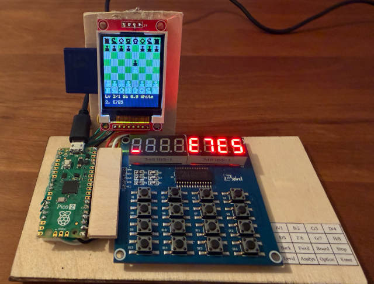
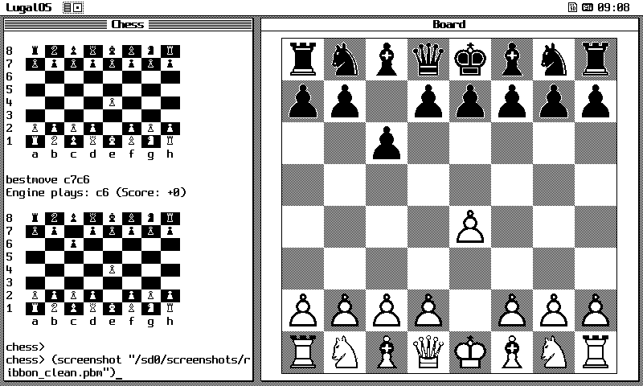
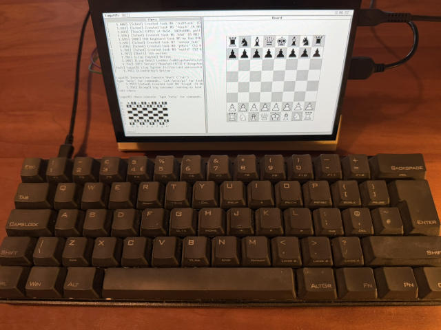
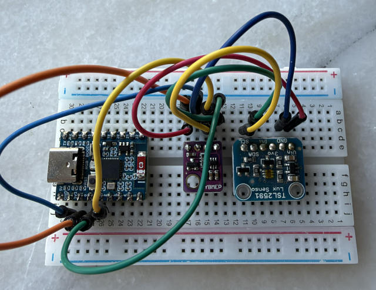
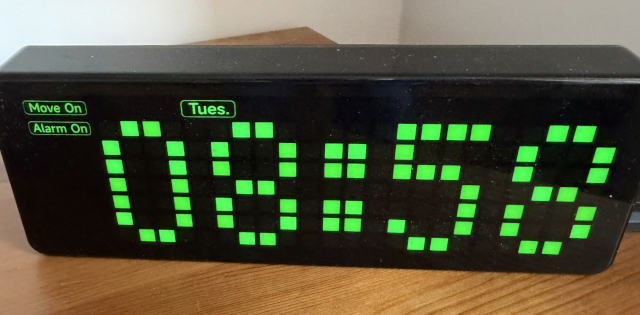

# LugalOS: Bare-Metal RISC-V Microkernel Operating System

[]()
[]()
[](LICENSE)

**LugalOS** is a bare-metal, capability-isolated microkernel operating system built for RISC-V microcontrollers and workstations. Inspired by the minimalism of Plan 9 and the power of classic Lisp machines, LugalOS features hardware-enforced memory domains, copy-always message channels, an exact Computer Algebra System (CAS), on-device C compilation, and a horizontal tiling window ribbon.

---

## Hardware Gallery & Presets Showcase

<div align="center">

| Dedicated Chess Appliance | Horizontal Window Ribbon (7" LCD) |
| :---: | :---: |
|  |  |
| *RP2350 Hazard3 dual-core with ST7735 color TFT, TM1638 keypad, and opening book.* | *RP2350-LCD-7 horizontal window ribbon with split-screen shell, graphical canvases, and status bar.* |

| Waveshare ESP32-P4-WIFI6-Touch-LCD-7B | Waveshare ESP32-C6-Zero Wireless Node |
| :---: | :---: |
|  |  |
| *400 MHz dual-core RV32, 1024×600 MIPI-DSI, GT911 touch, 32 MB PSRAM, USB host.* | *160 MHz RV32IMAC, 512 KB SRAM, 802.11ax Wi-Fi 6, BME280 & TSL2591 telemetry.* |

| Waveshare Pico-Clock-Green Radio Clock | Z-Machine & Canvas Auto-Mapper |
| :---: | :---: |
|  |  |
| *RP2350 with SM16106 LED matrix, DCF77 longwave radio receiver, and hardware RTC.* | *Infocom Version 3 interpreter with real-time directed graph room mapper on the window ribbon.* |

</div>

---

## Key Capabilities at a Glance

* **Capability-Enforced Microkernel Core**: Preemptive multitasking with hardware-enforced per-task memory domains—Physical Memory Protection (PMP) on NOMMU microcontrollers, Sv39 page tables on RV64—strictly confining drivers and user programs.
* **Driver Tasks Confined to PMP Windows**: UART, native USB CDC dual-ACM, SD/SPI block storage, I2C bus controllers, TFT canvas, and TM1638 drivers each run as separate U-mode tasks. A fault in one driver cannot corrupt the kernel or another driver.
* **Dual-Core SMP Acceleration**: Both cores of the RP2350 (Hazard3) and ESP32-P4 run a shared scheduler. The chess engine achieves a **1.96×** speedup on move generation (`perft`) and **1.60×** on Lazy SMP alpha-beta search.
* **Exact Symbolic Computer Algebra System (CAS)**: Complete symbolic mathematics in pure Lisp without floating-point instructions: arbitrary-precision bignums, exact rationals $\mathbb{Q}$, Gaussian rationals $\mathbb{Q}(i)$, polynomial factorization, symbolic calculus, and power series.
* **Plan 9 IPC & 9P Filesystem Networking**: Copy-always channels (`chan_t`) as the core IPC primitive. Serves and consumes 9P2000 filesystems over USB CDC-ACM, SLIP, and TCP. Sync files directly to running MicroSD cards without removing media via `tools/p9sync.py`.
* **On-Device C11 Compilation & Binary Execution**: Native `chibicc` C11 compiler generates RISC-V ELF binaries directly on the microcontroller, executed as confined U-mode tasks.
* **Zero Floating-Point in Kernel / M-Mode**: Boot code enforces `mstatus.FS = 0`. All mathematics, sensor scaling, and graphical coordinates use pure fixed-point or exact integer math.
* **Zero SRAM Builtin Footprint**: Symbols, primitives, and standard library catalogs reside in Flash `.rodata` tables sorted for $O(\log N)$ binary search, keeping SRAM free for applications.

---

## Supported Hardware Presets

| Preset Name | Architecture | SoC / Board | Clock | RAM & Cache | Display & UI | Storage & Net | Role |
| :--- | :--- | :--- | :--- | :--- | :--- | :--- | :--- |
| **`rp2350-terminal`** | RV32 Hazard3 | Waveshare RP2350-LCD-7 | 150 MHz | 520 KB SRAM + 8 MB PSRAM | 7" 800×480 RGB LCD, GT911 Touch | SD/SPI, Dual CDC USB | Workstation Terminal |
| **`esp32p4-lcd7b`** | RV32 Dual-Core | ESP32-P4-WIFI6-LCD-7B (rev v3.2) | 400 MHz | 768 KB L2MEM + 32 MB PSRAM | 7" 1024×600 MIPI-DSI, GT911 Touch | SDMMC, USB Host, Wi-Fi 6 | High-Perf Ribbon Workstation |
| **`esp32p4-tab5`** | RV32 Dual-Core | M5Stack Tab5 (rev v1.3) | 360–400 MHz | 768 KB L2MEM + 32 MB PSRAM | 5" 720×1280 MIPI-DSI, ST7121 Touch | SDMMC, USB Host, Dual Expander | 5" Portable Tablet / Reader |
| **`esp32p4`** | RV32 Dual-Core | ESP32-P4-NANO (rev v1.3) | 360–400 MHz | 768 KB L2MEM + 32 MB PSRAM | Serial Console (921600 baud) | RMII Ethernet, SDMMC | Microkernel Compute Node |
| **`esp32c6`** | RV32IMAC | Waveshare ESP32-C6-Zero | 160 MHz | 512 KB SRAM, 8 MB Flash | Serial / JTAG Console | 802.11ax Wi-Fi, Flashfs | Low-Power Wireless Node |
| **`rp2350-chess`** | RV32 Hazard3 | Raspberry Pi Pico 2 | 150 MHz | 520 KB SRAM | 1.8" ST7735 TFT, TM1638 Keypad | SD/SPI card | Dedicated Chess Computer |
| **`rp2350-clock`** | RV32 Hazard3 | Waveshare Pico-Clock-Green | 150 MHz | 520 KB SRAM | SM16106 LED Matrix | DCF77 Radio, RTC | Precision Network Time Node |
| **`rp2350-gateway`** | RV32 Hazard3 | Raspberry Pi Pico 2 | 150 MHz | 520 KB SRAM | Serial Console | ENC28J60 Ethernet, USB 9P | Network Gateway Node |
| **`rp2350-wifi`** | RV32 Hazard3 | Raspberry Pi Pico 2 W | 150 MHz | 520 KB SRAM | Serial Console | CYW43439 Wi-Fi (802.11n) | Wireless IoT Node |
| **`rv32`** | RV32 NOMMU | QEMU `virt` machine | Emulated | 128 MB RAM | VirtIO Console | VirtIO Blk, VirtIO Net | 32-bit Microkernel CI Target |
| **`rv64`** | RV64 Sv39 MMU| QEMU `virt` machine | Emulated | 128 MB RAM | VirtIO Console | VirtIO Blk, VirtIO Net | 64-bit Virtual Memory Target |
| **`rv64-smp`** | RV64 SMP | QEMU `virt` (2 harts) | Emulated | 128 MB RAM | VirtIO Console | VirtIO Blk, VirtIO Net | Multicore SMP CI Target |

---

## 5-Minute Quickstart

### Prerequisites
* Toolchains: `riscv32-unknown-elf-gcc` or `riscv64-unknown-elf-gcc`
* Build Tools: `cmake`, `ninja`, Python 3.11+ (with `uv`)
* Virtualization: `qemu-system-riscv32`, `qemu-system-riscv64`

### 1. Build and Run in QEMU
```bash
# Configure and build the 64-bit virtual memory target
cmake --preset rv64
ninja -C build/rv64

# Run automated QEMU test suite
python3 tests/runner.py

# Launch interactive QEMU shell
ninja -C build/rv64 run
```

### 2. Build and Flash Connected Hardware
```bash
# Example: Flash Waveshare RP2350 7" Terminal
ninja -C build/rp2350-terminal
picotool load -f build/rp2350-terminal/lugalos.uf2 -x

# Example: Flash Waveshare ESP32-P4 7" Touch Terminal
ninja -C build/esp32p4-lcd7b
python3 tools/p4flash.py --board lcd7b --build build/esp32p4-lcd7b --only boot,os --verify

# Example: Flash M5Stack Tab5 5" Portable Tablet
ninja -C build/esp32p4-tab5
python3 tools/p4flash.py --board tab5 --build build/esp32p4-tab5 --only boot,os --verify
```

---

## Microkernel Architecture Overview

```
┌────────────────────────────────────────────────────────────────────────┐
│                        USER SPACE APPLICATIONS                         │
│   lsh (Shell)   •   Lisp REPL / CAS   •   e / ed (Editors)   •   Chess │
│   chibicc (C Compiler)   •   User ELFs (Confined PMP / Sv39 Domains)   │
└───────────────────────────────────┬────────────────────────────────────┘
                                    │ System Calls (Pointer Validation)
┌───────────────────────────────────▼────────────────────────────────────┐
│                    ISOLATED U-MODE DRIVER DOMAINS                      │
│   UART0 Console   •   USB CDC ACM   •   SD/SPI Storage   •   I2C RTC   │
│   ST7735 TFT      •   TM1638 Keypad •   LCD Scanout DMA  •   Ethernet  │
└───────────────────────────────────┬────────────────────────────────────┘
                                    │ Copy-Always Message Channels
┌───────────────────────────────────▼────────────────────────────────────┐
│                       LUGALOS MICROKERNEL CORE                         │
│   Preemptive / Priority Scheduler • Cross-Hart SMP Lock Hand-off (amoswap)│
│   Physical Page Allocator (palloc)• Bulk PSRAM Zone  • VFS / DevFS     │
│   Tokenized Dictionary Logger     • PMP / Sv39 Hardware Memory Manager │
└────────────────────────────────────────────────────────────────────────┘
```

---

## Comprehensive Documentation Portal

LugalOS maintains structured, in-depth documentation under [`doc/`](doc/):

* **[About LugalOS](doc/about.md)**: Architectural overview, hardware specifications, and system concepts.
* **[User Manual](doc/user/index.md)**:
  * [Shell & Command Environment](doc/user/shell.md)
  * [Text Editors: Full-Screen & Line Editors](doc/user/editors.md)
  * [Window Ribbon & Terminal System](doc/user/ribbon.md)
  * [LugalOS Chess Computer](doc/user/chess.md)
  * [Computer Algebra System (CAS)](doc/user/cas.md)
  * [Environmental Sensors & MQTT Telemetry](doc/user/sensors.md)
* **[Administrator Manual](doc/admin/index.md)**:
  * [Hardware Presets Matrix](doc/admin/presets.md)
  * [Firmware Flashing Guide](doc/admin/flashing.md)
  * [Consoles, Serial Ports & Modem Control](doc/admin/consoles.md)
  * [Plan 9 Networking & Host Integration](doc/admin/networking.md)
  * [Identity, Authentication & Security](doc/admin/identity.md)
  * [Storage & Filesystems](doc/admin/storage.md)
  * [Target Hardware & Board Reference Guides](doc/admin/boards/index.md)
* **[System Programmer Manual](doc/dev/index.md)**:
  * [On-Device C Programming & Syscalls](doc/dev/on_device/c_programming.md)
  * [Lisp Dialect, Primitives & Scripting](doc/dev/on_device/lisp_scripting.md)
  * [Microkernel Architecture & Memory Domains](doc/dev/kernel/architecture.md)
  * [Scheduler & SMP Multicore Locking](doc/dev/kernel/scheduler.md)
  * [Tokenized Kernel Logging Macro System](doc/dev/kernel/logging.md)
  * [Confined Driver Framework](doc/dev/kernel/drivers.md)
  * [Board Bringup & Porting Guide](doc/dev/kernel/porting.md)
  * [Testing Guide & QA Framework](doc/dev/testing.md)
* **[Architecture Decision Records (ADRs)](doc/history/adr/index.md)**:
  * Context, decisions, and trade-offs behind core design choices.
* **[Agent & Developer Guide (`AGENTS.md`)](AGENTS.md)**:
  * Strict rules, coding standards, hardware TTY mappings, and invariants for AI agents.

---

## How this was build

This project was implemented with the help of AI agents:

- Anthropic Claude Code (mostly Opus 5.5)
- Google Antigravity (mostly Gemini 3.8 Flash)
- Pi (Qwen3.8 Flash Next)

## License & Acknowledgments

LugalOS is licensed under the [MIT License](LICENSE).  
Copyright © 2026 Dominik Schloesser and LugalOS Contributors.
