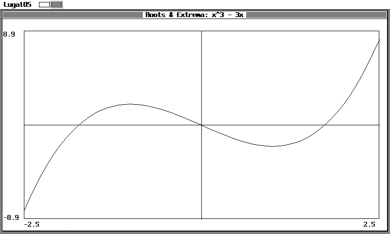
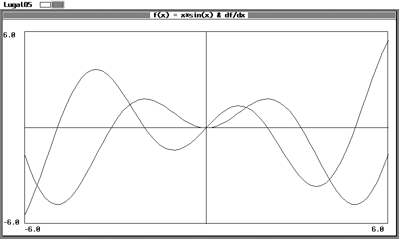
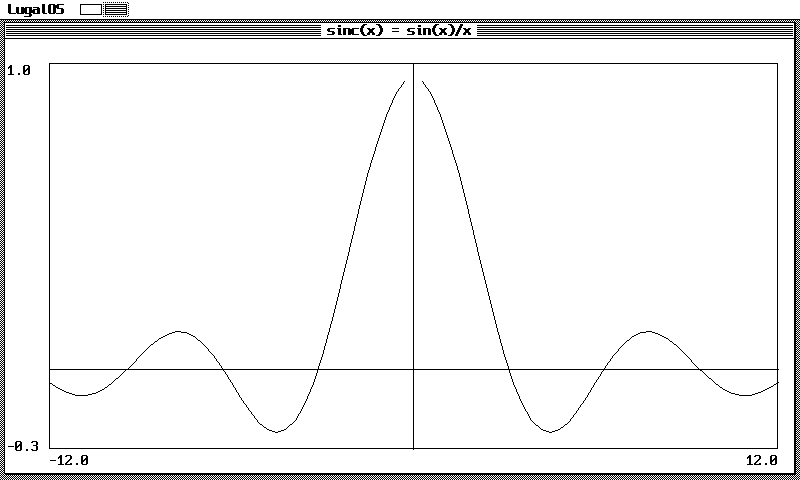
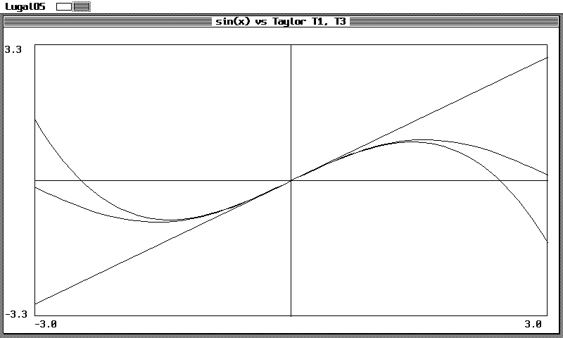
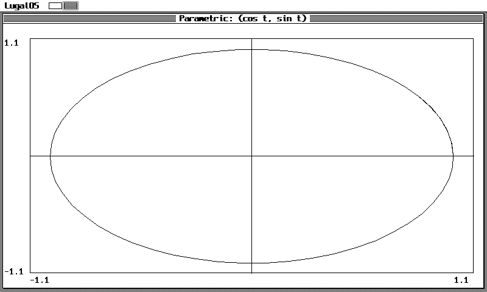

q# LugalOS Computer Algebra System (CAS) — Student & User Manual

LugalOS features a self-contained, exact Computer Algebra System (CAS) written in compact Scheme-like Lisp. It runs in freestanding, zero-floating-point environments across RISC-V microcontrollers (such as the RP2350 Hazard3 and ESP32-P4) and virtual machines.

All computations are carried out using exact algebraic techniques: exact integers, arbitrary-precision bignums, exact rationals $\mathbb{Q}$, exact Gaussian rationals $\mathbb{Q}(i)$, and symbolic expressions.

---

## Table of Contents

1. [System Startup & Interaction Modes](#1-system-startup--interaction-modes)
2. [Exact Numbers & Canonical Algebraic Simplification](#2-exact-numbers--canonical-algebraic-simplification)
3. [Polynomial Algebra & Factorization](#3-polynomial-algebra--factorization)
4. [Exact Equation Solving](#4-exact-equation-solving)
5. [Partial Fraction Decomposition (`apart`)](#5-partial-fraction-decomposition-apart)
6. [Symbolic Differentiation & Integration](#6-symbolic-differentiation--integration)
7. [Symbolic Limits & Limes (`limit`, `limes`)](#7-symbolic-limits--limes-limit-limes)
8. [Taylor Series & Laurent Expansions (`taylor`)](#8-taylor-series--laurent-expansions-taylor)
9. [Trigonometric, Hyperbolic & Exponential Transformations](#9-trigonometric-hyperbolic--exponential-transformations)
10. [Exact Linear Algebra over $\mathbb{R}$ and $\mathbb{C}$](#10-exact-linear-algebra-over-mathbfr-and-mathbbc)
11. [Natural Infix Calculator Mode](#11-natural-infix-calculator-mode)
12. [Mathematical Plotting & Canvas Visualization (`plot`)](#12-mathematical-plotting--canvas-visualization-plot)
13. [Quick Reference Summary](#13-quick-reference-summary)

---

## 1. System Startup & Interaction Modes

### Mathematical & Architectural Background
In modern computer algebra systems, expressions are structured as tree graphs known as **Abstract Syntax Trees (AST)**. In LugalOS Lisp, every mathematical expression is represented as a prefix S-expression (e.g., $x^2 + 2x + 1$ is `(+ (^ x 2) (* 2 x) 1)`).

Because the kernel operates in RISC-V Machine-Mode with the hardware floating-point unit disabled (`mstatus.FS = 0`), no IEEE 754 floats are permitted. All arithmetic is mathematically exact:
* Rational numbers $\mathbb{Q}$: represented as exact pairs of coprime integers `numerator/denominator`.
* Gaussian rationals $\mathbb{Q}(i)$: exact complex numbers $a + bi$ where $a, b \in \mathbb{Q}$.
* Pure fixed-point scaling: avoids rounding errors and illegal instruction exceptions.

### Loading the CAS
From the LugalOS interactive shell (`lsh`), launch the Lisp REPL and load the CAS loader:

```lisp
lsh> lisp
lisp> (load "/sd0/cas/cas.lisp")
=> #t
```

> [!NOTE]
> If booted from flash without an SD card mounted, `cas.lisp` automatically resolves to `/flash0/cas/cas.lisp`.

You can leave the Lisp REPL at any time to return to `lsh` using `(exit)` or `(quit)`:
```lisp
lisp> (exit)
lsh>
```

---

## 2. Exact Numbers & Canonical Algebraic Simplification

### Mathematical Background
An algebraic expression can be written in infinitely many equivalent forms (e.g. $x + x$, $2x$, $3x - x$). A computer algebra system establishes a **canonical form** by applying a confluent term-rewriting system:
* **Total Ordering:** Subexpressions are strictly sorted in lexicographical order (constants $\prec$ symbols $\prec$ compounds).
* **Identity Reduction:** $x + 0 \to x$, $x \cdot 1 \to x$, $x \cdot 0 \to 0$, $x^1 \to x$, $x^0 \to 1$.
* **Like-Term Collection:** $c_1 u + c_2 u \to (c_1 + c_2) u$.
* **Constant Folding:** Arithmetic over $\mathbb{Q}$ and $\mathbb{Q}(i)$ is evaluated immediately.
* **Radical Simplification:** $\sqrt{a^2 b} \to |a| \sqrt{b}$ and $\sqrt{-c} \to i \sqrt{c}$ for $c > 0$.

### Available Commands

| Function | Signature | Description |
| :--- | :--- | :--- |
| `simplify` | `(simplify expr)` | Reduces `expr` to its irreducible canonical form. |
| `expand` | `(expand expr)` | Recursively distributes multiplications over additions $(a+b)(c+d)$. |
| `cas-real-part` | `(cas-real-part expr)` | Extracts the real component $\text{Re}(z)$ of an expression. |
| `cas-imag-part` | `(cas-imag-part expr)` | Extracts the imaginary component $\text{Im}(z)$ of an expression. |
| `cas-conjugate` | `(cas-conjugate expr)` | Computes the complex conjugate $z^* = a - bi$. |
| `cas-complex-abs`| `(cas-complex-abs expr)` | Computes the exact absolute value $|z| = \sqrt{a^2 + b^2}$. |

### Usage Examples

```lisp
;; Like-term collection and arithmetic over Q
(simplify '(+ (* 3 x) (* 2 x) 5 -2))
;; => (+ 3 (* 5 x))

;; Distribution and expansion
(expand '(* (+ x 1) (+ x -1)))
;; => (+ -1 (^ x 2))

;; Exact radical reduction
(simplify '(sqrt 72))
;; => (* 6 (sqrt 2))

;; Imaginary radicals over C
(simplify '(sqrt -4))
;; => (* 2 i)

(simplify '(sqrt -18))
;; => (* 3 i (sqrt 2))

;; Complex numbers and conjugate operations
(cas-real-part '(+ 3 (* 4 i)))
;; => 3

(cas-imag-part '(+ 3 (* 4 i)))
;; => 4

(cas-conjugate '(+ 3 (* 4 i)))
;; => (+ 3 (* -4 i))

(cas-complex-abs '(+ 3 (* 4 i)))
;; => 5
```

---

## 3. Polynomial Algebra & Factorization

### Mathematical Background
Let $R$ be a field ($\mathbb{Q}$ or $\mathbb{C}$) and $R[x]$ the ring of polynomials in variable $x$.
* **Euclidean Division:** For polynomials $A(x), B(x)$ with $B \neq 0$, there exist unique quotient $Q(x)$ and remainder $R(x)$ such that:
  $$A(x) = B(x) Q(x) + R(x), \quad \text{with } \deg(R) < \deg(B)$$
* **Rational Root Theorem (Gauss's Lemma):** For $P(x) = a_n x^n + \dots + a_0 \in \mathbb{Z}[x]$, any rational root $p/q$ satisfies $p \mid a_0$ and $q \mid a_n$.
* **Factorization over $\mathbb{C}$:** By the Fundamental Theorem of Algebra, any non-zero polynomial factors completely into linear factors over the complex numbers:
  $$P(x) = a_n \prod_{k=1}^n (x - z_k)$$

### Available Commands

| Function | Signature | Description |
| :--- | :--- | :--- |
| `poly-degree` | `(poly-degree p var)` | Returns the degree $\deg(P)$ with respect to `var`. |
| `poly-lead-coeff`| `(poly-lead-coeff p var)`| Returns the leading coefficient $a_n$. |
| `poly-div` | `(poly-div num den var)` | Performs polynomial long division; returns `(list quotient remainder)`. |
| `poly-factor` | `(poly-factor p var)` | Factors $P(x)$ into irreducible components over $\mathbb{Q}$ and $\mathbb{R}$. |
| `poly-factor-complex` | `(poly-factor-complex p var)` | Factors $P(x)$ completely into linear factors over $\mathbb{C}$. |

### Usage Examples

```lisp
;; Polynomial division: (x^3 - 1) / (x - 1)
(poly-div '(+ (^ x 3) -1) '(+ x -1) 'x)
;; => ((+ 1 x (^ x 2)) 0)

;; Polynomial division with remainder: (x^2 + 2x + 3) / (x + 1)
(poly-div '(+ (^ x 2) (* 2 x) 3) '(+ x 1) 'x)
;; => ((+ 1 x) 2)

;; Factorization over Q (irreducible quadratic left as-is)
(poly-factor '(+ (^ x 3) -1) 'x)
;; => (* (+ -1 x) (+ 1 x (^ x 2)))

(poly-factor '(+ (^ x 4) -1) 'x)
;; => (* (+ -1 x) (+ 1 x) (+ 1 (^ x 2)))

;; Complete factorization over C into linear terms
(poly-factor-complex '(+ (^ x 2) 1) 'x)
;; => (* (+ i x) (+ (* -1 i) x))

(poly-factor-complex '(+ (^ x 4) -1) 'x)
;; => (* (+ -1 x) (+ 1 x) (+ (* -1 i) x) (+ i x))

(poly-factor-complex '(+ (^ x 2) (* 2 x) 2) 'x)
;; => (* (+ 1 i x) (+ 1 (* -1 i) x))
```

---

## 4. Exact Equation Solving

### Mathematical Background
The solver finds exact solutions to equations of the form $f(x) = 0$ or $f(x) = g(x)$:
* **Linear:** $ax + b = 0 \implies x = -b/a$.
* **Quadratic:** $ax^2 + bx + c = 0 \implies x = \frac{-b \pm \sqrt{b^2 - 4ac}}{2a}$. When discriminant $\Delta < 0$, roots are exact Gaussian values $p \pm q i$.
* **Cubic:** $ax^3 + bx^2 + cx + d = 0$. Reduces by finding exact rational roots and factoring into a quadratic, or applies the cubic formula.
* **Quartic:** $ax^4 + bx^3 + cx^2 + dx + e = 0$. Resolves biquadratic equations ($x^4 + ax^2 + b = 0$) or discovers rational roots.

### Available Commands

| Function | Signature | Description |
| :--- | :--- | :--- |
| `solve` | `(solve equation var)` | Master equation solver. Accepts `(= lhs rhs)` or implicit `lhs = 0`. |
| `solve-quadratic`| `(solve-quadratic eq var)` | Solves quadratic equations over $\mathbb{R}$ and $\mathbb{C}$. |
| `solve-cubic` | `(solve-cubic eq var)` | Solves cubic equations over $\mathbb{R}$ and $\mathbb{C}$. |
| `solve-quartic` | `(solve-quartic eq var)` | Solves quartic equations over $\mathbb{R}$ and $\mathbb{C}$. |

### Usage Examples

```lisp
;; Linear equation: 2x - 6 = 0
(solve '(= (+ (* 2 x) -6) 0) 'x)
;; => ((x . 3))

;; Quadratic with complex conjugate roots: x^2 + 1 = 0
(solve '(= (+ (^ x 2) 1) 0) 'x)
;; => ((x * -1 i) (x . i))

;; Quadratic with shifted complex roots: x^2 + 2x + 2 = 0
(solve '(= (+ (^ x 2) (* 2 x) 2) 0) 'x)
;; => ((x + -1 (* -1 i)) (x + -1 i))

;; Cubic equation: x^3 - 6x^2 + 11x - 6 = 0  (roots: 1, 2, 3)
(solve '(= (+ (^ x 3) (* -6 (^ x 2)) (* 11 x) -6) 0) 'x)
;; => ((x . 1) (x . 2) (x . 3))

;; Quartic equation over C: x^4 - 1 = 0
(solve '(= (+ (^ x 4) -1) 0) 'x)
;; => ((x . 1) (x . -1) (x . i) (x * -1 i))
```

### Graphical Visualization: Polynomial Roots & Critical Points
Solving polynomials algebraically corresponds geometrically to finding zero crossings along the real axis. In addition, finding the roots of the derivative $f'(x) = 0$ identifies the function's local extrema (peaks and valleys).

Consider the cubic polynomial $f(x) = x^3 - 3x$:
* **Roots:** Factoring $x^3 - 3x = x(x^2 - 3) = 0$ yields exact roots at $x = 0$ and $x = \pm\sqrt{3} \approx \pm 1.732$.
* **Extrema:** $f'(x) = 3x^2 - 3 = 0 \implies x = \pm 1$, with local maximum at $(-1, 2)$ and local minimum at $(1, -2)$.



*Figure 4.1: Real roots and extrema of $f(x) = x^3 - 3x$ plotted on an 800×480 LugalOS canvas ribbon.*

To graph this cubic function across the full screen:
```lisp
(load "/sd0/cas/plot.lisp")
(plot "x^3 - 3*x" '(x -5/2 5/2)
      '((title . "Roots & Extrema: x^3 - 3x") (samples . 60) (layout . canvas)))
```

---

## 5. Partial Fraction Decomposition (`apart`)

### Mathematical Background
Given a rational function $f(x) = \frac{P(x)}{Q(x)}$ with $\deg(P) < \deg(Q)$, the partial fraction decomposition expresses $f(x)$ as a sum of elementary fractions over the prime factors of $Q(x)$:
$$\frac{P(x)}{(x - r_1)(x - r_2) \cdots} = \sum_{j} \frac{A_j}{x - r_j}$$

* **Heaviside Cover-Up Method:** For distinct linear factors $(x - r_k)$, the coefficient is evaluated as:
  $$A_k = \lim_{x \to r_k} (x - r_k) \frac{P(x)}{Q(x)}$$
* **Evaluation & Interpolation:** For higher-degree and repeated factors, LugalOS evaluates basis cofactor polynomials at sample points to solve undetermined coefficients through exact Gauss-Jordan elimination without ballooning the symbolic AST.

### Available Commands

| Function | Signature | Description |
| :--- | :--- | :--- |
| `apart` | `(apart expr [var])` | Computes the partial fraction decomposition of a rational function. |

### Usage Examples

```lisp
;; Simple decomposition: 1 / (x^2 - 1) = 1/2/(x - 1) - 1/2/(x + 1)
(apart '(/ 1 (+ (^ x 2) -1)) 'x)
;; => (+ (* 1/2 (^ (+ -1 x) -1)) (* -1/2 (^ (+ 1 x) -1)))

;; Cubic denominator: 1 / (x^3 - x)
(apart '(/ 1 (+ (^ x 3) (* -1 x))) 'x)
;; => (+ (* -1 (^ x -1)) (* 1/2 (^ (+ -1 x) -1)) (* 1/2 (^ (+ 1 x) -1)))

;; Quartic denominator: 1 / (x^4 - 5x^2 + 4) = 1 / ((x-1)(x+1)(x-2)(x+2))
(apart '(/ 1 (+ (^ x 4) (* -5 (^ x 2)) 4)) 'x)
;; => (+ (* -1/6 (^ (+ -1 x) -1)) (* 1/6 (^ (+ 1 x) -1)) (* 1/12 (^ (+ -2 x) -1)) (* -1/12 (^ (+ 2 x) -1)))
```

---

## 6. Symbolic Differentiation & Integration

### Mathematical Background
* **Differentiation:** Implements formal differentiation rules in the differential algebra of rational and transcendental functions:
  * Sum Rule: $(u + v)' = u' + v'$
  * Product Rule: $(uv)' = u'v + uv'$
  * Quotient Rule: $(u/v)' = (u'v - uv')/v^2$
  * Chain Rule: $f(g(x))' = f'(g(x)) \cdot g'(x)$
* **Integration:** Computes indefinite integrals $\int f(x) dx$ and definite integrals $\int_a^b f(x) dx$:
  * Rational functions: decomposes via `apart` and integrates into logarithmic and arctangent forms ($\int \frac{1}{x^2+a^2} dx = \frac{1}{a} \arctan(x/a)$).
  * Integration by Parts: $\int u v' dx = uv - \int u' v dx$ for products $x^n e^{ax}$, $x^n \cos(ax)$, $x^n \sin(ax)$, $x^n \ln(x)$.
  * Fundamental Theorem of Calculus: $\int_a^b f(x) dx = F(b) - F(a)$.

### Available Commands

| Function | Signature | Description |
| :--- | :--- | :--- |
| `diff` | `(diff expr var [order])` | Computes the $n$-th derivative $\frac{d^n}{dx^n} f(x)$ (default order = 1). |
| `integrate` | `(integrate expr var)` | Computes the indefinite integral $\int f(x) dx$ (omits constant $+ C$). |
| `integrate-def` | `(integrate-def expr var a b)` | Computes the definite integral $\int_a^b f(x) dx$. |

### Supported Functions
`sin`, `cos`, `tan`, `asin`, `acos`, `atan`, `sinh`, `cosh`, `tanh`, `exp`, `log` ($\ln$), `sqrt`, `abs`, and polynomial powers `^`.

### Usage Examples

```lisp
;; First and second derivatives
(diff '(sin (* 2 x)) 'x)
;; => (* 2 (cos (* 2 x)))

(diff '(sin (* 2 x)) 'x 2)
;; => (* -4 (sin (* 2 x)))

;; Hyperbolic derivatives
(diff '(sinh x) 'x)
;; => (cosh x)

(diff '(tanh x) 'x)
;; => (+ 1 (* -1 (^ (tanh x) 2)))

;; Product and chain rule
(diff '(* (^ x 2) (exp x)) 'x)
;; => (+ (* 2 x (exp x)) (* (^ x 2) (exp x)))

;; Integration by parts: \int x * exp(x) dx
(integrate '(* x (exp x)) 'x)
;; => (* (exp x) (+ -1 x))

;; Rational function integration: \int 1 / (x^2 + 1) dx = atan(x)
(integrate '(/ 1 (+ (^ x 2) 1)) 'x)
;; => (atan x)

;; Definite integration: \int_0^1 x^2 dx = 1/3
(integrate-def '(^ x 2) 'x 0 1)
;; => 1/3
```

### Graphical Visualization: Function vs. Symbolic Derivative (`plot-diff`)
Understanding the relationship between a function $f(x)$ and its derivative $f'(x)$ is central to calculus. When $f'(x) > 0$, the function is strictly increasing; when $f'(x) = 0$, the function reaches a horizontal tangent or critical point; and when $f'(x) < 0$, the function is strictly decreasing.

LugalOS provides `plot-diff`, which symbolically computes the exact derivative $f'(x) = \frac{d}{dx}f(x)$ using CAS differentiation rules and renders both curves side by side on shared coordinate axes.

Consider $f(x) = x \sin(x)$:
* Product rule: $f'(x) = \frac{d}{dx}[x] \cdot \sin(x) + x \cdot \frac{d}{dx}[\sin(x)] = \sin(x) + x \cos(x)$.



*Figure 6.1: The function $f(x) = x \sin(x)$ plotted alongside its symbolic derivative $f'(x) = \sin(x) + x \cos(x)$ on $x \in [-6, 6]$.*

To plot a function and its symbolic derivative across the full screen:
```lisp
(load "/sd0/cas/plot.lisp")
(plot-diff "x*sin(x)" '(x -6 6)
           '((title . "f(x) = x*sin(x) & df/dx") (samples . 70) (layout . canvas)))
```

---

## 7. Symbolic Limits & Limes (`limit`, `limes`)

### Mathematical Background
The limit $\lim_{x \to x_0} f(x)$ models the behavior of a function near a point $x_0$:
* **Continuous Points:** If $D(x_0) \neq 0$, the limit is simply $f(x_0)$.
* **Removable Singularities ($0/0$):** Synthetic division cancels common $(x - x_0)$ factors algebraically.
* **L'Hôpital's Rule:** For indeterminate forms $0/0$ and $\infty/\infty$, derivatives of numerator and denominator are taken recursively:
  $$\lim_{x \to x_0} \frac{N(x)}{D(x)} = \lim_{x \to x_0} \frac{N'(x)}{D'(x)}$$
* **Vertical Poles & Directional Limits:** A rational pole $x_0$ yields directional limits $+\infty$, $-\infty$, or `undefined` (if left and right limits disagree).
* **Limits at Infinity ($\pm\infty$):** Evaluated by degree ratio for polynomials, or via substitution $x = 1/u$ as $u \to 0^+$.

### Available Commands

| Function | Signature | Description |
| :--- | :--- | :--- |
| `limit` | `(limit expr var point [dir])` | Evaluates the limit $\lim_{x \to point} expr$. |
| `limes` | `(limes expr var point [dir])` | Alias for `limit`. |

**Direction Arguments (`dir`):**
* `'right` (or `'+`, `'>`): Approaching from the right ($x \to x_0^+$).
* `'left` (or `'-`, `'<`): Approaching from the left ($x \to x_0^-$).
* `'two-sided` (default): True two-sided limit; returns `'undefined` if $\lim_{x \to x_0^+} \neq \lim_{x \to x_0^-}$.

**Special Points:**
`'infinity` (or `'inf`, `'+inf`), `'-infinity` (or `'-inf`).

### Usage Examples

```lisp
;; Removable algebraic singularity: (x^2 - 1) / (x - 1) as x -> 1
(limit '(/ (+ (^ x 2) -1) (+ x -1)) 'x 1)
;; => 2

;; Transcendental L'Hopital 0/0: sin(x) / x as x -> 0
(limit '(/ (sin x) x) 'x 0)
;; => 1

;; Higher order 0/0: (1 - cos(x)) / x^2 as x -> 0
(limit '(/ (- 1 (cos x)) (^ x 2)) 'x 0)
;; => 1/2

;; Exponential 0/0: (exp(x) - 1) / x as x -> 0
(limit '(/ (+ (exp x) -1) x) 'x 0)
;; => 1

;; Directional limits at vertical pole 1/x at 0
(limit '(/ 1 x) 'x 0 'right)
;; => infinity

(limit '(/ 1 x) 'x 0 'left)
;; => -infinity

(limit '(/ 1 x) 'x 0)
;; => undefined

;; Even pole: 1/x^2 at 0
(limit '(/ 1 (^ x 2)) 'x 0)
;; => infinity

;; Limit at infinity: (3x^2 + 1) / (2x^2 - 5) as x -> +inf
(limit '(/ (+ (* 3 (^ x 2)) 1) (+ (* 2 (^ x 2)) -5)) 'x 'infinity)
;; => 3/2
```

### Graphical Visualization: Removable Discontinuity & Limits (`plot`)
A fundamental triumph of calculus is resolving indeterminate forms such as $0/0$. The cardinal sine function $\text{sinc}(x) = \frac{\sin x}{x}$ is undefined under naive arithmetic evaluation at $x = 0$. However, L'Hôpital's rule and Taylor expansion prove that the limit is well-defined and equals 1:
$$\lim_{x \to 0} \frac{\sin x}{x} = \lim_{x \to 0} \frac{\cos x}{1} = 1$$

LugalOS's plotting engine evaluates removable singularities cleanly using CAS limit rules and continuous rational approximations, rendering a smooth curve without divide-by-zero crashes.



*Figure 7.1: The sinc function $f(x) = \frac{\sin x}{x}$ plotted across $x \in [-12, 12]$, smoothly crossing the removable singularity at $(0, 1)$.*

To plot this function across the full screen:
```lisp
(load "/sd0/cas/plot.lisp")
(plot "sin(x)/x" '(x -12 12)
      '((title . "sinc(x) = sin(x)/x") (samples . 80) (layout . canvas)))
```

---

## 8. Taylor Series & Laurent Expansions (`taylor`)

### Mathematical Background
* **Taylor / Maclaurin Series:** Represents an analytic function as a power series around $x_0$:
  $$f(x) = \sum_{k=0}^{n} \frac{f^{(k)}(x_0)}{k!} (x - x_0)^k + \mathcal{O}((x - x_0)^{n+1})$$
* **Laurent Series for Meromorphic Functions:** When $f(x)$ has a pole of order $p$ at $x_0$, it cannot be evaluated directly by derivative substitution due to division by zero. LugalOS uses a **pole factoring algorithm**:
  $$f(x) = \frac{N(x)}{D(x)} = \frac{1}{(x - x_0)^p} \frac{N(x)}{D_{\text{rem}}(x)}$$
  The regular part $g(x) = \frac{N(x)}{D_{\text{rem}}(x)}$ is analytic at $x_0$. Expanding $g(x)$ to order $n+p$ and multiplying by $(x - x_0)^{-p}$ yields:
  $$f(x) = \sum_{k=-p}^{n} c_k (x - x_0)^k$$
  - Terms with $k < 0$ form the **principal part** (poles).
  - Terms with $k = 0$ give the constant term.
  - Removable singularities ($0/0$) have $p \le \text{order}(N)$, leaving pure non-negative powers automatically!

### Available Commands

| Function | Signature | Description |
| :--- | :--- | :--- |
| `taylor` | `(taylor expr var order [center])` | Computes the Taylor or Laurent series expansion up to degree `order` around `center` (default `center = 0`). |

### Usage Examples

```lisp
;; Standard Maclaurin series of exp(x) to order 3
(taylor '(exp x) 'x 3)
;; => (+ 1 x (* 1/2 (^ x 2)) (* 1/6 (^ x 3)))

;; Maclaurin series of sin(x) to order 5
(taylor '(sin x) 'x 5)
;; => (+ x (* -1/6 (^ x 3)) (* 1/120 (^ x 5)))

;; Removable singularity: sin(x)/x at 0 (evaluated without 0/0 error!)
(taylor '(/ (sin x) x) 'x 3 0)
;; => (+ 1 (* -1/6 (^ x 2)))

;; Laurent expansion with order-1 pole: exp(x) / x at 0
(taylor '(/ (exp x) x) 'x 2 0)
;; => (+ 1 (* 1/2 x) (^ x -1) (* 1/6 (^ x 2)))
;; Note: (^ x -1) is 1/x (the principal pole term).

;; Expansion around non-zero real center: x^3 around x = 2
(taylor '(^ x 3) 'x 3 2)
;; => (+ 8 (* 12 (+ -2 x)) (* 6 (^ (+ -2 x) 2)) (^ (+ -2 x) 3))

;; Complex Laurent expansion around pole x = i: 1 / (x^2 + 1)
;; x^2 + 1 = (x - i)(x + i), pole of order 1 at i:
(taylor '(/ 1 (+ (^ x 2) 1)) 'x 1 'i)
;; => (+ 1/4 (* (* -1/2 i) (^ (+ (* -1 i) x) -1)) (* (* 1/8 i) (+ (* -1 i) x)))
```

### Graphical Visualization: Polynomial Convergence (`plot-multi`)
Taylor's theorem asserts that an analytic function can be approximated near an expansion point $x_0$ by its Taylor polynomials $T_n(x)$. As the degree $n$ increases, the polynomial matches progressively higher derivatives of the target function, expanding the neighborhood over which the polynomial closely resembles the transcendental curve.

Using `plot-multi`, you can graph a transcendental function alongside several of its symbolic Taylor polynomials on shared axes:
* Target function: $f(x) = \sin(x)$
* Linear tangent: $T_1(x) = x$
* Cubic approximation: $T_3(x) = x - \frac{x^3}{6}$



*Figure 8.1: $\sin(x)$ compared against its 1st-degree tangent $T_1(x) = x$ and 3rd-degree Taylor polynomial $T_3(x) = x - x^3/6$ across $x \in [-3, 3]$.*

To overlay these curves across the full screen:
```lisp
(load "/sd0/cas/plot.lisp")
(plot-multi (list '(sin x) 'x '(- x (/ (^ x 3) 6))) '(x -3 3)
            '((title . "sin(x) vs Taylor T1, T3") (samples . 70) (layout . canvas)))
```

---

## 9. Trigonometric, Hyperbolic & Exponential Transformations

### Mathematical Background
* **Pythagorean Identities:** $\sin^2(u) + \cos^2(u) = 1$ and $\cosh^2(u) - \sinh^2(u) = 1$.
* **Euler's Formula:** Connects trigonometry, hyperbolics, and exponentials over $\mathbb{C}$:
  $$e^{iu} = \cos(u) + i \sin(u), \quad e^{-iu} = \cos(u) - i \sin(u)$$
  $$\cos(u) = \frac{e^{iu} + e^{-iu}}{2}, \quad \sin(u) = \frac{e^{iu} - e^{-iu}}{2i}$$
  $$\cosh(u) = \frac{e^u + e^{-u}}{2}, \quad \sinh(u) = \frac{e^u - e^{-u}}{2}$$
* **Hyperbolic/Trigonometric Equivalence:**
  $$\sin(i u) = i \sinh(u), \quad \cos(i u) = \cosh(u), \quad \tan(i u) = i \tanh(u)$$
  $$\sinh(i u) = i \sin(u), \quad \cosh(i u) = \cos(u), \quad \tanh(i u) = i \tan(u)$$

### Available Commands

| Function | Signature | Description |
| :--- | :--- | :--- |
| `trig-simplify` | `(trig-simplify expr)` | Applies trigonometric identities: double angle, $1+\tan^2 u \to \sec^2 u$, $\cosh^2 u - \sinh^2 u \to 1$. |
| `to-exp` | `(to-exp expr)` | Converts trigonometric and hyperbolic functions to complex exponential form. |
| `to-trig` | `(to-trig expr)` | Rewrites complex exponentials $e^{iu}$ into trigonometric Cartesian form. |

### Usage Examples

```lisp
;; Pythagorean identity reduction
(simplify '(+ (^ (sin x) 2) (^ (cos x) 2)))
;; => 1

;; Hyperbolic identity reduction
(trig-simplify '(+ (^ (cosh x) 2) (* -1 (^ (sinh x) 2))))
;; => 1

;; Imaginary trigonometric transformations
(simplify '(sin (* i x)))
;; => (* i (sinh x))

(simplify '(cos (* i x)))
;; => (cosh x)

(simplify '(sinh (* i x)))
;; => (* i (sin x))

(simplify '(cosh (* i x)))
;; => (cos x)

;; Euler identities for exact angles
(simplify '(exp (* i pi)))
;; => -1

(simplify '(exp (* 1/2 (* i pi))))
;; => i

(simplify '(exp (* 2 (* i pi))))
;; => 1

;; Cartesian exponential splitting: e^(1 + i*pi) = -e
(simplify '(exp (+ 1 (* i pi))))
;; => (* -1 (exp 1))

;; Complex powers: i^i = e^(-pi/2)
(simplify '(^ i i))
;; => (exp (* -1/2 pi))

;; Converting trig expressions to complex exponentials
(to-exp '(cos x))
;; => (* 1/2 (+ (exp (* i x)) (exp (* -1 i x))))

;; Converting complex exponentials back to trig
(to-trig '(exp (* i x)))
;; => (+ (cos x) (* i (sin x)))
```

---

## 10. Exact Linear Algebra over $\mathbb{R}$ and $\mathbb{C}$

### Mathematical Background
Matrices and vectors are represented as lists of row lists (e.g. `((1 2) (3 4))`) or flat `LISP_VECTOR` buffers. Operations preserve exact arithmetic without numerical drift:
* **Determinant & Inversion:** Computed via Gaussian and Gauss-Jordan elimination on $[A | I]$ over $\mathbb{Q}$ and $\mathbb{Q}(i)$.
* **Hermitian Adjoint:** For complex matrix $A$, the conjugate transpose is $A^\dagger = (A^*)^T$.
* **Unitary & Hermitian Properties:**
  * Hermitian: $A = A^\dagger$.
  * Unitary: $A^\dagger A = I$ (preserves complex vector inner products $\langle u, v \rangle = u^\dagger v$).

### Available Commands

| Function | Signature | Description |
| :--- | :--- | :--- |
| `matrix-add`, `matrix-sub` | `(matrix-add A B)` | Matrix addition and subtraction. |
| `matrix-mul` | `(matrix-mul A B)` | Matrix multiplication. |
| `matrix-scale` | `(matrix-scale A s)` | Scalar multiplication. |
| `matrix-transpose` | `(matrix-transpose A)` | Matrix transpose $A^T$. |
| `matrix-det` | `(matrix-det A)` | Exact determinant $\det(A)$. |
| `matrix-inv` | `(matrix-inv A)` | Exact matrix inverse $A^{-1}$. |
| `matrix-solve` | `(matrix-solve A B)` | Solves linear matrix equation $A X = B$. |
| `vector-dot` | `(vector-dot u v)` | Standard dot product $\sum u_i v_i$. |
| `vector-cross` | `(vector-cross u v)` | 3D vector cross product $u \times v$. |
| `matrix-conjugate` | `(matrix-conjugate A)` | Element-wise complex conjugate $A^*$. |
| `matrix-adjoint` | `(matrix-adjoint A)` | Conjugate transpose $A^\dagger = (A^*)^T$ (alias: `matrix-hermitian`). |
| `matrix-trace` | `(matrix-trace A)` | Matrix trace $\text{Tr}(A) = \sum A_{ii}$. |
| `vector-hermitian-dot`| `(vector-hermitian-dot u v)`| Sesquilinear inner product $u^\dagger v = \sum u_i^* v_i$. |
| `matrix-hermitian?` | `(matrix-hermitian? A)` | Returns `#t` if $A = A^\dagger$. |
| `matrix-unitary?` | `(matrix-unitary? A)` | Returns `#t` if $A^\dagger A = I$. |

### Usage Examples

```lisp
;; Matrix multiplication
(matrix-mul '((1 2) (3 4)) '((2 0) (1 2)))
;; => ((4 4) (10 8))

;; Exact determinant
(matrix-det '((1 2 3) (0 4 5) (1 0 6)))
;; => 22

;; Exact matrix inverse
(matrix-inv '((1 2) (3 4)))
;; => ((-2 1) (3/2 -1/2))

;; Complex matrix inverse: [[1, i], [0, 1]]^-1 = [[1, -i], [0, 1]]
(matrix-inv '((1 i) (0 1)))
;; => ((1 (* -1 i)) (0 1))

;; Quantum mechanics: Pauli-Y matrix \sigma_y = [[0, -i], [i, 0]]
(define sigma-y '((0 (* -1 i)) (i 0)))

;; Check Hermitian property: \sigma_y^\dagger == \sigma_y
(matrix-hermitian? sigma-y)
;; => #t

;; Check Unitarity: \sigma_y^\dagger * \sigma_y == I
(matrix-unitary? sigma-y)
;; => #t

;; Trace: Tr(\sigma_y) == 0
(matrix-trace sigma-y)
;; => 0

;; Conjugate transpose (adjoint)
(matrix-adjoint '((1+2i 3) (4-5i 6i)))
;; => ((1-2i 4+5i) (3 -6i))
```

---

## 11. Natural Infix Calculator Mode

### Mathematical Background
While Lisp's prefix S-expressions are unambiguous for machine evaluation, human mathematics is traditionally written using **infix notation** with operator precedence ($a + b \cdot c = a + (b \cdot c)$, $a^b = a \uparrow b$).

LugalOS includes an infix tokenizer and precedence-climbing parser (`format.lisp`) that converts standard mathematical strings to and from prefix ASTs.

### Available Commands

| Function | Signature | Description |
| :--- | :--- | :--- |
| `calc` | `(calc "string")` | Parses an infix string, evaluates/simplifies it symbolically, and returns an infix result string. |
| `to-infix` | `(to-infix expr)` | Formats a prefix AST into an infix string. |
| `from-infix` | `(from-infix "string")` | Parses an infix mathematical string into a prefix AST. |

### Usage Examples

```lisp
;; Direct interactive calculus in infix notation
(calc "diff(sin(x) * exp(x), x)")
;; => "cos(x)*exp(x) + sin(x)*exp(x)"

;; Higher order derivatives
(calc "diff(x^4 + 3x^2, x, 2)")
;; => "12*x^2 + 6"

;; Symbolic limits
(calc "limit(sin(x) / x, x, 0)")
;; => "1"

(calc "limit((x^2 - 1) / (x - 1), x, 1)")
;; => "2"

(calc "limit(1/x^2, x, 0)")
;; => "infinity"

;; Laurent series expansion (formatted with fractions!)
(calc "taylor(exp(x) / x, x, 2)")
;; => "x^2/6 + 1/x + x/2 + 1"

;; Integration
(calc "integrate(x * exp(x), x)")
;; => "exp(x)*(x - 1)"
```

---

## 12. Mathematical Plotting & Canvas Visualization (`plot`)

### Mathematical & Architectural Background
LugalOS provides a hardware-accelerated 2D function and curve plotting subsystem (`/sd0/cas/plot.lisp`) that renders directly into graphical terminal canvases across RISC-V targets:
* **Zero Floating-Point in M-Mode:** All sampling intervals, range auto-scaling, coordinate projections, and axis ticks are computed using exact rational arithmetic $\mathbb{Q}$ and 32-bit fixed-point math ($10^6$ scale for trigonometric functions).
* **Ribbon Window Integration:** Invoking any plotting function automatically allocates a graphics canvas window on the horizontal ribbon (`canvas-window 'split'`) alongside your interactive shell or Lisp REPL.
* **Auto-Scaling Axes:** Analyzes sampled ranges to determine optimal bounding boxes $[x_{\min}, x_{\max}] \times [y_{\min}, y_{\max}]$ with protective padding, coordinate axes ($x=0, y=0$), numerical tick labels, and title banners.
* **CAS Synergy:** Integrates seamlessly with `diff` to graph symbolic derivatives (`plot-diff`) and `simplify` to evaluate composite algebraic expressions.

### Available Commands

| Function | Signature | Description |
| :--- | :--- | :--- |
| `plot` | `(plot expr (var min max) [opts])` | Graphs a single function $y = f(x)$ over $[x_{\min}, x_{\max}]$. |
| `plot-diff` | `(plot-diff expr (var min max) [opts])` | Graphs $f(x)$ and its symbolic derivative $f'(x)$ on shared axes. |
| `plot-multi` | `(plot-multi expr-list (var min max) [opts])` | Overlays multiple functions on shared coordinate axes. |
| `plot-parametric` | `(plot-parametric x-expr y-expr (t min max) [opts])` | Graphs a parametric curve $(x(t), y(t))$ for $t \in [t_{\min}, t_{\max}]$. |

#### Plot Options (`opts`)
Options are passed as an association list:
* `'title`: Header string displayed above the plot (e.g. `'((title . "Harmonic Oscillator"))`).
* `'samples`: Number of intervals sampled across the domain (default: 40–50).
* `'color`: Curve color index (default: 1).
* `'ymin`, `'ymax`: Explicit overrides for vertical axis bounds (bypasses auto-scaling).
* `'layout`: Screen layout mode: `'canvas` for full-screen display (hides the console window), or `'split` (default) to share the screen with the text terminal. You can also toggle layouts interactively at any time with `(canvas-window 'canvas)` or `(canvas-window 'split)`.

### Parametric Curves: Exact Unit Circle
Parametric plotting maps an independent parameter $t \in [t_{\min}, t_{\max}]$ to coordinate pairs $(x(t), y(t))$. A canonical example is the unit circle:
$$x(t) = \cos(t), \quad y(t) = \sin(t), \quad t \in [0, 2\pi]$$



*Figure 12.1: Parametric unit circle $(x(t), y(t)) = (\cos t, \sin t)$ plotted for $t \in [0, 7]$ across the full 800×480 LugalOS screen.*

To generate this parametric curve across the full screen:
```lisp
(load "/sd0/cas/plot.lisp")
(plot-parametric '(cos t) '(sin t) '(t 0 7)
                 '((title . "Parametric: (cos t, sin t)") (samples . 60) (layout . canvas)))
```

---

## 13. Quick Reference Summary

| Operation | Prefix Syntax | Infix Equivalent (`calc`) |
| :--- | :--- | :--- |
| **Simplify** | `(simplify expr)` | `calc("simplify(expr)")` |
| **Expand** | `(expand expr)` | `calc("expand(expr)")` |
| **Solve** | `(solve '(= lhs rhs) 'x)` | `calc("solve(lhs = rhs, x)")` |
| **Factor** | `(poly-factor p 'x)` | `(poly-factor ...)` |
| **Factor over $\mathbb{C}$** | `(poly-factor-complex p 'x)` | `(poly-factor-complex ...)` |
| **Partial Fractions** | `(apart expr 'x)` | `(apart ...)` |
| **Derivative** | `(diff expr 'x [n])` | `calc("diff(expr, x, [n])")` |
| **Indefinite Integral** | `(integrate expr 'x)` | `calc("integrate(expr, x)")` |
| **Definite Integral** | `(integrate-def expr 'x a b)` | `(integrate-def ...)` |
| **Limit / Limes** | `(limit expr 'x point [dir])` | `calc("limit(expr, x, point)")` |
| **Taylor / Laurent** | `(taylor expr 'x order [x0])` | `calc("taylor(expr, x, order)")` |
| **Function Plot** | `(plot expr '(x min max) [opts])` | `(plot ...)` |
| **Derivative Plot** | `(plot-diff expr '(x min max) [opts])` | `(plot-diff ...)` |
| **Multi Plot** | `(plot-multi '(f1 f2) '(x min max) [opts])` | `(plot-multi ...)` |
| **Parametric Plot** | `(plot-parametric fx fy '(t min max) [opts])` | `(plot-parametric ...)` |
| **Trig Simplification** | `(trig-simplify expr)` | `(trig-simplify ...)` |
| **Form to Exponential** | `(to-exp expr)` | `(to-exp ...)` |
| **Form to Trig** | `(to-trig expr)` | `(to-trig ...)` |
| **Matrix Multiply** | `(matrix-mul A B)` | `(matrix-mul A B)` |
| **Matrix Inverse** | `(matrix-inv A)` | `(matrix-inv A)` |
| **Matrix Adjoint** | `(matrix-adjoint A)` | `(matrix-adjoint A)` |
| **Exit REPL** | `(exit)` or `(quit)` | `(exit)` |
