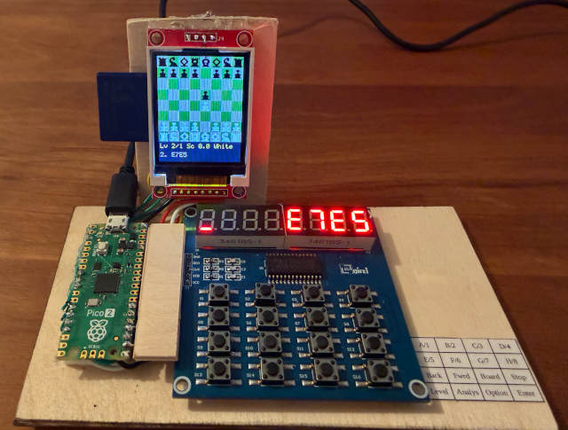

# LugalOS Chess Computer

[Documentation](../README.md) > [User Manual](index.md) > **Chess Computer**

---

LugalOS features a native chess computer system running across dedicated appliances (the `rp2350-chess` preset) as well as graphical display terminals on the window ribbon ([window ribbon](ribbon.md)).

---

## 1. Hardware Setups

### Dedicated Appliance (`rp2350-chess`)
A standalone physical chess computer built with:
* **Controller**: Raspberry Pi Pico 2 (RP2350 Hazard3 dual-core RISC-V).
* **Display**: 1.8" 160x128 ST7735 SPI color TFT (displays active board, move highlights, and clock).
* **Keypad & Status**: TM1638 module featuring 8 pushbuttons, 8 dual-color LEDs, and an 8-digit 7-segment display (eval score and move counter).
* **Storage**: MicroSD card over SPI (`/sd0/CHESS/`) holding opening books and game history.


*LugalOS running isolated driver tasks for TFT, TM1638 keypad, and chess engine on RP2350.*

### Graphical Ribbon & Touch Modes (`rp2350-terminal`, `esp32p4-lcd7b`, `esp32p4-tab5`)
On LCD terminal targets, Chess provides two distinct UX modes:
* **Terminal Mode (`chess`)**: Opens a side-by-side split window (`SCREEN_LAYOUT_SPLIT_WIDE`) pairing a VT terminal with a graphical board. Moves are entered using keyboard algebraic notation.
* **Touch Mode (`chess touch`)**: Opens a full-height interactive graphical chessboard window (`SCREEN_LAYOUT_CANVAS`) designed for stylus and touch-screen play, complete with tap piece movement, promotion selection, and a Classic Mac (`ugui`) control panel. Also directly launchable from the Touch Launcher (`RIBBON_WIN_LAUNCHER`).

---

## 2. Engine Capabilities & Multicore Search

* **Move Generation**: Full FIDE rules (castling, en passant, promotion, draw detection via 50-move rule and 3-fold repetition).
* **Search Architecture**: Alpha-Beta minimax search with quiescence search, MVV-LVA move ordering, and a lock-free transposition table.
* **Lazy SMP Multicore Parallelism**:
  * Leverages both RISC-V CPU cores concurrently.
  * In Lisp, `(perft 4 2)` splits move generation across both cores achieving **1.96x** speedup.
  * `(chess 2)` runs a 2-core Lazy SMP search sharing transposition tables, achieving **1.60x** search speedup to fixed depth.

---

## 3. How to Play

### Launching the Game
From the shell:
```text
lsh> chess          # Terminal keyboard mode
lsh> chess touch    # Standalone touch mode
```
Or from the Lisp REPL:
```lisp
lsh> lisp
(chess)             ; Terminal mode (single-core search)
(chess 2)           ; Dual-core Lazy SMP search
(chess-touch)       ; Touch mode
```
Or simply tap the **Chess** card in the Touch Launcher.

### Touch Controls & On-Screen Interface
When playing in Touch Mode:
* **Piece Selection & Movement**: Tap any piece of the side to move to select it. The board highlights the selected piece and draws dotted targets on all legal destination squares. Tap a destination dot to execute the move.
* **Pawn Promotion**: Moving a pawn to the 8th rank displays an on-screen promotion dialog with Queen, Rook, Bishop, and Knight icons.
* **Toolbar & Navigation**:
  * `< Back` / `Fwd >`: Step through game history (undo/redo).
  * `Stop` / `Go`: Interrupt an in-progress search or command the computer to calculate and play immediately for the active side.
  * `Level [-] [+]`: Adjust engine search depth / thinking budget on the fly.
  * `Analyse`: Toggles live score evaluation display (`+1.23`, `-0.45`, `M2`) and the principal variation (PV) move line.
  * `Options`: Modal menu providing New Game, Board Inversion (Flip White/Black), Engine Auto-Play toggle, Game Save/Load, and Exit to Launcher/Shell.
  * **Window Close Box**: Tapping the top-left titlebar close box returns cleanly to the ribbon.

### Move Input (Algebraic Notation)
Enter standard coordinate notation:
```text
White move: e2e4
Black responds: e7e5
White move: g1f3
```
To promote a pawn, append the desired piece: `e7e8q` (queen) or `e7e8n` (knight).

### Hardware TM1638 Controls (Appliance Mode)
On the physical appliance:
* **Buttons S1-S3**: Cursor file/rank navigation across the board.
* **Button S4**: Select piece / confirm destination square.
* **Button S7**: Take back last move.
* **Button S8**: Force computer to compute and play immediately.
* **7-Segment Display**: Left 4 digits show computer evaluation (e.g. `+0.45` or `-1.20`); right 4 digits show move number and depth.

---

## 4. Opening Book & Game Persistence

* **Opening Book**: On boot, the engine automatically checks `/sd0/CHESS/BOOK.BIN`. If present, moves in the opening phase are played instantly from the book.
* **Saving Games**: Games are recorded and saved to `/sd0/CHESS/` in PGN/text format, preserving historical play across reboots.

---

**Navigation:** [<- User Manual](index.md) | [Documentation Index](../README.md)
