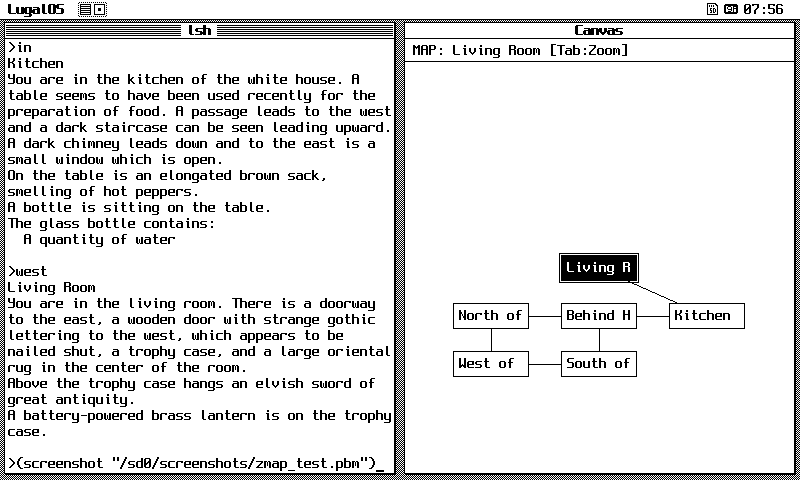

# LugalOS Z-Machine & Interactive Fiction

LugalOS includes a native, freestanding Z-machine (Version 3) interpreter for interactive fiction, featuring an interactive split-screen real-time auto-mapper on the [window ribbon](doc/user/ribbon.md).

---

## 1. Overview & Architecture

The LugalOS Z-machine environment allows playing classic Infocom titles and modern interactive fiction story files directly from the [shell](doc/user/shell.md) or Lisp REPL:

* **Z-Machine Specification**: Implements the complete Version 3 specification (flat 128 KB address space, 61 opcodes, routine call frames, dictionary tokenization, and dynamic memory save/restore).
* **Freestanding C & Zero FPU**: Pure integer arithmetic adhering strictly to the LugalOS kernel policy disabling floating-point hardware (`mstatus.FS = 0`).
* **Zero Idle Memory Overhead**: The interpreter retains zero static buffers or `.bss` footprint when inactive. At runtime, the 128 KB address space, resident story image, and VM control state are dynamically allocated from bulk PSRAM (`palloc_pages_bulk`), and 100% of memory is reclaimed on exit.
* **Automatic Word-Wrapping**: Built-in boundary word-wrapper (`zwrap`) formats story prose cleanly to the active terminal column width without splitting words mid-line.

---

## 2. Split-Screen Canvas Auto-Mapper (`zmap`)

On graphical display terminals (such as the 7" LCD on RP2350 and ESP32-P4), launching `zmachine` automatically configures a split-screen layout (`SCREEN_LAYOUT_SPLIT_HALF`), dedicating the left pane to the game console and the right pane to the graphical auto-mapper canvas.


*Zork I running on the 7" LCD terminal: text console with word wrapping (left) and dynamic room graph auto-mapper (right).*

### How Auto-Mapping Works
1. **Room Discovery Contract**: The mapper leverages the Version 3 Z-machine specification guarantee: Global Variable 0 (`HERE`) continuously points to the object ID of the player's active room.
2. **Directional Tracking**: Movement commands (`north`, `south`, `east`, `west`, `ne`, `nw`, `se`, `sw`, `up`, `down`, `in`, `out`) are intercepted on each turn to compute relative grid placements `(gx, gy)` and record travel edges.
3. **Collision Resolution**: If a newly discovered room collides with an existing grid location, an outward spiral search places the room at the nearest unobstructed position.
4. **Active Room Centering**: The canvas viewport automatically centers itself around the player's current location. The active room is rendered with an inverted white-on-black focus box and an outer border.
5. **Elevation Indicators**: Vertical connections between rooms display elevation badges (`^` for UP exits, `v` for DOWN exits).

### Detail vs. Zoom Overview Modes
The auto-mapper supports two distinct rendering modes:

* **Detail Mode (Default)**: Renders 8-character descriptive room labels (e.g. `West of `, `Behind H`, `Kitchen`, `Living R`), directional connection links, and elevation indicators.
* **Zoom Overview Mode**: Displays compact, high-density room boxes labeled with two-letter initials (e.g. `WH`, `NH`, `BH`, `KI`, `LR`), enabling players to view large underground cave systems and complex mazes at a glance.

#### Toggling Zoom Modes
You can toggle between Detail and Zoom Overview modes at any time:
* Press the **`Tab`** key or **`Ctrl-O`** during play.
* Type **`(zoom)`** or **`(map)`** at the game prompt.

---

## 3. Starting Games

### Launching from the Shell
To start an interactive fiction session, use the `zmachine` command:

```text
lsh> zmachine            # Starts default story: /sd0/games/zork1.z3
lsh> zmachine zork2      # Starts /sd0/games/zork2.z3
lsh> zmachine zork3      # Starts /sd0/games/zork3.z3
lsh> zmachine hitchhik   # Starts /sd0/games/hitchhik.z3
```

You can also pass an explicit filesystem path:
```text
lsh> zmachine /sd0/games/planetfa.z3
```

### Launching from Lisp
From the interactive Lisp prompt:
```lisp
lsh> lisp
(zmachine)              ; Runs /sd0/games/zork1.z3
(zmachine "zork2")      ; Runs /sd0/games/zork2.z3
```

---

## 4. Save Slots & Auto-Resume

LugalOS provides a robust persistence system supporting 10 independent save slots (`0` to `9`), plus automated session recovery:

### Saving a Game
Type `save` at the game prompt:
```text
> save
Save slot [0-9, default 0]: 1
[Saved slot 1: /sd0/games/zork1_1.sav]
```
The interpreter simultaneously saves the story memory state (`.sav`) and the complete discovered auto-map graph (`.map`), preserving your explored map layout.

### Restoring a Game
Type `restore` at the game prompt:
```text
> restore
Restore slot [0-9, default 1]: 1
[Restored slot 1: /sd0/games/zork1_1.sav]
```
Both the player's exact game state and the canvas map are restored instantly.

### Automated Session Recovery
When leaving a game via `quit` or `Ctrl-C`, the interpreter automatically writes an autosave checkpoint (`<story>_auto.sav` and `<story>_auto.map`). Upon launching the game again, you are prompted:
```text
Resume previous game? (y/n) [y]: y
[Resumed from /sd0/games/zork1_auto.sav]
```
Pressing `Enter` or `y` resumes the game from your exact position with the full map intact. Pressing `n` cleans up the autosave files and begins a new journey.

---

## 5. Lisp Integration at the Game Prompt

Following the same convention as the LugalOS [chess computer](doc/user/chess.md), typing an opening parenthesis `(` at the game prompt switches the line input to the Lisp evaluator:

```text
> (+ 19 23)
=> 42
> (screenshot "/sd0/screenshots/zmap.pbm")
=> "/sd0/screenshots/zmap.pbm"
> (zoom)
=> overview
```

When the expression finishes evaluating, the game's prompt refreshes normally. Evaluating `(screenshot)` captures an authentic 1-bpp PBM snapshot of both the text console and the auto-mapper canvas directly to `/sd0/screenshots/`.

---

## 6. Shipped Games & Adding New Titles

LugalOS ships with open-source MIT-licensed story files staged under `/sd0/games/`:

| File | Release | Source Provenance |
| :--- | :--- | :--- |
| `ZORK1.Z3` | Release 1 | Built from MIT-licensed ZIL sources (Microsoft open source 2025) |
| `ZORK2.Z3` | Release 1 | Built from MIT-licensed ZIL sources |
| `ZORK3.Z3` | Release 1 | Built from MIT-licensed ZIL sources |

### Adding Custom Story Files
To add additional interactive fiction games:
1. Ensure the story file is in **Version 3** format (`.z3` or `.zip`).
2. Rename the file using standard 8.3 FAT short filenames (e.g. `ENCHANTE.Z3`, `PLANETFA.Z3`, `HITCHHIK.Z3`).
3. Copy the file into `/sd0/games/` using the 9P synchronization tool (`tools/p9sync.py`) or by mounting the MicroSD card on a host workstation.
4. Launch the game using `zmachine <filename>`.
