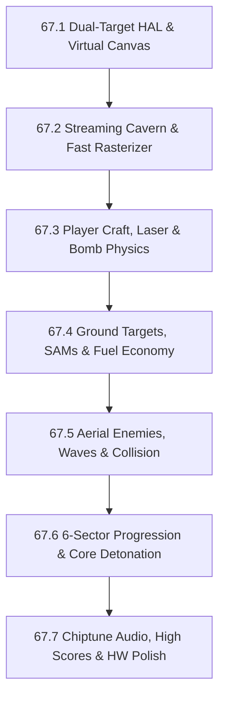

# Phase 67 — Ceres Alpha: Freestanding 2D Horizontal Arcade Scroller

**Status**: In Progress  
**Target Version**: 0.20.0  
**Target Hardware**: ESP32-P4 only (Waveshare ESP32-P4-WIFI6-Touch-LCD-7B and M5Stack Tab5) with 32 MB PSRAM  
**Host Tooling**: Linux host runner with SDL3 for rapid prototyping, headless simulation, and AddressSanitizer/UBSan verification  
**Follows**:
- Phase 47: ESP32-P4 LCD-7B Ribbon Workspace & MIPI-DSI Scanout (`drivers/dsi_esp32p4.c`)
- Phase 55: Tear-Free Double Buffering, Hybrid Ribbon Compositing & RGB565 Color Canvases (`CANVAS_FMT_RGB565`)
- Phase 56: M5Stack Tab5 Dual-Orientation Display (`drivers/dsi_esp32p4.c`, ST7121)
- Phase 62: ESP32-P4 Audio, Power & IMU Subsystem (`drivers/es8311.c`, `drivers/i2s_esp32p4.c`)
- Phase 64: Moonbase Lambda 2D Graphics Engine & Hardware PPA SRM 2D-DMA Acceleration (`drivers/ppa_esp32p4.c`)

---

## 1. Executive Summary & Concept

*Ceres Alpha* is a freestanding, fast-paced 2D horizontal arcade scrolling shoot'em-up set in the subterranean cavern network of dwarf planet Ceres, inspired by classic 1981 arcade pioneers (*Scramble*, *Super Cobra*, *Vanguard*, *Gradius*). It is designed from first principles for LugalOS on ESP32-P4 platforms and Linux host simulation.

```
       +--------------------------------------------------------------+
  HUD  | SCORE: 014200   HI-SCORE: 045000   SECTOR: 2   SHIPS: [> [>   |
       | FUEL [||||||||||||||||||||......]   RESCUED: 2/3   LASER BOMB |
       +==============================================================+
       |   /\    /\/\                                    /\/\         |
ROCK   |  /  \  /    \  /\                              /    \/\      |
CEIL   | /    \/      \/  \                            /        \     |
       |-------------------                           /          \    |
       |                                                              |
       |        [=>  -- - - (laser)         <o> (alien UFO)           |
       |       /  \                                                   |
       |  (beam)   \ (bomb)                                  /\       |
       |     :      \                                       /  \ (SAM)|
       |    \o/      v             ___                     /    \  ^  |
ROCK   |   (pilot)   /\           |   | [FUEL]            /      \ |  |
FLOOR  |  /\  |     /  \     /\   |   | [TANK]     /\    /        \|  |
       | /  \_|_   /    \___/  \__|___|___________/  \__/             |
       +--------------------------------------------------------------+
```

### 1.1 Game Premise & Core Mechanics
1. **Nimble Reconnaissance Craft**:
   - The player pilots an agile scout craft through a continuously rightward-scrolling hostile planetary landscape and cavern complex.
   - Fluid 8-way movement clamped to the tactical flight zone.
2. **Dual-Vector Weaponry**:
   - **Forward Pulse Laser (Air-to-Air)**: High-velocity twin energy bolts fired horizontally to intercept oncoming enemy aircraft, airborne mines, and meteors.
   - **Gravitational Torpedo / Bomb (Air-to-Ground)**: Parabolic falling bomb affected by lunar gravity ($v_y = v_y + g$, $v_x = v_{ship}$) to bomb ground targets positioned in canyons, craters, and vertical shafts.
3. **The Fuel Lifeline**:
   - The ship consumes fuel continuously.
   - Ground targets include marked **Fuel Silos & Energy Depots**. Precision bombing of fuel tanks restores ship fuel reserves.
   - Running out of fuel causes thruster flame-out, leaving the craft in an unpowered glide until crashing.
4. **Search & Rescue Operations (The Human Element)**:
   - Stranded reconnaissance pilots, downed scout pods, and captured scientists await rescue in crater dips and cavern alcoves.
   - **Tractor Scoop & Fly-by Retrieval**:
     - Flying low over a waving survivor automatically deploys the ship's ventral tractor beam, hoisting them safely aboard.
     - Daring risk/reward: Picking up survivors requires perilous low-altitude flight near jagged rock faces and SAM turrets.
   - **Abduction Hazard (*Defender* Homage)**:
     - Alien "Harvester" drones descend from above to snatch stranded survivors!
     - If an abductor grabs a human, the player can shoot the alien out of the sky; the survivor drops via emergency parachute and can be caught mid-air before hitting the ground.
   - **Bunker Extraction**:
     - In fortified zones, survivors are locked in reinforced holding cells or cryo-pods. A precision bomb cracks the containment bunker open, freeing the survivor for pickup.
   - **Rescue Rewards**:
     - Immediate fuel injection (+20% fuel per rescue), major score multipliers, and stage-end "PERFECT RESCUE" bonuses (shield recharge or extra ship).
5. **Mission Tasks & Tactical Variety**:
   - Not merely mindless shooting; the player encounters distinct mission objectives:
     - **Zone 1: Ground Strike**: Bombing surface radar dishes, rescuing downed scout pilots from mountain ridges, and dodging vertically launching SAM silos.
     - **Zone 2: Cavern Dogfight**: Navigating narrowing ceiling and floor formations while battling swooping alien saucer squadrons and intercepting abductor drones.
     - **Zone 3: Meteor Trench**: Maneuvering through a chaotic asteroid / fireball storm while catching jettisoned escape pods tumbling through the debris.
     - **Zone 4: Fortress Penetration**: Bombing localized force field generators to bring down energy shields across narrow chasms, and liberating scientists from fortified holding pens.
     - **Zone 5: The Labyrinth**: Navigating razor-thin subterranean corridors with zero room for error to reach deep survival shelters.
     - **Zone 6: Reactor Core Elimination**: Deep dive into the final stronghold, landing a precision bomb into the central thermal exhaust/reactor core, followed by a frantic full-throttle escape burn before the sector implodes.

---

## 2. Technical Directives & Hardware Architecture

### 2.1 The LugalOS Constraints
1. **Freestanding C**: 100% standard C99/C11 code compiled with `-nostdlib -ffreestanding`. Zero reliance on libc, dynamic libraries, or POSIX APIs.
2. **Zero Floating-Point**: RISC-V M-mode runs with `mstatus.FS = 0` (FPU disabled). All trajectory calculations, gravitational curves, sine/cosine wave paths for alien swarms, and scroll velocities use **16.16 fixed-point arithmetic** (`fixed32_t`).
3. **Zero SRAM Footprint**: Static sprite arrays, tile definitions, and level profiles reside in Flash `.rodata`. Framebuffers, entity pools, and terrain streaming rings reside in PSRAM (`palloc_pages_bulk`).
4. **Keyboard-First Controls**: No capacitive touch or mouse overhead during gameplay. Low-latency ANSI VT key sequence decoder (`keyseq_read_console()`) for Arrow keys / WASD, Space (laser), and B / Alt / Enter (bomb).

### 2.2 Dual-Target Platform HAL
* **Host Simulator (`platform_sdl3.c`)**:
  - Compiles natively on Linux with `clang`/`gcc` and AddressSanitizer (`-fsanitize=address,undefined`).
  - Streams RGB565 framebuffer directly to SDL3 window at 60 Hz.
  - Sub-second rebuild and automated headless testing.
* **LugalOS Bare Metal (`platform_p4.c`)**:
  - Connects to LugalOS RGB565 fullscreen canvas (`SCREEN_LAYOUT_FULLSCREEN | 0x80u`).
  - Double-buffered in PSRAM with tear-free presentation.
  - **Hardware PPA SRM 2D-DMA Acceleration**:
    - **M5Stack Tab5 (1280×720 physical panel)**: Game renders to a 16:9 virtual canvas of **640×360** pixels. The hardware PPA SRM driver performs a fused **2× upscale + 90° CCW rotation** directly into the scanout buffer in <1 ms, freeing 99% of CPU time for game logic and 60 FPS rendering.
    - **Waveshare LCD-7B (1024×600 physical panel)**: Game renders to a centered 640×360 playfield flanked by stylized illuminated retro arcade bezels, radar minimap, and instrument readouts, or scales natively.

### 2.3 Moonbase Comparison: Shared Layer vs. Separation

| Component | Moonbase Lambda | Ceres Alpha | Architecture Strategy |
| :--- | :--- | :--- | :--- |
| **Platform HAL** | SDL3 host runner, P4 PSRAM canvas, PPA SRM double-buffering | Identical canvas lifecycle, double-buffering, and PPA SRM acceleration | **Identical interface contract**: Replicate HAL signatures for seamless future unification. |
| **2D Blit Core** | Surface structs, 16-bit rects, spans, chromakey sprites, 8×16 font | Surface structs, fast spans, chromakey sprites, 8×16 font | **Duplicated & tailored**: Core primitives copied and tuned for vertical column loops. |
| **World Geometry** | 2:1 isometric diamond grid, 3D extruded blocks, heightfields | 1D streaming heightfields (ceiling/floor), parallax starfield | **Kept strictly separate**: Moonbase uses 8.7 MB tile cache; Ceres uses streaming column ring buffer. |
| **Rendering Model** | Dirty-rect skipping (<1% CPU when idle) | Continuous 60 Hz full-screen motion blit | **Kept strictly separate**: Dirty rects cannot accelerate continuous full-screen scrolling. Fast column spans required. |
| **Input Model** | Multi-touch drag, pinch-to-zoom, tap selection, build ribbon | Digital keyboard: low-latency 8-way directional + dual fire buttons | **Kept strictly separate**: Zero touch gesture overhead in Ceres. |
| **Simulation Loop**| 10 Hz DAG resource network & BFS power solver | 60 Hz deterministic physics, AABB collisions & entity state machine | **Kept strictly separate**: Different domain requirements. |

### 2.4 Pragmatic Strategy: "Duplicate First, Consolidate on Three"

1. **Avoid Premature Abstraction**:
   - Duplicating the platform HAL and 2D blitter primitives into `user/ceres/` for this second game is the most reliable path. It keeps Moonbase 100% stable and verified on silicon, while giving *Ceres Alpha* complete agility to reshape its blitter for 60 Hz vertical column streaming without worrying about breaking isometric terrain routines.
   - Once 2–3 distinct games exist in the tree (e.g. Moonbase, Ceres Alpha, and a future title), the true intersection of common graphics needs will be obvious and can be factored into a clean `user/libgame/` or `kernel/video/` layer.

2. **Hardware Portability as the Driver for a Future Common HAL**:
   - The primary long-term argument for a shared graphics/platform layer is **hardware portability**.
   - If every game adheres to a standardized HAL interface (`platform_init()`, `platform_get_framebuffer()`, `platform_present()`, `platform_poll_event()`), then **porting to a new hardware target only needs to be implemented once**:
     - Bringing up a new board (e.g., RP2350 with LCD-7, a new ESP32 revision, or a future RISC-V SoC) by writing a single `platform_<newboard>.c` immediately enables all LugalOS games to run on that target.
   - **Action Item**: Keep `ceres_platform.h` semantically and syntactically identical to `moon_platform.h`, even while implemented independently. This ensures zero friction when extracting the common HAL or porting games to future hardware targets.

---

## 3. Engine Architecture & Rendering Pipeline

```
user/ceres/
├── Makefile                    # Host build (SDL3 + ASan) & headless test target
├── include/
│   ├── ceres_blitter.h         # Fast 16-bit spans, RGB565 primitives & sprite blitter
│   ├── ceres_config.h          # Virtual dimensions (640x360), frame rates, color palette
│   ├── ceres_entities.h        # Fixed entity pool: ship, lasers, bombs, SAMs, UFOs, fuel
│   ├── ceres_fixed.h           # 16.16 fixed-point math, trigonometric LUT, parabolas
│   ├── ceres_game.h            # Game state machine, loop controller & difficulty scaler
│   ├── ceres_platform.h        # Platform HAL interface (SDL3 / ESP32-P4)
│   ├── ceres_sound.h           # Chiptune SFX triggers (laser, bomb, explosion, alarm)
│   ├── ceres_sprites.h         # Flash .rodata pixel art arrays & chromakey masks
│   └── ceres_terrain.h         # Streaming cavern heightfield, column profiles & starfield
└── src/
    ├── main_host.c             # Host entry point, CLI flags & headless test runner
    ├── platform_p4.c           # Bare-metal ESP32-P4 HAL with PPA SRM double-buffering
    ├── platform_sdl3.c         # Host SDL3 video/input harness
    ├── ceres_blitter.c         # Optimized 32-bit word spans & sprite compositing
    ├── ceres_entities.c        # Entity updates, trajectory physics & pool management
    ├── ceres_fixed.c           # Fixed-point math routines & LUT tables
    ├── ceres_game.c            # Game state, scoring, fuel depletion, collision resolution
    ├── ceres_sound.c           # Retro synth sound effects (I2S ES8311 on P4, SDL3 audio)
    ├── ceres_sprites.c         # Sprite assets (ship, weapons, enemies, installations)
    └── ceres_terrain.c         # Procedural cavern generator & column slice rasterizer
```

### 3.1 Streaming Cavern Heightfield Rasterizer
* The playfield height is 360 pixels, width 640 pixels.
* Terrain consists of two profiles per column $x$:
  - $Y_{ceil}(x)$: Distance from top of screen to bottom of rocky ceiling.
  - $Y_{floor}(x)$: Height of cavern floor from bottom of screen upward.
* **Rendering a Column**:
  1. Draw ceiling rock from $y = 0$ to $Y_{ceil}(x)$ (textured strata or shaded rock tone).
  2. Draw cavern backdrop / open space from $y = Y_{ceil}(x)$ to $360 - Y_{floor}(x)$ (deep space black with 2-layer parallax starfield).
  3. Draw floor rock from $y = 360 - Y_{floor}(x)$ to $360$.
* **Fast Span Fills**:
  - Drawing vertical columns or horizontal spans using 32-bit aligned stores (`uint32_t` storing 2 pixels at a time) achieves $>120$ FPS on ESP32-P4 PSRAM.
* **Streaming Ring Buffer**:
  - A ring buffer of $640 + 64$ columns maintains terrain geometry.
  - As the camera advances by $dx$ pixels, new terrain columns are procedurally generated or pulled from sector definitions at the right boundary.

### 3.2 Fixed Entity Pool & Collision Detection
* Zero dynamic memory allocations during gameplay.
* Entity arrays allocated statically in BSS/PSRAM:
  - 1 Player Ship
  - Up to 8 Active Forward Lasers
  - Up to 4 Active Gravity Bombs
  - Up to 16 Airborne Enemies (UFOs, missiles, meteors, Harvester abductors)
  - Up to 24 Ground Targets (SAM silos, fuel tanks, radar dishes, turrets, cryo-bunkers)
  - Up to 8 Stranded Survivors / Rescue Pods
  - Up to 32 Particle Sparks / Debris fragments
* **Collision Hierarchy**:
  - Stage 1: Quick AABB (Axis-Aligned Bounding Box) coordinate overlap.
  - Stage 2: Terrain collision against the column heightfield:
    - Ship crashes if $y_{ship} \le Y_{ceil}(x_{ship})$ or $y_{ship} + h_{ship} \ge 360 - Y_{floor}(x_{ship})$.
    - Bombs detonate when $y_{bomb} \ge 360 - Y_{floor}(x_{bomb})$.
  - Stage 3: Weapon vs Entity hitboxes.
  - Stage 4: Tractor Beam Proximity / Scoop vs Survivor Hitbox (and Abductor vs Survivor).

---

## 4. Sector Progression & Level Design

| Sector | Theme | Landscape & Cavern Profile | Enemy Encounters & Hazards | Objectives & Rescue Tasks |
| :---: | :--- | :--- | :--- | :--- |
| **1** | **Mountain Approach** | Wide-open sky, rolling mountainous floor, crater dips. | Vertical SAM silos launching as ship approaches; radar arrays. | Establish fuel rhythm; bomb initial fuel tanks; rescue downed scout pilots from mountain ledges. |
| **2** | **Crystal Cavern** | Ceiling descends; jagged stalactites and stalagmites. | Formations of 4–6 flying saucers undulating in sine waves; alien Harvester abductor drones. | Tight maneuvering; intercept Harvesters to save miners; catch parachuting survivors mid-air. |
| **3** | **Asteroid Trench** | High-velocity cavern with crumbling floating rock masses. | Fast tumbling meteors and fireballs (indestructible / high HP). | Pure evasive navigation; scoop jettisoned escape pods tumbling among the meteors. |
| **4** | **Fortified Base** | Industrial subterranean city; laser fence pylons blocking paths. | Ground anti-air turrets, homing missiles, ceiling gun pods. | Precision bomb power conduits to drop laser barriers; blast prison bunkers to liberate scientists. |
| **5** | **The Labyrinth** | Extremely narrow, twisting jagged rock tunnel with dead-ends. | Stationary floating proximity mines and rapid ambush drones. | Flawless low-speed control; rescue stranded survey team in deep survival shelter alcoves. |
| **6** | **Reactor Stronghold** | Heavily armored alien bastion with exhaust trench. | High-density defense turrets and final defensive drones. | **Core Bomb Run**: Precision bomb drop into the glowing Reactor Core; execute emergency escape sprint with rescued crew before base detonates! |

*Completing Sector 6 loops back to Sector 1 with accelerated scroll speeds, faster enemy projectiles, and steeper fuel depletion.*

---

## 5. Milestone Breakdown



### Milestone 67.1: Dual-Target HAL & Virtual Canvas — **COMPLETE**
* **Deliverables**:
  - Directory structure `user/ceres/` and host build system `Makefile`.
  - Virtual 16:9 canvas ($640 \times 360$ RGB565) and 60 FPS deterministic game loop.
  - Host runner with SDL3 (`platform_sdl3.c`), keyboard input mapping, and ASan/UBSan harness.
  - Bare-metal LugalOS driver (`platform_p4.c`) integrating with `SCREEN_LAYOUT_FULLSCREEN | 0x80u` and PPA SRM 2D-DMA hardware scaling/rotation for M5Stack Tab5 and LCD-7B.
  - Native command `ceres` (and `scroller` alias) registered in `kernel/shell.c`.
  - Zero-static game architecture (`ceres_game.c`) passing static concurrency scan with 0 unmarked variables.
* **Verification**:
  - `make -C user/ceres test` boots SDL3 window, runs unit tests and 60 frames headlessly with ASan/UBSan passing 100%.
  - `ninja -C build/esp32p4-tab5` cross-compiles cleanly to RISC-V with zero linker errors.
  - `tools/racescan.py --check` passes with 0 shared unmarked statics.

### Milestone 67.2: Streaming Cavern Engine & Fast 2D Rasterizer — **COMPLETE**
* **Deliverables**:
  - Continuous horizontal scrolling heightfield engine (`ceres_terrain.c`, `ceres_terrain.h`).
  - Ring-buffer column generator (1024 columns) producing cavern ceiling and floor profiles with strata bands.
  - 16.16 Fixed-point math and 256-step trigonometric LUT (`ceres_fixed.c`, `ceres_fixed.h`).
  - Smooth S-curve cosine interpolation for rolling mountain ridges, flat plateaus, craters, and subterranean chasms.
  - Multi-layer parallax background starfield (distant dim, mid white, near cosmic blue) with natural rock occlusion.
  - Ground target attachment pegged to dynamic terrain floor elevation.
  - Terrain collision query API (`ceres_terrain_check_collision`, `ceres_terrain_sample`) and ship flight corridor clamping.
* **Verification**:
  - `make -C user/ceres test` runs terrain ring buffer streaming (wrapping >2x), Sector 2 cavern generation, and collision detection tests with 100% pass under ASan/UBSan.
  - `ninja -C build/esp32p4-tab5` builds and links cleanly with zero linker errors.
  - `tools/racescan.py --check` passes with 0 shared unmarked statics.

### Milestone 67.3: Player Craft, Physics & Dual-Vector Weapons — **COMPLETE**
* **Deliverables**:
  - Player ship sprite rendering with 3-state pitch bank tilt (`climb`, `level`, `dive`), boost-responsive thruster flame plume scaling, and trailing exhaust embers.
  - Zero-static fixed entity pool (`ceres_entities.h`, `ceres_entities.c`) embedded directly in `ceres_game_t` for lasers, bombs, and spark/explosion particles.
  - Fixed-point 16.16 projectile kinematics:
    - High-velocity forward twin pulse lasers ($v_x = 12.0$ px/frame, $v_y = 0$, rate-limited with cooldown).
    - Parabolic falling gravity-bombs with arcade authenticity ($v_{x,0} = 3.0$ px/frame, $v_{y,0} = 1.5$ px/frame, $v_{y, t+1} = v_{y, t} + g$ with $g = 0.20$ px/frame$^2$, max 2 active bombs concurrently).
  - Terrain collision resolution for projectiles:
    - Lasers impacting cavern ceiling/floor rock trigger cyan spark debris bursts and deactivate.
    - Bombs striking cavern floor or stalactites detonate into multi-color radial explosion fragments.
  - Boundary collision keeping the ship within screen limits and out of the ceiling/floor rock (sampling nose, center, and tail clearance).
  - Live weapon and bomb HUD diagnostics (`LASER: [SPC] X`, `BOMB: [B] Y/2`).
* **Verification**:
  - `make -C user/ceres test` runs dedicated unit tests for laser straight-line kinematics, bomb parabolic trajectory, 2-bomb arcade limit, terrain impact detonation, and particle decay with 100% pass under ASan/UBSan.
  - `ninja -C build/esp32p4-tab5` builds and links cleanly with `riscv64-elf-gcc` and zero warnings.
  - `tools/racescan.py --check` passes with 0 shared unmarked statics.

### Milestone 67.4: Ground Targets, SAMs & Fuel Economy — **COMPLETE**
* **Deliverables**:
  - Ground installations pegged to dynamic floor/ceiling coordinates with foundation anchoring pads preventing any visual floating on uneven terrain:
    - `CERES_TARGET_FUEL_SILO` ($32 \times 24$): Bombing destroys tank, replenishes $+250$ fuel, awards $+150$ score.
    - `CERES_TARGET_SAM_SILO` ($24 \times 16$): Proximity detection triggers vertical high-acceleration rocket launch when ship within 190 px; destructible on ground or in mid-air.
    - `CERES_TARGET_RADAR` ($24 \times 24$): Rotating scanner dish ($+100$ score).
    - `CERES_TARGET_CRYO_BUNKER` ($32 \times 24$): Fortified containment unit; bomb breach cracks bunker open and liberates stranded survivor ($+100$ score).
    - `CERES_TARGET_SURVIVOR` ($16 \times 18$): Downed pilot/miner waving from terrain ledge. Low-altitude tractor scoop pickup ($+200$ fuel, $+500$ score, increments HUD `RESCUED: X/Y` tally).
  - Dynamic Fuel Gauge in HUD with tri-state color alerting (green >50%, amber 20-50%, flashing red <20%). Depletion rate ~12 units/sec with flame-out unpowered downward glide at 0 fuel.
  - 4-Bit Packed Sprite Architecture (`user/ceres/tools/convert_sprites.py`): Quantized 16-color palettes and packed nibble decoding reducing Flash `.rodata` footprint from 6,928 bytes to 1,956 bytes, guaranteeing fit in ESP32-P4 XIP segment.
  - Deduplicated typography on RISC-V bare-metal using kernel `font8x16_glyphs`, saving 1,520 bytes.
* **Verification**:
  - `make -C user/ceres test`: 100% PASS across 15 unit test suites under AddressSanitizer and UBSan.
  - `ninja -C build/esp32p4-tab5`: Clean compilation and linking with >3 KB XIP headroom.
  - `tools/racescan.py --check` passes with 0 shared unmarked statics.
  - `tools/gendocs.py --check` passes with 0 drift.

### Milestone 67.5: Aerial Enemies, Alien Harvesters & Mid-Air Rescue — **COMPLETE**
* **Deliverables**:
  - Sine-wave undulating alien saucers, diving fighters, and tumbling meteors.
  - Alien "Harvester" abductor drones that target stranded survivors on the ground and winch them upward.
  - Parachute drop physics: Shooting an abductor releases the survivor into a slow parachute descent; catching them mid-air awards a "HEROIC RESCUE" multiplier.
  - Two-stage collision detection: Broadphase AABB followed by terrain heightfield sampling and sprite masks.
  - Particle explosion system with expanding debris rings and smoke puffs.
* **Verification**:
  - Lasers destroy aerial enemies; bombs destroy ground targets.
  - Abductor picks up survivor if player fails to intercept; shooting abductor drops survivor with parachute.
  - Ship collision with rock or enemy craft triggers ship destruction, life deduction, and respawn checkpoint.

### Milestone 67.6: 6-Sector Progression, Objectives & Core Detonation
* **Deliverables**:
  - Complete 6-sector level pipeline:
    1. *Mountain Approach*
    2. *Crystal Cavern*
    3. *Asteroid Trench*
    4. *Fortified Base* (Laser barriers & force field generators)
    5. *The Labyrinth*
    6. *Reactor Stronghold*
  - Sector 4 Barrier Mechanic: Bombing power generators drops laser fences.
  - Sector 6 Climax: Narrow shaft leading to the vibrating Reactor Core. Successful bomb hit triggers base meltdown alarm, reverse camera escape rush, and loop rollover.
* **Verification**:
  - Full game playthrough verified on host headless test harness (`user/ceres/tests/test_ceres_loop.c`).

### Milestone 67.7: Chiptune Audio, Scoring, High-Score Persistence & Silicon Validation
* **Deliverables**:
  - Chiptune sound effects: Laser pew, bomb whistle, explosion rumble, low-fuel alarm, survivor rescue chime, stage fanfare via ESP32-P4 I2S/ES8311 driver (`drivers/es8311.c`) and SDL3 audio.
  - Arcade HUD: Score, High Score, Fuel meter, Rescued survivor counter (`RESCUED: X/Y`), Sector indicator, Lives counter.
  - High score persistence to SD card (`/sd0/games/ceres.dat`) or Flash (`/flash0/`) with saved survivor rescue tallies.
  - Hardware-in-the-loop test suite (`tests/hw/test_ceres.py`) testing both M5Stack Tab5 and ESP32-P4-7B.
  - Documentation: User manual in `doc/user/ceres.md` and shell command updates.
* **Verification**:
  - `python3 tests/runner.py` passes 100%.
  - Hardware benchmarks confirm solid 60 FPS on ESP32-P4 hardware with <15% CPU load thanks to PPA SRM.

---

## 6. Verification & Hardware-in-the-Loop Testing

1. **Host Unit & Simulation Tests**:
   - `make -C user/ceres test`: Runs physics regression tests, collision math verification, and headless 60-frame simulation with AddressSanitizer and UBSan.
2. **Static Concurrency & Racescan Compliance**:
   - `python3 tools/racescan.py --check`: Enforces static storage verdicts (`session_claim_t`, `single task: ...`).
3. **Hardware Silicon Verification (`tests/hw/test_ceres.py`)**:
   - Validates canvas initialization, PPA SRM scaling, double-buffered presentation timing, keyboard input processing, and clean terminal restoration on both Tab5 and LCD-7B.
