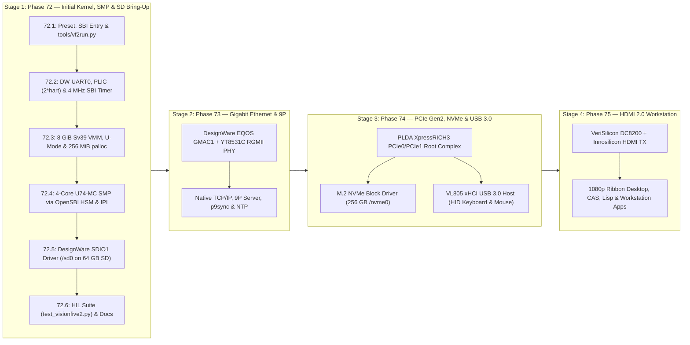

# Phase 72 — StarFive VisionFive 2 (JH7110) 64-Bit Hardware Bring-Up

**Status**: PLANNED (drafted 2026-11-07; §0 preliminary evaluation verified against live hardware on `/dev/ttyUSB0` and `JH7110_TRM_StarFive_Preliminary_V2.pdf`).
**Target Hardware**:
- **Primary**: **StarFive VisionFive 2 v1.3B** (`visionfive2` preset, StarFive **JH7110** rev B, 4× SiFive U74-MC RV64GC application harts + 1× S7 monitor hart, 8 GiB LPDDR4, 64 GB MicroSD, 256 GB M.2 NVMe, Gigabit Ethernet, HDMI 2.0)
- **Regression**: QEMU 64-bit (`rv64`, `rv64-smp`), QEMU 32-bit (`rv32`, `rv32-fold`), ESP32-P4 (`esp32p4-tab5`, `esp32p4-lcd7b`), and RP2350 (`rp2350-terminal`) — zero regressions, zero SRAM growth on 32-bit targets.

**Goal**: Port LugalOS to its first physical 64-bit RISC-V hardware platform — bringing up the 64-bit S-mode microkernel under OpenSBI v1.0, automated network/serial boot (`tools/vf2run.py`) without ever modifying onboard QSPI flash, DesignWare UART0 interrupt console, JH7110 PLIC and 4 MHz SBI preemption timer, 8 GiB Sv39 virtual memory with U-mode task isolation and scalable physical page allocation, 4-core U74-MC SMP, and the Synopsys DesignWare SDIO driver mounting the 64 GB microSD card at `/sd0`.

---

## 0. Preliminary porting plan

Before defining individual implementation milestones, we evaluated the live hardware connected to this workstation, the vendor documentation and reference source trees in `~/Source/gith/visionfive2`, and LugalOS's existing 64-bit QEMU (`rv64` / `rv64-smp`) architecture layer.

### 0.1 Live Hardware Inventory & Bench Verification

The target board is attached to `/dev/ttyUSB0` (`/dev/serial/by-id/usb-1a86_USB_Serial-if00-port0`, `115200 8N1`) and was interrogated directly at its U-Boot prompt (`StarFive #`):

| Subsystem | Measured Hardware Fact (Live Probe on `/dev/ttyUSB0`) |
| :--- | :--- |
| **Board & Revision** | **StarFive VisionFive 2 v1.3B** (`fdtfile=starfive/jh7110-starfive-visionfive-2-v1.3b.dtb`) |
| **SoC & Silicon Rev** | StarFive **JH7110**, `chip_vision=B` |
| **Factory EEPROM** | `VF7110B1-2318-D008E000-18004992` (`D008` = **8 GiB LPDDR4**, `E000` = **no eMMC** populated) |
| **Boot Mode & Flash** | `bootmode=flash` — boots from onboard 16 MiB GigaDevice `gd25lq128` QSPI NOR (`spi@13010000`, 64 KiB erase blocks): `SPL` → `OpenSBI v1.0` → `U-Boot 2021.10 (Feb 28 2023, VF2_515_Branch_SDK_Release-31)` |
| **CPU Topology** | Asymmetric 5-hart cluster: • `cpu@0` (Hart 0): SiFive **S7** monitor core (`rv64imac_zba_zbb`, M+U mode only, **no S-mode, no MMU, no FPU**) • `cpu@1..4` (Harts 1..4): 4× SiFive **U74-MC** application cores (`rv64imafdc_zba_zbb`, M+S+U mode, **Sv39 MMU**, 32 KiB I$ + 32 KiB D$, shared 2 MiB L2 cache controller at `0x02010000`, up to 1.5 GHz) |
| **OpenSBI Firmware** | **OpenSBI v1.0** (`0x40000000..0x4007FFFF`, 512 KiB reserved). Extensions detected via `sbi` command: **TIME** (`stimer`), **IPI** (`sipi`), **RFENCE** (`srfnc`), **HSM** (Hart State Management), **SRST** (System Reset via AXP15060 PMIC on I2C5 `0x36`), plus v0.1 legacy console putchar/getchar |
| **System DRAM** | **8 GiB LPDDR4** mapped continuously at **`0x40000000 .. 0x2_3FFFFFFF`** (`size = 0x200000000`) via the U74 Memory Port (`Table 2-5` in TRM), with an uncached System Port alias at `+0x4_00000000` (`0x4_40000000 .. 0x6_3FFFFFFF`). U-Boot standard load addresses: `kernel_addr_r = 0x40200000`, `ramdisk_addr_r = 0x46100000`, `fdt_addr_r = 0x46000000` |
| **UART Console** | `serial@10000000` (`uart0`, Synopsys `snps,dw-apb-uart`), 24 MHz reference clock (`osc`), 115200 8N1, PLIC IRQ 32, routed to 40-pin header pins 6 (GND), 8 (TX / GPIO5), 10 (RX / GPIO6) |
| **MicroSD Card** | `mmc 1` (`sdio1@16020000`, Synopsys `snps,dw-mshc` / `starfive,jh7110-sdio`, PLIC IRQ 75): **64 GB SDXC** card attached (`58.2 GiB`, SD 3.0 High Speed 50 MHz, 4-bit width), MBR partition 1 (`start=2048, count=122136575`, type `0x0c` FAT32 LBA, currently empty and ready for testing) |
| **M.2 NVMe Drive** | **256 GB M.2 NVMe SSD** in bottom M-key socket wired to `pcie1@2C000000` (PLDA XpressRICH3 PCIe Gen2 ×1, PLIC IRQ 57, `PERST#` on `GPIO28`, config space `0x9_C0000000`, 32-bit MEM `0x38000000..0x3FFFFFFF`, 64-bit MEM `0x9_80000000..0x9_BFFFFFFF`). *(Note: Factory Feb 2023 QSPI U-Boot was compiled without `CONFIG_PCI` / `CONFIG_NVME` CLI commands; the SSD will be enumerated directly by LugalOS's own PCIe+NVMe driver in Stage 3.)* |
| **Gigabit Ethernet** | Dual Synopsys DesignWare EQOS MACs (`snps,dwmac-5.10a`) + **Motorcomm YT8531C** RGMII PHYs (v1.3B uses two identical YT8531C PHYs): • `gmac0@16030000` (MAC `6c:cf:39:00:b9:8d`, IRQ 7): unplugged • `gmac1@16040000` (MAC `6c:cf:39:00:b9:8e`, IRQ 78): **active LAN link**, acquired `192.168.178.25` via DHCP in 10 ms and verified bidirectional ICMP ping with this workstation (`192.168.178.180` on `enp86s0`) |
| **HDMI Display** | Monitor connected to HDMI 2.0 port driven by **VeriSilicon DC8200** display controller (`0x29400000`, IRQ 95) + **Innosilicon HDMI TX** (`0x29590000`, IRQ 99, DDC I2C on GPIO0/1, HPD on GPIO15) |
| **USB 3.0 Host** | 4× USB 3.0 Type-A ports via onboard **VIA Labs VL805** PCIe-to-xHCI controller on `pcie0@2B000000` (IRQ 56, `PERST#` on `GPIO26`); USB-C peripheral/OTG controller at `usb@10100000` (Cadence USB3) |

---

### 0.2 Evaluation of Documentation & Reference Sources

All required documentation and reference source trees are present in `~/Source/gith/visionfive2/`:

#### A. Hardware Documentation (`~/Source/gith/visionfive2/docs/`)
1. **StarFive JH7110 Technical Reference Manual**:
   - `JH7110_TRM_StarFive_Preliminary_V2.pdf` (559 pages, Doc ID `JH7110-TRMEN-001`, added 2026-11-07) — Authoritative hardware reference containing:
     - **Section 2.3 & Table 2-3 (`System Interrupt Connections`, p. 35)**: Full 136-source PLIC interrupt map.
     - **Section 2.4.1 & Table 2-4 (`System Memory Map`, p. 42)**: Peripheral MMIO base addresses and sizes.
     - **Section 2.4.2 & Table 2-5 (`U74 Memory Map`, p. 49–50)**: U74 internal map (`CLINT @ 0x02000000`, `L2 Cache Controller @ 0x02010000`, `U7 Hart 1..4 L2 Prefetchers @ 0x02032000..0x02039FFF`, `PLIC @ 0x0C000000`), Peripheral Port (`0x10000000..0x1FFFFFFF`), System Port (`0x20000000..0x3FFFFFFF`), cached Memory Port (`0x00_40000000..0x04_3FFFFFFF`), uncached System Port DRAM alias (`0x04_40000000..0x08_3FFFFFFF`), and 64-bit PCIe space (`0x09_80000000..0x09_FFFFFFFF`).
     - **Section 2.7 (`GPIO`, p. 82)** & **Section 2.8 (`SYS CRG`, `STG CRG`, `AON CRG`, `SYSCON`, `IOMUX`, p. 132–483)**: Complete clock, reset, syscon, and pinmux register bitfields.
     - **Section 3 (`Power Management & PMU`, p. 484)** & **Section 5 (`Display Subsystem: DC8200, DSI, HDMI, DOM VOUT CRG/SYSCON`, p. 526–554)**.
2. **Board Hardware & Schematics**:
   - `RV002_V1.3B_20230208.pdf` — Complete electrical schematic for VisionFive 2 **v1.3B**, confirming YT8531C dual PHYs, VL805 USB3 hub on PCIe0, M.2 M-key NVMe on PCIe1, AXP15060 PMIC on I2C5 (`0x36`), and GPIO pin assignments.
   - `JH7110_DS.pdf` (v1.67, 111 pages), `JH7110_Boot_UG.pdf`, `VisionFive2_Datasheet.pdf`, `VisionFive2_40-Pin_GPIO_Header_UG.pdf`, `VisionFive2_SW_TRM.pdf`.
3. **Peripheral Application Notes**:
   - `JH7110_SDK_PG_Ethernet.pdf`, `SDK_DG_GPIO.pdf`, `SDK_DG_SPI.pdf`, `SDK_DG_UART.pdf`, `SDK_DG_IIC.pdf`, `SDK_DG_Timer_Watchdog.pdf`.

#### B. Vendor Reference Source Trees (`~/Source/gith/visionfive2/VisionFive2/`)
- **`opensbi/`**: `platform/generic/starfive/jh7110.c` — cold-boot hart selection, AXP15060 PMIC I2C reset/shutdown sequences (`sbi_system_reset`), and PMU hooks.
- **`u-boot/`**:
  - `arch/riscv/include/asm/arch-jh7110/jh7110-regs.h`, `drivers/clk/starfive/clk-jh7110.c`, `drivers/reset/reset-jh7110.c`.
  - `drivers/mmc/snps_dw_mmc.c` & `dw_mmc_starfive.c` — bare-metal Synopsys DesignWare SDIO driver (`sdio1@16020000`).
  - `drivers/net/dwc_eth_qos.c` & `phy/motorcomm.c` — bare-metal DesignWare EQOS Gigabit MAC (`gmac1@16040000`) and Motorcomm YT8531C RGMII PHY driver.
  - `drivers/pci/pcie_starfive.c` & `drivers/nvme/nvme.c` — bare-metal PLDA XpressRICH3 PCIe Root Complex and NVMe driver.
  - `drivers/video/starfive/sf_vop.c`, `sf_hdmi.c` — bare-metal VeriSilicon DC8200 and Innosilicon HDMI TX driver.
- **`linux/`**:
  - `arch/riscv/boot/dts/starfive/jh7110.dtsi`, `jh7110-starfive-visionfive-2.dtsi`, `jh7110-starfive-visionfive-2-v1.3b.dts`.

---

### 0.3 Architectural Gap Analysis (`rv64-mmu` QEMU vs VisionFive 2 JH7110)

Comparing LugalOS's `arch/riscv/` and `kernel/` code against the JH7110 hardware reveals **eight concrete architectural seams**:

1. **Privilege Mode at Entry (`CONFIG_SBI=1` S-Mode vs Bare-Metal M-Mode)**:
   - OpenSBI v1.0 owns M-mode (`0x40000000..0x4007FFFF`) and enters the kernel directly in **S-mode** with `a0 = hartid`, `a1 = dtb_pa`, `satp = 0`, `sstatus.SIE = 0`.
   - [`arch/riscv/common/entry.S`](file:///home/dsc/Source/gith/domschl/lugalos/arch/riscv/common/entry.S) must be gated by `CONFIG_SBI=1` so it never executes M-mode CSR instructions (`csrr mhartid`, `csrw mtvec`, `csrw pmp*`, `mret`), prepends the 64-byte RISC-V Linux `Image` header for U-Boot `booti`, saves `a0` (`hartid`) to `tp` and `a1` (`dtb_pa`) to `g_dtb_pa`, sets `stvec`, zeroes `.bss`, and calls `kmain()`.
2. **Asymmetric Hart Topology (`Hart 0` = S7 Monitor Core, `Harts 1..4` = U74 Application Cores)**:
   - Hart 0 is an M-mode-only S7 core parked by OpenSBI; Harts `1..4` are the four S-mode U74-MC cores. The cold-boot hart passed by U-Boot in `a0` is in `1..4` (typically `1`).
   - We size `MAX_HARTS = 5` on `visionfive2` so `g_harts[0..4]` is indexed directly by hardware `hartid` (`tp` holds `1..4` with zero translation overhead in `this_hart()`), record `g_boot_hart` at boot instead of assuming `hartid == 0`, and bring up the other three U74 harts via OpenSBI HSM (`sbi_hart_start`).
3. **PLIC S-Mode Context Indexing (`2 * hartid` vs `2 * hartid + 1`)**:
   - Because Hart 0 (S7) has no S-mode context (only M-mode Context 0), U74 Hart $h \in \{1..4\}$ has M-mode context $2h - 1$ (`1, 3, 5, 7`) and **S-mode context $2h$ (`2, 4, 6, 8`)**.
   - [`plic_context()`](file:///home/dsc/Source/gith/domschl/lugalos/arch/riscv/common/trap.c#L78-L85) in `arch/riscv/common/trap.c` must use `PLIC_S_CONTEXT(h)` (`2u * (h)` on JH7110 vs `2u * (h) + 1u` on QEMU `virt`) and support up to `PLIC_MAX_IRQ = 136` sources (`Table 2-3` in TRM).
4. **Timer Frequency (`4 MHz` vs `10 MHz`) & Preemption Timer Arming (`sbi_set_timer` vs `Sstc`)**:
   - JH7110's CLINT `rdtime` counter ticks at **4 MHz** (`4` ticks/µs, `CONFIG_TIMEBASE_HZ = 4000000`).
   - U74-MC does not implement `Sstc` (`stimecmp` CSR `0x14d`), and CLINT `mtimecmp`/`msip` at `0x02000000` are M-mode-only under OpenSBI PMP. [`kernel/ticker.c`](file:///home/dsc/Source/gith/domschl/lugalos/kernel/ticker.c) must arm timer ticks via `sbi_set_timer()` (`EID=0x54494D45, FID=0`) and send cross-hart reschedule IPIs via `sbi_send_ipi()` (`EID=0x735049, FID=0`).
5. **DesignWare 16550 UART Register Stride (`reg-shift = 2`, `reg-io-width = 4`) & IRQ 32**:
   - `uart0@10000000` (`snps,dw-apb-uart`) has 32-bit registers spaced every 4 bytes (`reg-shift = 2`), PLIC IRQ 32, and a DesignWare `USR` register (`offset 0x1F << 2 = 0x7C`) that must be read when `IIR & 0x0F == 0x07` (`BUSY`).
6. **Physical Memory Map (`0x40200000`), Sv39 VMM Permissions & Scalable `palloc`**:
   - Kernel links at `0x40200000` (`linker/visionfive2.ld`), above OpenSBI's reserved `0x40000000..0x4007FFFF`.
   - In [`arch/riscv/rv64_mmu/vmm.c`](file:///home/dsc/Source/gith/domschl/lugalos/arch/riscv/rv64_mmu/vmm.c), MMIO (`VPN[2] = 0`, `0x00000000..0x3FFFFFFF`) must be mapped **`PTE_R | PTE_W` (no `PTE_X`)** to prevent speculative instruction fetches into peripheral registers on real U74 silicon, while cached DRAM (`0x40000000..0x2_3FFFFFFF`, `VPN[2] = 1..8`) is mapped with the first 2 MiB (`0x40000000..0x401FFFFF`, containing OpenSBI) excluded from kernel/user access, and uncached DRAM alias (`VPN[2] = 17..24`, `0x4_40000000..0x6_3FFFFFFF`) is mapped `PTE_R | PTE_W` for non-coherent DMA buffers.
   - [`kernel/palloc.c`](file:///home/dsc/Source/gith/domschl/lugalos/kernel/palloc.c) `PALLOC_MAX_PAGES` is made configurable per board (`CONFIG_PALLOC_MAX_PAGES`, e.g., `65536` pages = **256 MiB** page pool on VisionFive 2, with only 8 KiB of bitmap in `.bss`).
7. **Compiler ISA & Strict Zero-Float ABI (`-march=rv64imac_zba_zbb_zicsr_zifencei -mabi=lp64`)**:
   - Per `AGENTS.md` §1 (*Zero Floating-Point in Kernel*), `visionfive2` compiles with soft-float ABI (`-mabi=lp64`) and integer + bitmanip ISA (`rv64imac_zba_zbb_zicsr_zifencei`), preventing GCC from ever emitting FPU instructions while `sstatus.FS = 0`.
8. **Cache Coherency & Non-Cacheable Alias (`0x4_00000000`)**:
   - Per `Table 2-5` (`U74 Memory Map`, TRM p. 50), physical addresses `0x00_40000000..0x04_3FFFFFFF` traverse the cached **Memory Port**, while `0x04_40000000..0x08_3FFFFFFF` (`pa + 0x4_00000000`) traverse the uncached **System Port** to the same LPDDR4, complemented by the SiFive L2 Cache Controller Flush64 register at `0x02010200`.

---

### 0.4 Porting Strategy & Four-Stage Structure

- **Brick-Proof QSPI Policy**: Onboard QSPI NOR flash (`SPL + OpenSBI v1.0 + U-Boot 2021.10`) is **never modified**. All kernel loading happens into DRAM (`0x40200000`) over TFTP (`gmac1`), FAT32 microSD (`mmc 1:1`), or UART YMODEM, and `reboot` uses OpenSBI `SRST` to pulse the AXP15060 PMIC and return cleanly to U-Boot.

---

## 1. Milestones: Initial LugalOS Kernel Port (72.1 – 72.6)

Each milestone ends with an observable, automated test on the physical VisionFive 2 connected to `/dev/ttyUSB0`, while keeping `python3 tests/runner.py` 100% green across all existing presets.

---

### Milestone 72.1 — Build Preset (`visionfive2`), OpenSBI S-Mode Entry, Early SBI Console & `tools/vf2run.py`

**Goal**: Build a freestanding 64-bit S-mode LugalOS image (`build/visionfive2/lugalos.bin`) with a standard RISC-V Linux `Image` header, boot it into DRAM (`0x40200000`) on the VisionFive 2 via `tools/vf2run.py` without touching QSPI flash, print the boot banner and hardware CSR/hart/DTB diagnostics through OpenSBI console / polled DW-UART0, and reboot cleanly back to U-Boot via OpenSBI `SRST`.

#### Files to Create / Modify
- **Create [`cmake/toolchain-visionfive2.cmake`](file:///home/dsc/Source/gith/domschl/lugalos/cmake/toolchain-visionfive2.cmake)**:
  - Uses `riscv64-unknown-elf-gcc` (or fallback `riscv64-elf-gcc`) with `-march=rv64imac_zba_zbb_zicsr_zifencei -mabi=lp64 -mcmodel=medany`.
- **Create [`cmake/board-visionfive2.cmake`](file:///home/dsc/Source/gith/domschl/lugalos/cmake/board-visionfive2.cmake)**:
  - Defines:
    - `CONFIG_BOARD_VISIONFIVE2=1`
    - `CONFIG_RV64=1`, `CONFIG_MMU=1`, `CONFIG_MODE_S=1`, `CONFIG_SBI=1`
    - `CONFIG_SMP=1`, `CONFIG_MAX_HARTS=5` (harts `1..4` active U74, slot `0` unused S7)
    - `CONFIG_TIMEBASE_HZ=4000000` (4 MHz CLINT `rdtime`)
    - `CONFIG_UART_BASE=0x10000000UL`, `CONFIG_UART_REG_SHIFT=2`, `CONFIG_UART_IO_WIDTH=4`, `CONFIG_UART0_IRQ=32`, `CONFIG_UART_SKIP_BAUD_INIT=1`
    - `CONFIG_PLIC_BASE=0x0C000000UL`, `CONFIG_PLIC_MAX_IRQ=136`, `CONFIG_PLIC_S_CONTEXT_STRIDE=2`, `CONFIG_PLIC_S_CONTEXT_OFFSET=0` (`context = 2 * hartid`)
    - `CONFIG_DRAM_BASE=0x40000000UL`, `CONFIG_KERNEL_LOAD_ADDR=0x40200000UL`
    - `CONFIG_PALLOC_MAX_PAGES=65536` (256 MiB managed 4 KiB page pool)
- **Create [`linker/visionfive2.ld`](file:///home/dsc/Source/gith/domschl/lugalos/linker/visionfive2.ld)**:
  - Links the kernel at `ORIGIN = 0x40200000` (`2 MiB` offset into DRAM, safely above OpenSBI's `0x40000000..0x4007FFFF` PMP-protected region).
  - Places `.text.boot` first at `0x40200000`, followed by `.text`, `.rodata`, `.data`, `.bss`, 5 per-hart boot stacks (`16 KiB × 5 = 80 KiB`), and exports `_heap_start` / `_heap_end` (`0x40200000 .. 0x52000000`, providing >280 MiB of physical page heap).
- **Modify [`CMakePresets.json`](file:///home/dsc/Source/gith/domschl/lugalos/CMakePresets.json) & [`CMakeLists.txt`](file:///home/dsc/Source/gith/domschl/lugalos/CMakeLists.txt)**:
  - Add the `visionfive2` preset (`LUGALOS_BOARD=visionfive2`, toolchain `cmake/toolchain-visionfive2.cmake`) and generate `build/visionfive2/lugalos.bin` via `riscv64-unknown-elf-objcopy -O binary`.
- **Create [`arch/riscv/include/sbi.h`](file:///home/dsc/Source/gith/domschl/lugalos/arch/riscv/include/sbi.h) & [`arch/riscv/common/sbi.c`](file:///home/dsc/Source/gith/domschl/lugalos/arch/riscv/common/sbi.c)**:
  - Standard RISC-V SBI v1.0 `ecall` wrapper (`sbiret_t sbi_ecall(long ext, long fid, ...)`):
    - Base Extension (`EID = 0x10`): `sbi_get_spec_version()`, `sbi_get_impl_id()`, `sbi_get_impl_version()`, `sbi_probe_extension(ext_id)`.
    - Timer Extension (`EID = 0x54494D45 "TIME", FID = 0`): `sbi_set_timer(uint64_t stime_value)`.
    - IPI Extension (`EID = 0x735049 "sPI", FID = 0`): `sbi_send_ipi(unsigned long hart_mask, unsigned long hart_mask_base)`.
    - HSM Extension (`EID = 0x48534D "HSM"`): `sbi_hart_start(hartid, start_addr, opaque)` (`FID=0`), `sbi_hart_stop()` (`FID=1`), `sbi_hart_get_status(hartid)` (`FID=2`).
    - System Reset Extension (`EID = 0x53525354 "SRST", FID = 0`): `sbi_system_reset(uint32_t reset_type, uint32_t reset_reason)` (triggers cold/warm reboot or shutdown via OpenSBI's AXP15060 PMIC I2C handler).
    - Legacy Console (`EID = 0x01` putchar / `0x02` getchar) for ultra-early debug before UART0 driver init.
- **Modify [`arch/riscv/common/entry.S`](file:///home/dsc/Source/gith/domschl/lugalos/arch/riscv/common/entry.S)**:
  - Under `#if defined(CONFIG_SBI)`:
    1. Emit the 64-byte RISC-V Linux `Image` header at `_start`:
       - `+0x00`: `j _sbi_entry` (`code0`) / `nop` (`code1`)
       - `+0x08`: `.quad 0x200000` (`text_offset` = 2 MiB from `0x40000000`)
       - `+0x10`: `.quad _end - _start` (`image_size`)
       - `+0x18`: `.quad 0` (`flags`)
       - `+0x20`: `.word 2` (`version` = 0.2)
       - `+0x30`: `.ascii "RISCV\0\0\0"` (`magic`)
       - `+0x38`: `.ascii "RSC\x05"` (`magic2`), `.word 0`
    2. At `_sbi_entry` (entered in S-mode from U-Boot `booti 0x40200000 - ${fdtcontroladdr}` with `a0 = boot_hartid`, `a1 = dtb_pa`):
       - Mask S-mode interrupts (`csrw sie, zero`; `csrci sstatus, 2`).
       - Explicitly disable FPU in `sstatus.FS` (`li t0, (3 << 13); csrc sstatus, t0`) so any accidental float instruction traps immediately.
       - Move `a0` (`boot_hartid`) into `tp` (`mv tp, a0`).
       - Set `stvec` to `_trap_vector`.
       - Zero `.bss`, store `a0` to `g_boot_hart` and `a1` to `g_dtb_pa`.
       - Compute per-hart stack pointer `sp = _stack_bottom + (tp + 1) * STACK_SIZE` and call `kmain()`.
    3. Provide `_secondary_start` entry point for `sbi_hart_start(hartid, _secondary_start, 0)` where OpenSBI enters in S-mode with `a0 = hartid`: disables `sie`/`sstatus.FS`, sets `tp = a0`, sets `stvec = _trap_vector`, loads that hart's `sp`, and calls `smp_secondary_main()`.
- **Create [`tools/vf2run.py`](file:///home/dsc/Source/gith/domschl/lugalos/tools/vf2run.py)**:
  - Auto-detects `/dev/serial/by-id/usb-1a86_USB_Serial-if00-port0` (or `--port`, `--board` from `~/.config/lugalos/vf2-ports.env`) at 115200 8N1.
  - Synchronizes with the board regardless of current state:
    - If sitting at `StarFive #`, ready immediately.
    - If sitting at `lugalos>`, sends `reboot\r` (which calls `sbi_system_reset(SBI_SRST_RESET_TYPE_COLD_REBOOT, 0)`), waits for U-Boot's `Hit any key to stop autoboot`, and interrupts into `StarFive #`.
  - Supports **three transport modes** to load `lugalos.bin` to `0x40200000`:
    1. `--method ymodem` (pure serial via U-Boot `loady 0x40200000 115200`, works with zero network privileges or root access).
    2. `--method tftp` (uses an embedded UDP TFTP server on `192.168.178.180`; if non-root cannot bind UDP port 69, supports `cap_net_bind_service` or U-Boot `tftpdstp` / `loady` fallback).
    3. `--method sd` (boots `lugalos.bin` from `fatload mmc 1:1 0x40200000 lugalos.bin`).
  - Executes `booti 0x40200000 - ${fdtcontroladdr}`, captures boot output, optionally runs `--cmd "<shell command>"` and waits `--cmd-wait <sec>`.

#### Verification & Acceptance Criteria (72.1)
1. `ninja -C build/visionfive2` compiles cleanly with zero warnings and zero floating-point instructions (`riscv64-unknown-elf-objdump -d build/visionfive2/lugalos.elf | grep -E '\bf(add|sub|mul|div|ld|sd|lw|sw|mv|cvt)'` returns empty).
2. `python3 tools/vf2run.py --kernel build/visionfive2` loads `lugalos.bin` into DRAM on the live VisionFive 2, boots in S-mode via `booti`, and prints the LugalOS boot banner along with `boot_hartid`, `dtb_pa`, and OpenSBI spec version `1.0`.
3. Running `reboot` (or `vf2run.py --reboot`) cleanly resets the board via OpenSBI `SRST` (AXP15060 PMIC) and returns to the `StarFive #` prompt without manual power cycling.

---

### Milestone 72.2 — Synopsys DesignWare UART0 (`reg-shift=2`), JH7110 PLIC (`2*hartid`) & 4 MHz SBI Timer

**Goal**: Bring up interrupt-driven console I/O on `uart0@10000000` (PLIC IRQ 32), the JH7110 PLIC S-mode interrupt controller (`context = 2 * hartid`, 136 sources), and the 4 MHz `rdtime` + `sbi_set_timer()` preemption tick so the interactive LugalOS shell (`lugalos>`) runs with working commands (`ver`, `help`, `uptime`, `ps`, `reboot`).

#### Files to Create / Modify
- **Modify [`drivers/uart_16550.c`](file:///home/dsc/Source/gith/domschl/lugalos/drivers/uart_16550.c)**:
  - Add compile-time register accessor helpers `uart_reg_read(offset)` and `uart_reg_write(offset, val)` supporting `CONFIG_UART_REG_SHIFT` (`0` on QEMU `virt`, `2` on JH7110) and `CONFIG_UART_IO_WIDTH` (`1` vs `4`, 32-bit `volatile uint32_t *` accesses at `0x10000000 + (reg << 2)`).
  - Parameterize `UART_BASE` (`CONFIG_UART_BASE`) and `UART0_IRQ` (`CONFIG_UART0_IRQ`, `32` on JH7110 vs `10` on QEMU).
  - Under `CONFIG_UART_SKIP_BAUD_INIT=1` (when U-Boot/OpenSBI has already configured the 24 MHz baud divisor for 115200 8N1), skip `LCR_DLAB` divisor clobbering, ensure `LCR = 0x03` (8N1) and `FCR = 0x07` (FIFO enabled), and enable `IER = 0x01` (`ERBFI` RX interrupt).
  - Add DesignWare APB UART busy-detect handling in `uart_isr()`: read `IIR` (`offset 2`); if `(iir & 0x0F) == 0x07` (`UART_IIR_BUSY`), read and discard `USR` (`offset 0x1F`, byte offset `0x7C`) to clear the DesignWare busy interrupt condition (`SDK_DG_UART.pdf` / `snps,dw-apb-uart` quirk).
- **Modify [`arch/riscv/common/trap.c`](file:///home/dsc/Source/gith/domschl/lugalos/arch/riscv/common/trap.c)**:
  - Generalize `plic_context()` using `CONFIG_PLIC_S_CONTEXT_STRIDE` and `CONFIG_PLIC_S_CONTEXT_OFFSET`:
    - QEMU `virt` (`rv64` / `rv64-smp`): `2u * hart_id() + 1u`
    - VisionFive 2 (`visionfive2`): `2u * hart_id()` (so U74 Harts `1..4` use S-mode contexts `2, 4, 6, 8`, matching `jh7110.dtsi` and `Table 2-3` of `JH7110_TRM_StarFive_Preliminary_V2.pdf`).
  - Expand `plic_init()` and `plic_init_hart()` to support `CONFIG_PLIC_MAX_IRQ` (`136` on JH7110; enable registers span words `0..4` at `PLIC_BASE + 0x2000 + ctx * 0x80`).
  - Replace hardcoded `hart_id() == 0` checks on external interrupt routing with `hart_id() == g_boot_hart`.
- **Modify [`kernel/time.c`](file:///home/dsc/Source/gith/domschl/lugalos/kernel/time.c)**:
  - Replace hardcoded `/ 10ULL` (`10 MHz`) in the `CONFIG_MODE_S` `rdtime` path with `(CONFIG_TIMEBASE_HZ / 1000000ULL)` (`4ULL` on VisionFive 2, `10ULL` on QEMU `virt`).
- **Modify [`kernel/ticker.c`](file:///home/dsc/Source/gith/domschl/lugalos/kernel/ticker.c)**:
  - Scale `TICK_INTERVAL_TICKS` by `(CONFIG_TIMEBASE_HZ / 1000000ULL) * CONFIG_TICK_PERIOD_US` (`4000` ticks for a 1 ms tick at 4 MHz).
  - Under `CONFIG_SBI=1`, arm the next S-mode timer interrupt in `ticker_arm()` via `sbi_set_timer(next)` instead of writing the `Sstc` `stimecmp` CSR (`0x14d`), and clear/re-arm cleanly on `scause == (1ULL << 63) | 5` (Supervisor Timer Interrupt).

#### Verification & Acceptance Criteria (72.2)
1. Booting `build/visionfive2` via `tools/vf2run.py --cmd "ver"` reaches `lugalos>`, accepts UART RX keystrokes via PLIC IRQ 32 (`uart_isr`), and executes shell commands interactively.
2. `uptime` advances at exact wall-clock speed (verified over a 3.0-second host timer window: `3000 ms ± 50 ms`, confirming the 4 MHz timebase and `sbi_set_timer` tick rate).
3. `python3 tests/runner.py` passes on QEMU `rv64` and `rv64-smp` with zero regressions.

---

### Milestone 72.3 — 8 GiB Sv39 Virtual Memory, Non-Executable MMIO, U-Mode Isolation & Scalable `palloc`

**Goal**: Configure the U74-MC Sv39 MMU for the JH7110's physical address map (`Table 2-5` in TRM), protect OpenSBI's M-mode reservation (`0x40000000..0x401FFFFF`), enforce `R|W` (no `X`) on MMIO regions to prevent speculative instruction fetches into device registers, scale `palloc` to manage a 256 MiB page pool (`65,536` pages), and verify hardware U-mode fault containment (`faulttest`), CAS, and Lisp on 64-bit U74 silicon.

#### Files to Create / Modify
- **Modify [`kernel/include/kernel/palloc.h`](file:///home/dsc/Source/gith/domschl/lugalos/kernel/include/kernel/palloc.h) & [`kernel/palloc.c`](file:///home/dsc/Source/gith/domschl/lugalos/kernel/palloc.c)**:
  - Allow board configs to override `PALLOC_MAX_PAGES` via `CONFIG_PALLOC_MAX_PAGES` (defaulting to `4096` on existing targets so 32-bit SRAM footprints do not change by a single byte, and set to `65536` = **256 MiB** on `visionfive2`, which uses only `8 KiB` of static bitmap in `.bss`).
- **Modify [`arch/riscv/rv64_mmu/vmm.c`](file:///home/dsc/Source/gith/domschl/lugalos/arch/riscv/rv64_mmu/vmm.c)**:
  - Replace the QEMU-only `VPN[2] = 0..3` `R|W|X` identity loop with a platform-aware Sv39 root table setup for `CONFIG_BOARD_VISIONFIVE2` based on `Table 2-5` (`U74 Memory Map`, TRM p. 49–50):
    - **`VPN[2] = 0` (`0x00000000 .. 0x3FFFFFFF`, 1 GiB MMIO: CLINT, L2$, PLIC, UART/SDIO/GMAC, VOUT, PCIe32)**: 1 GiB leaf gigapage with **`PTE_R | PTE_W | PTE_A | PTE_D` (NO `PTE_X`, NO `PTE_U`)** — prevents U74 speculative instruction prefetching into MMIO space.
    - **`VPN[2] = 1` (`0x40000000 .. 0x7FFFFFFF`, first 1 GiB of LPDDR4)**: L2 non-leaf pointing to a static L1 table (`512 × 2 MiB` megapages):
      - `VPN[1] = 0` (`0x40000000 .. 0x401FFFFF`, 2 MiB): **left unmapped (`PTE_V = 0`)** so any accidental kernel or user pointer dereference into OpenSBI's M-mode region (`0x40000000..0x4007FFFF`) triggers an immediate, clean S-mode page fault instead of an M-mode PMP access fault!
      - `VPN[1] = 1..511` (`0x40200000 .. 0x7FFFFFFF`, 1022 MiB): mapped `PTE_R | PTE_W | PTE_X | PTE_A | PTE_D` (and split dynamically into 4 KiB L0 pages on demand when `vmm_grant_add()` grants U-mode pages).
    - **`VPN[2] = 2..8` (`0x80000000 .. 0x2_3FFFFFFF`, remaining 7 GiB of LPDDR4)**: 1 GiB leaf gigapages with `PTE_R | PTE_W | PTE_X | PTE_A | PTE_D`.
    - **`VPN[2] = 17..24` (`0x4_40000000 .. 0x6_3FFFFFFF`, 8 GiB uncached System Port DRAM alias)**: 1 GiB leaf gigapages with **`PTE_R | PTE_W | PTE_A | PTE_D` (no `PTE_X`)** for coherent/uncached DMA buffers.
    - **`VPN[2] = 38..39` (`0x9_80000000 .. 0x9_FFFFFFFF`, 2 GiB PCIe 64-bit config + BAR space)**: 1 GiB leaf gigapages with **`PTE_R | PTE_W | PTE_A | PTE_D` (no `PTE_X`)**.
- **Create [`arch/riscv/include/jh7110_cache.h`](file:///home/dsc/Source/gith/domschl/lugalos/arch/riscv/include/jh7110_cache.h)**:
  - Helper functions for the SiFive L2 Cache Controller (`0x02010000`, `Flush64` register at `0x02010200`, 64-byte cache line stride) and `JH7110_UNCACHED_ALIAS(pa)` (`(pa) + 0x400000000ULL`), cross-checked against `Table 2-5` in `JH7110_TRM_StarFive_Preliminary_V2.pdf` and `u-boot/drivers/cache/cache-sifive-ccache.c`.

#### Verification & Acceptance Criteria (72.3)
1. Kernel activates `satp` (`MODE = 8` Sv39 + `sfence.vma`) on the U74-MC core and reports the 256 MiB `palloc` pool via `mem` / `free`.
2. Running `faulttest` (and `domaintest`) on VisionFive 2 proves that U-mode tasks run unprivileged (`sstatus.SPP = 0`), wild U-mode loads/stores trigger Sv39 page faults (`scause = 13` / `15`), and the offending task is terminated cleanly without crashing the kernel.
3. Running on-device 64-bit Lisp and CAS expressions (e.g. `lisp -e "(+ (* 123456789 987654321) 1)"`) executes on the U74 core and returns exact results.

---

### Milestone 72.4 — Quad-Core U74-MC Symmetric Multiprocessing (4-Hart SMP via OpenSBI HSM & IPI)

**Goal**: Bring up all **four** physical 64-bit SiFive U74-MC application cores (`Harts 1, 2, 3, 4`) in S-mode SMP while leaving `Hart 0` (the M-mode-only S7 monitor core) parked, using OpenSBI's Hart State Management (`HSM`) extension to start secondary cores and OpenSBI's `IPI` extension for cross-hart scheduler wakeups.

#### Files to Create / Modify
- **Modify [`kernel/include/kernel/hart.h`](file:///home/dsc/Source/gith/domschl/lugalos/kernel/include/kernel/hart.h)**:
  - Set `MAX_HARTS = CONFIG_MAX_HARTS` (`5` on `visionfive2`, `2` on `rv64-smp` / `esp32p4` / `rp2350`).
  - Export `extern uint32_t g_boot_hart;` (initialized by `entry.S` from OpenSBI's `a0` on `CONFIG_SBI=1`, and `0` on bare-metal M-mode platforms).
  - Add helper `hart_is_valid_app_hart(uint32_t h)` (returns `h >= 1 && h <= 4` on `CONFIG_BOARD_VISIONFIVE2`, else `h < MAX_HARTS`).
- **Modify [`kernel/smp.c`](file:///home/dsc/Source/gith/domschl/lugalos/kernel/smp.c)**:
  - In `smp_init()`:
    - Initialize `g_harts[h]` for all application harts (`1..4` on VisionFive 2), creating an idle task (`idle1`, `idle2`, `idle3`, `idle4`) for each non-boot U74 hart.
  - In `smp_release_secondaries()`:
    - Under `CONFIG_SBI=1`: iterate over application harts `h` (`1..4`); for each `h != g_boot_hart`, call `sbi_hart_start(h, (unsigned long)_secondary_start, 0)` and wait (up to 100 ms via `time_poll_until_us()`) for `g_harts[h].online` to become `true`.
  - In `smp_secondary_main()`:
    - Load the kernel's root `satp` via `vmm_init_secondary()` (new helper in `vmm.c` that writes `satp` with the already-built `g_root_pt` and executes `sfence.vma` without zeroing `g_root_pt`!), initialize per-hart PLIC threshold (`plic_init_hart()`), set `g_harts[id].online = true`, arm the local SBI timer (`ticker_init()`), and enter the scheduler idle loop.
  - In `smp_notify_hart(uint32_t target_hart)`:
    - Under `CONFIG_SBI=1`: call `sbi_send_ipi(1UL << target_hart, 0)` instead of writing to M-mode-protected CLINT `msip`.
- **Modify [`kernel/sched.c`](file:///home/dsc/Source/gith/domschl/lugalos/kernel/sched.c)**:
  - Ensure any cross-hart loops (`0 .. MAX_HARTS - 1`) skip offline/monitor harts (`!g_harts[h].online`), so Hart 0 (S7) is never targeted for task migration or IPIs.

#### Verification & Acceptance Criteria (72.4)
1. At boot on VisionFive 2, LugalOS brings up all 4 U74-MC harts (`Harts 1, 2, 3, 4 online; Hart 0 S7 parked`) and logs all 4 harts active.
2. `ps` / `harts` shows tasks scheduled across all 4 U74 cores (`hart 1..4`).
3. `smptest`, `preempttest`, and `lockcheck` pass on the 4-core physical U74 cluster with zero lock-order violations and zero lost IPIs.

---

### Milestone 72.5 — Synopsys DesignWare SDIO Driver (`sdio1@16020000`) & 64 GB MicroSD VFS (`/sd0`)

**Goal**: Implement a clean, freestanding LugalOS block driver for the JH7110's Synopsys DesignWare Mobile Storage Host Controller (`sdio1@16020000`), mount the attached 64 GB microSDXC card's FAT32 partition at `/sd0`, and populate `/sd0` with LugalOS's standard `sd_root` tree (`cas/`, `help/`, `demos/`, `docs/`) so on-device CAS, Lisp, and help files work out of the box.

#### Hardware Details (Verified from `JH7110_TRM_StarFive_Preliminary_V2.pdf` Table 2-4, `jh7110.dtsi` & `u-boot/drivers/mmc/snps_dw_mmc.c`)
- **Controller Base**: `sdio1` at `0x16020000` (`snps,dw-mshc`, PLIC IRQ 75; `sdio0` at `0x16010000` is unpopulated eMMC).
- **Clocks & Resets**: Already enabled and clocked at 50 MHz (4-bit High Speed bus width) by U-Boot (`mmc dev 1` verified in §0.1), and controllable via `SYS_CRG` (`0x13020000`, `JH7110_TRM` §2.8.1).
- **Key DW-MSHC Registers (`0x16020000` base)**:
  - `CTRL (0x000)`: Controller reset (`bit 0`), FIFO reset (`bit 1`), DMA reset (`bit 2`).
  - `PWREN (0x004)`, `CLKDIV (0x008)`, `CLKENA (0x010)`, `TMOUT (0x014)`, `CTYPE (0x018)` (`bit 0` = 4-bit mode).
  - `BLKSIZ (0x01C)` (`512`), `BYTCNT (0x020)`.
  - `INTMASK (0x024)`, `CMDARG (0x028)`, `CMD (0x02C)` (`START_CMD = bit 31`, `USE_HOLD_REG = bit 29`, `DATA_EXP = bit 9`, `WRITE = bit 10`, `CHECK_CRC = bit 8`, `RESP_EXP = bit 6`, `RESP_LONG = bit 7`).
  - `RESP0..3 (0x030..0x03C)`, `MINTSTS (0x040)`, `RINTSTS (0x044)` (write-1-to-clear: `CMD_DONE = bit 2`, `DTO = bit 3` data transfer over, `TXDR = bit 4`, `RXDR = bit 5`, error bits `0xBFC2`).
  - `STATUS (0x048)` (`FIFO_EMPTY = bit 2`, `FIFO_FULL = bit 3`, `DATA_BUSY = bit 9`, `FIFO_COUNT = bits [29:17]`).
  - `FIFOTH (0x04C)`, `DATA (0x200)` (32-bit / 64-bit FIFO data port for deterministic PIO sector transfers without DMA ring cache hazards).

#### Files to Create / Modify
- **Create [`drivers/sdmmc_jh7110.c`](file:///home/dsc/Source/gith/domschl/lugalos/drivers/sdmmc_jh7110.c) & [`drivers/include/drivers/sdmmc_jh7110.h`](file:///home/dsc/Source/gith/domschl/lugalos/drivers/include/drivers/sdmmc_jh7110.h)**:
  - Implements the standard LugalOS SD/MMC block interface (`sdmmc_init()`, `sdmmc_read_blocks()`, `sdmmc_write_blocks()`, `sdmmc_get_sector_count()`) backed by `sdio1@16020000`.
  - Uses deterministic FIFO PIO transfers (`DATA @ +0x200`) guarded by `time_poll_until_us()` timeouts (no hand-rolled busy loops, per `AGENTS.md` §8), supporting both single-block (`CMD17` / `CMD24`) and multi-block (`CMD18` / `CMD25` with `SEND_AUTO_STOP`) transfers for SDHC/SDXC cards.
  - Annotates static driver state with a `racescan.py`-compliant ownership comment (`/* guarded by: g_sdmmc_lock */`).
- **Modify [`kernel/main.c`](file:///home/dsc/Source/gith/domschl/lugalos/kernel/main.c) / VFS mount table & [`CMakeLists.txt`](file:///home/dsc/Source/gith/domschl/lugalos/CMakeLists.txt)**:
  - Wire `sdmmc_jh7110.c` into the `visionfive2` build so `blk` / `fat32` automatically detects MBR partition 1 (`start=2048`) on `sdio1` and mounts it at `/sd0` during boot.
  - Add a `--sync-sd` / SD-image helper to `tools/vf2run.py` (or use `tools/create_sd_image.py`) so `/sd0` is populated with `build/visionfive2/sd_root` (`cas/`, `help/`, `demos/`, `docs/`) and optionally `lugalos.bin` for fast local `fatload mmc 1:1 0x40200000 lugalos.bin; booti 0x40200000 - ${fdtcontroladdr}` booting.

#### Verification & Acceptance Criteria (72.5)
1. Booting LugalOS on VisionFive 2 initializes `sdio1@16020000`, identifies the 64 GB SDXC card (~122M sectors), and mounts `/sd0` (`FAT32`).
2. `ls /sd0`, file creation/readback (`echo hello > /sd0/test.txt`, `cat /sd0/test.txt`, `rm /sd0/test.txt`), and loading the Computer Algebra System from SD (`lisp` → `(load "/sd0/cas/simplify.lisp")`) all succeed on real hardware.
3. Once `lugalos.bin` is stored on `/sd0/lugalos.bin`, `tools/vf2run.py --method sd` boots the kernel from the SD card into DRAM in < 500 ms.

---

### Milestone 72.6 — Hardware-in-the-Loop Test Suite (`tests/hw/test_visionfive2.py`) & Documentation

**Goal**: Lock in the VisionFive 2 kernel port with an automated hardware-in-the-loop regression script (`tests/hw/test_visionfive2.py`), race-scanner and lock-order verification, and a dedicated Board Reference Guide (`doc/admin/boards/visionfive2.md`).

#### Files to Create / Modify
- **Create [`tests/hw/test_visionfive2.py`](file:///home/dsc/Source/gith/domschl/lugalos/tests/hw/test_visionfive2.py)**:
  - Speculative HIL suite (skips cleanly if the VisionFive 2 UART is not attached, matching `tests/hw/test_esp32p4.py` and `tests/hw/test_rp2350.py`).
  - Automated checks on live silicon:
    1. Cold boot via `tools/vf2run.py` into S-mode (`booti` at `0x40200000`).
    2. Verify 4 U74-MC harts online (`Harts 1..4`) and `Hart 0` (S7) parked.
    3. Verify wall-clock timebase accuracy (`uptime` vs host clock at 4 MHz).
    4. Run `smptest`, `preempttest`, and `lockcheck` across all 4 U74 cores.
    5. Run `faulttest` / `domaintest` to verify Sv39 U-mode page-fault isolation.
    6. Verify `/sd0` mount on the 64 GB microSD card, read/write/delete round-trip, and `(load "/sd0/cas/simplify.lisp")` symbolic simplification on 64-bit hardware.
    7. Verify clean `reboot` back to U-Boot via OpenSBI `SRST`.
- **Create [`doc/admin/boards/visionfive2.md`](file:///home/dsc/Source/gith/domschl/lugalos/doc/admin/boards/visionfive2.md) & Update [`doc/admin/boards/index.md`](file:///home/dsc/Source/gith/domschl/lugalos/doc/admin/boards/index.md), [`AGENTS.md`](file:///home/dsc/Source/gith/domschl/lugalos/AGENTS.md)**:
  - Document the `visionfive2` preset, asymmetric S7+4×U74 topology, memory map, PLIC context formula, `tools/vf2run.py` usage, and brick-proof QSPI policy.
  - Run `python3 tools/gendocs.py --all` and `python3 tools/gendocs.py --check`.

#### Verification & Acceptance Criteria (72.6)
1. `python3 tests/hw/test_visionfive2.py` passes all checks end-to-end on the attached VisionFive 2.
2. `python3 tools/racescan.py --check` and `python3 tools/gendocs.py --check` pass with zero errors.
3. `python3 tests/runner.py` passes 100% of host and QEMU regression tests (`rv32`, `rv32-fold`, `rv64`, `rv64-smp`).

---

## 2. Subsequent Phases Roadmap (Stages 2–4)

To keep Phase 72 focused and fast to verify, the remaining peripheral subsystems on the VisionFive 2 will follow immediately in dedicated phases once Milestone 72.6 is complete:

- **Phase 73 (Stage 2) — Gigabit Ethernet (`gmac1@16040000` + Motorcomm YT8531C) & Native 9P**:
  - Port LugalOS's Synopsys DesignWare EQOS MAC driver (`drivers/emac_jh7110.c`, referencing `drivers/emac_esp32p4.c` and `u-boot/drivers/net/dwc_eth_qos.c`) + Motorcomm YT8531C RGMII PHY initialization (`jh7110-starfive-visionfive-2-v1.3b.dts` RGMII delay props).
  - Enable native LugalOS DHCP, ICMP, UDP/TCP, NTP client/server, remote shell, and high-speed TCP 9P file synchronization (`tools/p9sync.py` over Gigabit Ethernet at `192.168.178.25`).
- **Phase 74 (Stage 3) — PLDA PCIe Gen2 Root Complex (`pcie0`/`pcie1`), 256 GB M.2 NVMe (`/nvme0`) & VL805 xHCI USB 3.0 Host**:
  - Bring up the PLDA XpressRICH3 PCIe Gen2 controllers (`pcie0@2B000000` and `pcie1@2C000000`, `STG_CRG` clocks/resets, `GPIO26`/`GPIO28` `PERST#`, 64-bit BAR window `0x9_80000000..0x9_FFFFFFFF`).
  - Write a compact NVMe admin/I/O queue block driver (`drivers/nvme.c`) mounting the 256 GB M.2 SSD at `/nvme0`.
  - Bring up xHCI USB 3.0 host support on the PCIe0 VIA VL805 controller for USB keyboards and mice.
- **Phase 75 (Stage 4) — VeriSilicon DC8200 + Innosilicon HDMI 2.0 Display & 64-Bit Ribbon Workstation**:
  - Bring up `DOM_VOUT_CRG` (`0x295C0000`, `JH7110_TRM` §5.6.1), Innosilicon HDMI TX (`0x29590000`), and VeriSilicon DC8200 display controller (`0x29400000`) scanning out a 1080p RGB565/XRGB8888 framebuffer from DRAM.
  - Enable the LugalOS Ribbon window manager, anti-aliased fonts, Book Reader, CAS, Lisp, Chess, Moonbase, and Ceres on the HDMI monitor.

---

## 3. Summary Checklist

- [x] **72.1**: `visionfive2` CMake preset (`-march=rv64imac_zba_zbb_zicsr_zifencei -mabi=lp64`), `linker/visionfive2.ld` (`0x40200000`), RISC-V `Image` header, `CONFIG_SBI=1` S-mode entry (`entry.S`, `sbi.c`), and `tools/vf2run.py` booting first banner + `SRST` reboot on VisionFive 2.
- [x] **72.2**: DesignWare 32-bit `uart0@10000000` (`reg-shift=2`, `USR` busy clear, IRQ 32), JH7110 PLIC (`context = 2 * hartid`, 136 IRQs), 4 MHz `rdtime` + `sbi_set_timer()` preemption tick, interactive `lugalos>` shell on VisionFive 2.
- [x] **72.3**: 8 GiB Sv39 VMM mapping (`R|W` non-executable MMIO, OpenSBI `0x40000000..0x401FFFFF` guard, cached + uncached DRAM alias), 256 MiB `palloc` pool, U-mode fault containment (`faulttest`), 64-bit Lisp & CAS verification.
- [x] **72.4**: 4-core U74-MC SMP (`MAX_HARTS=5`, `g_boot_hart`, `sbi_hart_start` for harts `1..4`, Hart 0 S7 parked, `sbi_send_ipi` reschedule IPIs), passing `smptest`, `preempttest`, and `lockcheck`.
- [x] **72.5**: Synopsys DesignWare SDIO driver (`drivers/sdmmc_jh7110.c` at `0x16020000`), mounting the 64 GB microSDXC card at `/sd0` (`FAT32`) and syncing `sd_root`.
- [x] **72.6**: Automated HIL test suite (`tests/hw/test_visionfive2.py`), `doc/admin/boards/visionfive2.md`, `racescan.py --check`, `gendocs.py --check`, and full `tests/runner.py` regression pass.
