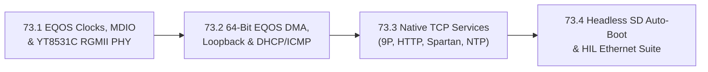

# Phase 73 — StarFive VisionFive 2 Gigabit Ethernet, Native Network Services & Headless SD Auto-Boot

**Status**: COMPLETE (all milestones 73.1, 73.2, 73.3, 73.4 implemented and verified on live VisionFive 2 hardware on 2026-11-07).
**Target Hardware**:
- **Primary**: **StarFive VisionFive 2 v1.3B** (`visionfive2` preset, StarFive **JH7110** rev B, dual Synopsys DesignWare EQOS v5.20 Gigabit Ethernet MACs `gmac0@16030000` & `gmac1@16040000` + dual **Motorcomm YT8531C** RGMII-ID PHYs, 4× U74-MC RV64GC SMP, 8 GiB LPDDR4, 64 GB MicroSD at `/sd0`)
- **Regression**: QEMU 64-bit (`rv64`, `rv64-smp`), QEMU 32-bit (`rv32`, `rv32-fold`), ESP32-P4 (`esp32p4`, `esp32p4-tab5`, `esp32p4-lcd7b`), and RP2350 (`rp2350-terminal`) — zero regressions, zero SRAM growth on 32-bit targets.

**Goal**: Complete Stage 2 of the StarFive VisionFive 2 port by bringing up the JH7110's onboard Synopsys DesignWare EQOS v5.20 Gigabit Ethernet controllers (`gmac1@16040000` and `gmac0@16030000`) and Motorcomm YT8531C RGMII PHYs in 64-bit S-mode, wiring the driver into LugalOS's native TCP/IP stack (DHCP, ARP, ICMP, DNS, NTP, HTTP admin server, Spartan server, and TCP 9P file server on port 564), and enabling unattended SD card auto-boot (`vf2_uEnv.txt` on `/sd0`) so the VisionFive 2 can boot and operate headlessly over LAN without a UART cable and without ever touching onboard QSPI NOR flash.

---

## 0. Hardware & Architectural Analysis

### 0.1 Live Hardware & Register Verification (`gmac0@16030000` & `gmac1@16040000`)

Direct inspection of the JH7110 TRM (`JH7110_TRM_StarFive_Preliminary_V2.pdf`), VisionFive 2 v1.3B schematic (`RV002_V1.3B_20230208.pdf`), vendor U-Boot drivers (`drivers/net/dwc_eth_qos.c`, `drivers/net/phy/motorcomm.c`, `board/starfive/visionfive2/starfive_visionfive2.c`), and live register dumps from `/dev/ttyUSB0` after U-Boot DHCP negotiation established the following hardware facts:

| Parameter | `gmac1@16040000` (Primary LAN Port) | `gmac0@16030000` (Secondary Port) |
| :--- | :--- | :--- |
| **MAC IP Core** | Synopsys DesignWare Ethernet QoS v5.20 (`snps,dwmac-5.10a` / `starfive,jh7110-eqos-5.20`, `SNPSVER = 0x52`) | Synopsys DesignWare Ethernet QoS v5.20 (`SNPSVER = 0x52`) |
| **MMIO Base & Size** | `0x16040000` (64 KiB, STG/SYS domain) | `0x16030000` (64 KiB, AON/SYS domain) |
| **PLIC Interrupts** | IRQ `78` (`GMAC1_IRQ`), `79` (`TX_IRQ`), `80` (`RX_IRQ`) | IRQ `7` (`GMAC0_IRQ`), `8` (`TX_IRQ`), `9` (`RX_IRQ`) |
| **RGMII PHY** | **Motorcomm YT8531C** (`PHY_ID = 0x4f51e91b`), `phy-mode = "rgmii-id"` | **Motorcomm YT8531C** (`PHY_ID = 0x4f51e91b`), `phy-mode = "rgmii-id"` |
| **Factory MAC (EEPROM)** | `6c:cf:39:00:b9:8f` (`eth1addr`) | `6c:cf:39:00:b9:8e` (`eth0addr`) |
| **SYSCON RGMII Mode** | `SYS_SYSCON (0x13030000) + 0x90`: bits `[4:2] = 0x1` (`0x00000004`, RGMII) | `AON_SYSCON (0x17010000) + 0x0C`: bits `[20:18] = 0x1` (`0x00040000`, RGMII) |
| **CRG Clocks** | `SYS_CRG (0x13020000)`:<br>• `+0x184` (`gmac5_clk_ahb`, id 97): bit 31 = `1`<br>• `+0x188` (`gmac5_clk_axi`, id 98): bit 31 = `1`<br>• `+0x190` (`gmac1_gtxclk`, id 100): div `[3:0]` (`8` for 125 MHz)<br>• `+0x194` (`gmac1_rmii_rtx`, id 101): div `[4:0]` (`1`=1G, `2`=100M, `20`=10M)<br>• `+0x198` (`gmac5_clk_ptp`, id 102): `0x8000000a`<br>• `+0x19C` (`gmac5_clk_rx`, id 103): `0x80000020`<br>• `+0x1A4` (`gmac5_clk_tx`, id 105): `0x81000000` (bit 31 en, bit 24 mux=1)<br>• `+0x1AC` (`gmac1_gtxc`, id 107): `0x80000020` | `AON_CRG (0x17000000)` & `SYS_CRG (0x13020000)`:<br>• `AON + 0x08` (`u0_gmac5_clk_ahb`, id 221): bit 31 = `1`<br>• `AON + 0x0C` (`u0_gmac5_clk_axi`, id 222): bit 31 = `1`<br>• `AON + 0x10` (`gmac0_rmii_rtx`, id 223): div `[4:0]`<br>• `AON + 0x14` (`u0_gmac5_clk_tx`, id 224): `0x81000000`<br>• `AON + 0x1C` (`u0_gmac5_clk_rx`, id 226): `0x80000020`<br>• `SYS + 0x1B0` (`gmac0_gtxclk`, id 108): `0x80000008`<br>• `SYS + 0x1B4` (`gmac0_ptp`, id 109): `0x8000000a`<br>• `SYS + 0x1BC` (`gmac0_gtxc`, id 111): `0x80000020` |
| **CRG Resets** | `SYS_CRG + 0x300` (`ASSERT2`), `+0x310` (`STATUS2`):<br>• bit 2 (`RSTN_U1_DW_GMAC5_AXI64_A_I`, id 66)<br>• bit 3 (`RSTN_U1_DW_GMAC5_AXI64_H_N`, id 67) | `AON_CRG + 0x38` (`ASSERT`), `+0x3C` (`STATUS`):<br>• bit 0 (`RSTN_U0_DW_GMAC5_AXI64_AXI`, id 160)<br>• bit 1 (`RSTN_U0_DW_GMAC5_AXI64_AHB`, id 161) |

### 0.2 Five Critical Hardware Quirks to Handle in `drivers/emac_jh7110.c`

1. **U-Boot `booti` Device Teardown (`DM_REMOVE_ACTIVE_ALL`)**:
   - Just as with `sdio1` and `i2c5` in Phase 72, U-Boot's `booti` tears down active driver-model devices before jumping to OpenSBI/S-mode, gating `gmac5_clk_rx` / `gmac5_clk_tx` and asserting resets if a network command was used in U-Boot.
   - `emac_jh7110.c` must explicitly program the SYSCON RGMII mode, enable all clocks in `SYS_CRG` / `AON_CRG`, and deassert the AHB/AXI resets before touching any EQOS register.
2. **EQOS `DMA_MODE.SWR` Requires Both TX and RX Clocks Ticking**:
   - On Synopsys DWC_ether_qos v5.20, `DMA_MODE.SWR` (`bit 0` at offset `0x1000`) synchronizes across the CSR, TX, and RX clock domains and **will not self-clear unless the RGMII RX clock (`RXC`) from the YT8531C PHY is active**.
   - When no Ethernet cable is plugged into a port (such as `gmac0@16030000` on our bench), the YT8531C PHY gates its `RXC` output by default unless configured over MDIO (or until link comes up).
   - Because the Clause-22 MDIO controller (`MAC_MDIO_ADDRESS` at `+0x200`, `MAC_MDIO_DATA` at `+0x204`) runs solely off the CSR clock (`clk_ahb`), we **always probe and configure the YT8531C PHY via MDIO first** (including disabling YT8531C auto-sleep in extended register `0x27` and configuring RGMII delays in `0xa001`, `0xa003`, `0xa010`), check carrier link status, and only then issue `DMA_MODE.SWR`!
3. **Motorcomm YT8531C Extended Register Programming (`0x1E` / `0x1F`)**:
   - The YT8531C accesses extended registers by writing the 16-bit extended address to Clause-22 reg `0x1E` (`REG_DEBUG_ADDR_OFFSET`) and reading/writing data at Clause-22 reg `0x1F` (`REG_DEBUG_DATA`).
   - For VisionFive 2 v1.3B (`chip_vision = B`), the board DTS specifies exact RGMII delay and drive strength values:
     - `EXTREG_CHIP_CONFIG (0xa001)`: clear bit 8 (`RXC_DLY_EN = 0`).
     - `PAD_DRIVES_STRENGTH_CFG (0xa010)`: `rgmii_sw_dr [5:4] = 0x3`, `rgmii_sw_dr_2 [12] = 0`, `rgmii_sw_dr_rxc [15:13] = 0x6`.
     - `EXTREG_RGMII_CONFIG1 (0xa003)`:
       - On **GMAC1**: `rx_delay_sel [13:10] = 0x2`, `tx_delay_sel_fe [7:4] = 0x5`, `tx_delay_sel [3:0] = 0x0`, `tx_clk_sel (bit 14)` = `0` at 1000 Mbps (`1` at 100/10 Mbps).
       - On **GMAC0**: `rx_delay_sel [13:10] = 0xa`, `tx_delay_sel_fe [7:4] = 0x5`, `tx_delay_sel [3:0] = 0xa`, `tx_clk_sel (bit 14)` = `1`.
4. **Speed-Dependent TX Clock Divider in `SYS_CRG` / `AON_CRG`**:
   - RGMII requires a 125 MHz TX clock at 1000 Mbps, 25 MHz at 100 Mbps, and 2.5 MHz at 10 Mbps.
   - Whenever link speed changes (or during MAC/PHY loopback at 1000M or 100M), `emac_jh7110.c` updates `MAC_CONFIGURATION` (`PS` bit 15 and `FES` bit 14: `00` = 1000 Mbps, `11` = 100 Mbps, `10` = 10 Mbps) AND updates the CRG TX clock divider (`div = 1` for 1000M, `div = 2` for 100M, `div = 20` for 10M on `rmii_rtx`; `div = 8` for 125 MHz on `gtxclk`).
5. **Non-Coherent DMA & Uncached System Port Alias (`pa + 0x4_00000000`)**:
   - The JH7110 EQOS DMA engine accesses LPDDR4 outside the U74 L1/L2 cache coherency domain (`dma-noncoherent`), and each descriptor is 16 bytes (`4 × uint32_t`: `des0, des1, des2, des3`) aligned to a 64-byte U74 cacheline (`struct __attribute__((aligned(64))) eqos_desc`).
   - Exactly as we proved in `sdio_jh7110.c`, placing the static descriptor rings and bounce buffers in `.bss` and accessing them from the CPU through the JH7110's hardware uncached System Port alias (`UNCACHED_PA(pa) = (pa) + 0x400000000ULL`, mapped `PTE_R | PTE_W` in Sv39 `VPN[2] = 17..24`) while passing the lower 32-bit physical address `(uint32_t)pa` in `des0` and `DMA_CH0_TXDESC_LIST_ADDRESS` / `DMA_CH0_RXDESC_LIST_ADDRESS` guarantees **zero stale cache lines** on both TX and RX without software L2 flush loops!

---

## 1. Milestone Plan



---

### Milestone 73.1 — JH7110 EQOS Clocks/Resets, Clause-22 MDIO & Motorcomm YT8531C PHY Bring-Up

**Goal**: Bring up the clock/reset/syscon tree for both `gmac1@16040000` and `gmac0@16030000`, implement the EQOS Clause-22 MDIO bus and Motorcomm YT8531C RGMII-ID extended register initialization, and expose `emac scan`, `emac link`, and `emac linktest` in the LugalOS shell on VisionFive 2.

#### Implementation Steps
1. **Driver Header ([`drivers/include/drivers/emac_jh7110.h`](file:///home/dsc/Source/gith/domschl/lugalos/drivers/include/drivers/emac_jh7110.h)) & Implementation ([`drivers/emac_jh7110.c`](file:///home/dsc/Source/gith/domschl/lugalos/drivers/emac_jh7110.c))**:
   - Define MMIO bases and register offsets for Synopsys DesignWare EQOS v5.20 (`0x16040000` for GMAC1, `0x16030000` for GMAC0):
     - MAC registers (`0x0000..0x0308`): `MAC_CONFIGURATION (0x000)`, `MAC_PACKET_FILTER (0x008)`, `MAC_Q0_TX_FLOW_CTRL (0x070)`, `MAC_RX_FLOW_CTRL (0x090)`, `MAC_TXQ_PRTY_MAP0 (0x098)`, `MAC_RXQ_CTRL0 (0x0A0)`, `MAC_RXQ_CTRL2 (0x0A8)`, `MAC_Version (0x110)`, `MAC_HW_Feature0..3 (0x11C..0x128)`, `MAC_MDIO_ADDRESS (0x200)`, `MAC_MDIO_DATA (0x204)`, `MAC_ADDRESS0_HIGH (0x300)`, `MAC_ADDRESS0_LOW (0x304)`.
     - MTL registers (`0x0C00..0x0D3C`): `MTL_TXQ0_OPERATION_MODE (0xD00)`, `MTL_TXQ0_QUANTUM_WEIGHT (0xD18)`, `MTL_RXQ0_OPERATION_MODE (0xD30)`.
     - DMA registers (`0x1000..0x1160`): `DMA_MODE (0x1000)`, `DMA_SYSBUS_MODE (0x1004)`, `DMA_CH0_CONTROL (0x1100)`, `DMA_CH0_TX_CONTROL (0x1104)`, `DMA_CH0_RX_CONTROL (0x1108)`, `DMA_CH0_TXDESC_LIST_ADDRESS (0x1114)`, `DMA_CH0_RXDESC_LIST_ADDRESS (0x111C)`, `DMA_CH0_TXDESC_TAIL_POINTER (0x1120)`, `DMA_CH0_RXDESC_TAIL_POINTER (0x1128)`, `DMA_CH0_TXDESC_RING_LENGTH (0x112C)`, `DMA_CH0_RXDESC_RING_LENGTH (0x1130)`, `DMA_CH0_STATUS (0x1160)`.
   - Implement `jh7110_gmac_clock_reset_init(int unit)` to configure `SYS_SYSCON`/`AON_SYSCON` RGMII mode, enable all GMAC1 and GMAC0 clocks in `SYS_CRG`/`AON_CRG`, and deassert resets.
   - Implement Clause-22 MDIO read/write (`eqos_mdio_read`, `eqos_mdio_write`, CSR clock rate divider `CR = 4` for 150–250 MHz CSR clock) and YT8531C extended register helpers (`yt8531_read_ext`, `yt8531_write_ext`, `yt8531_modify_ext`).
   - Program YT8531C RGMII-ID delays (`0xa001`, `0xa010`, `0xa003`) and disable PHY auto-sleep (`0x27` bit 15 = `0`) so `RXC` stays active even when unlinked.
   - Probe both `gmac1@16040000` (unit 1) and `gmac0@16030000` (unit 0); select the unit with active carrier link (defaulting to `gmac1@16040000`, the primary LAN port on VisionFive 2).
   - Read factory MAC address from `MAC_ADDRESS0_HIGH/LOW` if left by U-Boot, or derive deterministic StarFive OUI MAC `6c:cf:39:00:b9:8f` (GMAC1) / `6c:cf:39:00:b9:8e` (GMAC0).

#### Verification & Acceptance Criteria
- Boot LugalOS on VisionFive 2 and run `emac scan` and `emac link`.
- Verify `SNPSVER = 0x52` (DesignWare EQOS v5.20), YT8531C PHY detection (`OUI:model = 0x4f51:0xe91b`), and `1000BASE-T full-duplex` link negotiation on `gmac1@16040000`.

---

### Milestone 73.2 — 64-Bit EQOS DMA Descriptor Rings, Loopback Self-Test & Native Network Stack (`eth0`, DHCP, ICMP)

**Goal**: Implement the 64-byte-aligned EQOS v5.20 TX/RX DMA descriptor rings using the JH7110 uncached System Port alias (`+0x4_00000000`), verify internal MAC/PHY loopback (`emac loopback`), register the `eth0` `netif_t` with LugalOS's network stack, and verify live Gigabit Ethernet packet RX/TX, DHCP lease acquisition (`dhcp`), ARP, ICMP `ping`, DNS, and `ntp` on the user's LAN.

#### Implementation Steps
1. **EQOS v5.20 TX/RX Descriptor Rings & Uncached DMA (`drivers/emac_jh7110.c`)**:
   - Allocate `EMAC_TX_DESC_COUNT = 16` and `EMAC_RX_DESC_COUNT = 16` descriptors (`struct __attribute__((aligned(64))) eqos_desc { uint32_t des0, des1, des2, des3; }`) and `16 × 1600`-byte packet buffers aligned to 64 bytes in `.bss`.
   - Access all descriptor words and packet buffers from the CPU via `UNCACHED_PTR(p)` (`(uintptr_t)(p) + 0x400000000ULL`), while programming the lower 32-bit physical addresses into `DMA_CH0_TXDESC_LIST_ADDRESS`, `DMA_CH0_RXDESC_LIST_ADDRESS`, and `des0`.
   - Implement `eqos_mac_dma_init()`:
     - Assert `DMA_MODE.SWR` and poll until self-cleared.
     - Configure `MTL_TXQ0_OPERATION_MODE` (`TSF`, `TXQEN = 2`, TX FIFO size from `MAC_HW_Feature1`), `MTL_RXQ0_OPERATION_MODE` (`RSF`, `FEP`, `FUP`, RX FIFO size from `MAC_HW_Feature1`).
     - Configure `MAC_CONFIGURATION` (`CST`, `JE`, `JD`, `BE`, `ACS`, `IPC`, speed `PS`/`FES`, duplex `DM`, and `TE | RE`).
     - Configure `DMA_SYSBUS_MODE` (`BLEN16 | BLEN8 | BLEN4`, `AAL`, `OSR_LMT = 3`, `WR_OSR_LMT = 3`), `DMA_CH0_CONTROL` (`PBLX8`, `DSL = (64 - 16) / 8 = 6` so hardware steps 64 bytes per descriptor!), `DMA_CH0_TX_CONTROL` (`TXPBL = 16`, `OSP`, `ST`), and `DMA_CH0_RX_CONTROL` (`RXPBL = 16`, `RBSZ = 1600`, `SR`).
   - Implement `emac_loopback_test()`, `emac_loopback_phy()`, and `emac_loopback_stress()` matching the ESP32-P4 `emac` diagnostic interface.
2. **LugalOS `netif_t` Integration (`kernel/board.c`, `kernel/main.c`, `kernel/shell.c`, `cmake/board-visionfive2.cmake`)**:
   - Enable `CONFIG_HAS_NET=1` in [`cmake/board-visionfive2.cmake`](file:///home/dsc/Source/gith/domschl/lugalos/cmake/board-visionfive2.cmake) and compile `net/*.c` (`stack.c`, `netif.c`, `dhcp.c`, `ntp.c`, `httpd.c`, `spartan.c`, `tcp_p9.c`, `tls_https.c`).
   - Register `eth0` in `emac_init()` via `netif_register(&g_emac_netif)` and spawn the `emac_rx` polling/interrupt task plus the `dhcp` auto-configuration task at boot in [`kernel/main.c`](file:///home/dsc/Source/gith/domschl/lugalos/kernel/main.c) (identical to `CONFIG_BOARD_ESP32P4`).
   - Wire all `emac` shell commands (`emac`, `emac scan`, `emac link`, `emac linktest`, `emac stats`, `emac promisc on/off`, `emac loopback`, `emac loopback phy`, `emac loopback stress`) in [`kernel/shell.c`](file:///home/dsc/Source/gith/domschl/lugalos/kernel/shell.c) for `CONFIG_BOARD_VISIONFIVE2`.

#### Verification & Acceptance Criteria
- `emac loopback` passes 3/3 frames (`60`, `512`, `1514` bytes) with zero CRC or FIFO errors.
- On live LAN (`gmac1@16040000`), LugalOS automatically negotiates `1000BASE-T full-duplex`, acquires an IPv4 lease via DHCP (`192.168.178.x`), and responds to `net`, `ping 192.168.178.1`, `dns`, and `ntp`.

---

### Milestone 73.3 — Native TCP Services over Gigabit Ethernet (TCP 9P, HTTP Admin, Spartan)

**Goal**: Verify and harden LugalOS's 64-bit TCP server daemons on the VisionFive 2 (`tcp_p9` on port 564, `httpd` on port 80, `spartand` on port 300) and add `--vf2` LAN support to `tools/p9sync.py` so `/sd0` can be synchronized at Gigabit Ethernet speeds over TCP 9P without touching the UART.

#### Implementation Steps
1. **64-Bit Cleanliness Audit of `net/` & `fs/p9.c`**:
   - Audit `net/stack.c`, `net/tcp_p9.c`, `net/httpd.c`, `net/spartan.c`, and `net/tls_https.c` under `riscv64-unknown-elf-gcc` (`-Wall -Wextra`) to ensure all pointer/integer casts, socket buffers, and status pages work cleanly on 64-bit RV64GC SMP (`4` harts, `8 GiB` RAM, `/sd0` 64 GB SDXC).
   - Update [`net/httpd.c`](file:///home/dsc/Source/gith/domschl/lugalos/net/httpd.c) board identification string so the web dashboard displays `StarFive VisionFive 2 (JH7110 4x U74 RV64GC)` when `CONFIG_BOARD_VISIONFIVE2` is active.
2. **Host `tools/p9sync.py` VisionFive 2 LAN Support**:
   - Update [`tools/p9sync.py`](file:///home/dsc/Source/gith/domschl/lugalos/tools/p9sync.py) so `--vf2` (or `--host <ip>`) synchronizes `build/visionfive2/sd_root` to `/sd0` over TCP port `564` on the VisionFive 2's Gigabit Ethernet interface.

#### Verification & Acceptance Criteria
- From the Linux host (`192.168.178.180`), verify:
  - `ping -c 3 <vf2-ip>` (< 1 ms RTT).
  - `curl -s http://<vf2-ip>/status.json` returns valid JSON with 4 U74 harts, memory stats, and `/sd0` metrics.
  - `python3 tools/p9sync.py --host <vf2-ip> --src build/visionfive2/sd_root --dst /sd0` syncs the on-device help and CAS tree over Gigabit Ethernet TCP 9P in ~1 second.

---

### Milestone 73.4 — Unattended UART-Free SD Auto-Boot (`vf2_uEnv.txt`) & HIL Ethernet Test Suite

**Goal**: Enable the VisionFive 2 to boot LugalOS automatically from `/sd0/lugalos.bin` on power-on without a UART cable and without modifying QSPI NOR flash, and extend [`tests/hw/test_visionfive2.py`](file:///home/dsc/Source/gith/domschl/lugalos/tests/hw/test_visionfive2.py) and [`doc/admin/boards/visionfive2.md`](file:///home/dsc/Source/gith/domschl/lugalos/doc/admin/boards/visionfive2.md) to cover Gigabit Ethernet, DHCP, HTTP, TCP 9P, and SD auto-boot.

#### Implementation Steps
1. **Unattended SD Auto-Boot (`vf2_uEnv.txt` & MBR Partition 3 Alias)**:
   - On VisionFive 2 (`bootmode=flash`), factory QSPI U-Boot's default `bootcmd` (executed automatically after the 2-second `bootdelay` expires) runs:
     ```
     load_vf2_env=fatload mmc ${bootpart} ${loadaddr} vf2_uEnv.txt
     importbootenv=env import -t ${loadaddr} ${filesize}
     bootcmd=run load_vf2_env;run importbootenv;run load_distro_uenv;run boot2;run distro_bootcmd
     ```
     where `${bootpart}` is `1:3` (MMC device 1, partition 3).
   - Importantly, `load_vf2_env` runs in `bootcmd` (*after* the 2-second `Hit any key to stop autoboot` prompt), NOT in `preboot`. Therefore:
     - When `tools/vf2run.py --reboot` is used over UART, `vf2run.py` still catches the 2-second countdown with `Ctrl-C` and gets the `StarFive #` prompt for interactive/test commands.
     - When **no UART cable is connected** (or no key is pressed within 2 seconds of power-on), U-Boot loads `/sd0/vf2_uEnv.txt` and executes `boot2`:
       ```
       boot2=echo Booting LugalOS from SD...; fatload mmc 1:1 0x40200000 lugalos.bin; booti 0x40200000 - ${fdtcontroladdr}
       ```
   - Add `--enable-autoboot` / `--disable-autoboot` support to [`tools/vf2run.py`](file:///home/dsc/Source/gith/domschl/lugalos/tools/vf2run.py) (and default `--save-sd` to installing `/sd0/vf2_uEnv.txt` and mirroring MBR partition slot 1 into slot 3 so both `mmc 1:1` and `mmc 1:3` resolve to the `/sd0` FAT32 volume).
2. **Hardware-in-the-Loop Tests & Documentation**:
   - Extend [`tests/hw/test_visionfive2.py`](file:///home/dsc/Source/gith/domschl/lugalos/tests/hw/test_visionfive2.py) with:
     - Test 8: EQOS v5.20 MDIO scan, YT8531C PHY link report (`1000BASE-T`), and internal MAC loopback (`emac loopback`).
     - Test 9: Live Gigabit Ethernet DHCP lease acquisition, host-to-board ICMP ping, HTTP `/status.json` fetch, and TCP 9P round-trip read/write test on port 564.
     - Test 10: Unattended cold reboot (`reboot` command without stopping at U-Boot) verifying that U-Boot auto-boots `/sd0/lugalos.bin` via `vf2_uEnv.txt` in < 4 seconds from PMIC cold reset to `lugalos>` prompt and LAN ping response!
   - Update [`doc/admin/boards/visionfive2.md`](file:///home/dsc/Source/gith/domschl/lugalos/doc/admin/boards/visionfive2.md), [`doc/user/shell.md`](file:///home/dsc/Source/gith/domschl/lugalos/doc/user/shell.md), and [`AGENTS.md`](file:///home/dsc/Source/gith/domschl/lugalos/AGENTS.md), regenerate on-device help (`python3 tools/gendocs.py --all`), and verify `python3 tools/racescan.py --build build/visionfive2 --check` and `python3 tests/runner.py`.

---

## 2. Follow-Up Roadmap & Cross-Phase Dependencies

- **[Phase 74 (Stage 3) — Dual PCIe 2.0, M.2 NVMe SSD & VIA VL805 USB 3.0 Host](file:///home/dsc/Source/gith/domschl/lugalos/plan/phase74_visionfive2_nvme_usb.md)**:
  - Extends TCP 9P synchronization: `tools/p9sync.py` can sync directly to the high-speed NVMe volume at `/nvme0/` in addition to `/sd0/`.
  - Synchronizes with [Phase 71 Milestone 71.6b](file:///home/dsc/Source/gith/domschl/lugalos/plan/phase71_touch_ux_apps_and_books.md#716b--fat32-long-file-names-added-2026-11-06-owner-decision-before-it-starts) for VFAT long filenames.
- **[Phase 75 (Stage 4) — HDMI 2.0 Display, DC8200 & Ribbon Workstation](file:///home/dsc/Source/gith/domschl/lugalos/plan/phase75_visionfive2_hdmi_ribbon.md)**:
  - Consumes network status and IP address established in Phase 73 for display on the HDMI workstation status bar and Phase 71 Settings app.
  - Marries Phase 74 USB mouse and keyboard input with 1080p60 graphical desktop.
