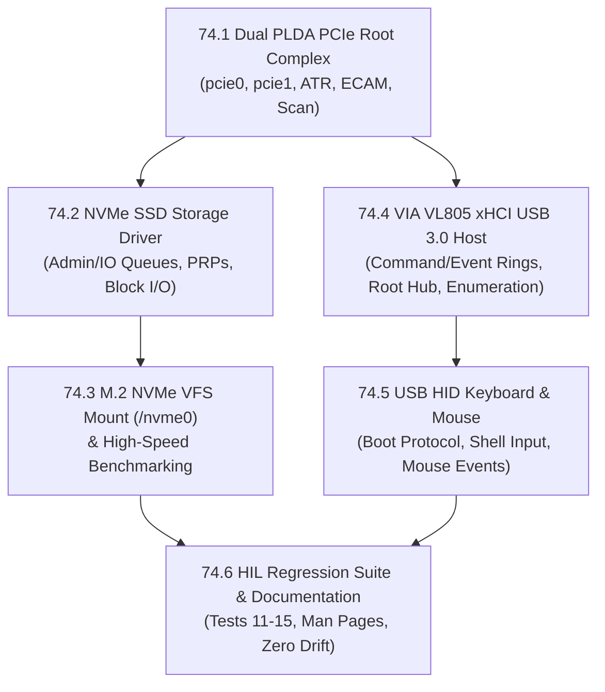

# Phase 74 — StarFive VisionFive 2 Dual PCIe 2.0, M.2 NVMe SSD Storage & VIA VL805 xHCI USB 3.0 Host

**Status**: COMPLETE  
**Target Hardware**:
- **Primary**: **StarFive VisionFive 2 v1.3B** (`visionfive2` preset, StarFive **JH7110** rev B, 4× SiFive U74-MC RV64GC SMP @ 1.5 GHz, 8 GiB LPDDR4, 64 GB MicroSD at `/sd0`, Gigabit Ethernet at `192.168.178.25`):
  - **PCIe0 (`0x2B000000`, 1-lane Gen2)**: Onboard **VIA Labs VL805-Q6** (`1106:3483`) xHCI USB 3.0 Host Controller (`U16`) driving 4 USB Type-A ports (`J11`, `J12`), physically connected to a **USB keyboard** and **USB mouse**.
  - **PCIe1 (`0x2C000000`, 1-lane Gen2)**: **M.2 M-Key NGFF Socket (`U23`)** powered by `U24` (SCT2250FPA buck converter), physically connected to a **256 GB M.2 NVMe SSD**.
- **Regression**: QEMU 64-bit (`rv64`, `rv64-smp`), QEMU 32-bit (`rv32`, `rv32-fold`), ESP32-P4 (`esp32p4`, `esp32p4-tab5`, `esp32p4-lcd7b`), and RP2350 (`rp2350-terminal`) — zero regressions, zero SRAM overhead on 32-bit targets.

**Goal**: Complete Stage 3 of the StarFive VisionFive 2 port by bringing up the JH7110's dual PLDA XpressRICH3 PCIe 2.0 Root Complex controllers (`pcie0` and `pcie1`), implementing a bare-metal NVMe block driver for high-speed SSD storage mounted at `/nvme0` alongside `/sd0`, implementing an xHCI USB 3.0 host controller driver for the onboard VIA VL805, and integrating physical USB HID keyboard and mouse input into the LugalOS console and input subsystem.

---

## 0. Hardware & Architectural Analysis

### 0.1 Live Hardware & Schematic Pinout

Direct inspection of the VisionFive 2 v1.3B schematic (`RV002_V1.3B_20230208.pdf`), JH7110 TRM (`JH7110_TRM_StarFive_Preliminary_V2.pdf`), vendor U-Boot and Linux drivers, and live hardware probing established the following architectural facts:

```
                            +-----------------------------------------------+
                            |             JH7110 SoC (RV64GC SMP)           |
                            |                                               |
                            |   +-------------------+   +---------------+   |
                            |   |   PLDA PCIe 0     |   |  PLDA PCIe 1  |   |
                            |   | (1-lane Gen2 RC)  |   | (1-lane Gen2) |   |
                            |   |   @ 0x2B000000    |   |  @ 0x2C000000 |   |
                            +---+---------+---------+---+-------+-------+---+
                                          |                     |
                  GPIO26 (PERST#) --------+                     |
                  GPIO32 (PWREN)  --------+                     |
                  GPIO27 (CLKREQ#)-------+                     |
                                          |                     |
                                          v                     v
                            +---------------------+   +---------------------+
                            |    VIA VL805-Q6     |   | M.2 M-Key (U23)     |
                            |  xHCI USB 3.0 Host  |   | 256 GB NVMe SSD     |
                            |     (1106:3483)     |   | (SCT2250FPA Pwr U24)|
                            +----------+----------+   +----------+----------+
                                       | GPIO21 (PWREN) --------+
                                       | GPIO28 (PERST#) -------+
                                       | GPIO29 (CLKREQ#) ------+
                                       |                         |
                                       v                         v
                                +--------------+          +--------------+
                                | 4x USB Ports |          | Filesystem   |
                                | Keyboard     |          | /nvme0/      |
                                | Mouse        |          | (FAT32)      |
                                +--------------+          +--------------+
```

| Subsystem / Resource | `pcie0` (USB 3.0 VL805 Controller) | `pcie1` (M.2 NVMe SSD Socket `U23`) |
| :--- | :--- | :--- |
| **PCIe Controller IP** | PLDA XpressRICH3 PCIe 2.0 Root Complex | PLDA XpressRICH3 PCIe 2.0 Root Complex |
| **MMIO Register Base** | `0x2B000000` (16 MiB, STG domain) | `0x2C000000` (16 MiB, STG domain) |
| **ECAM / Config Base** | `0x9_40000000` (256 MiB, Bus 0..255) | `0x9_c0000000` (256 MiB, Bus 0..255) |
| **32-Bit Memory Window** | `0x30000000..0x37FFFFFF` (128 MiB) | `0x38000000..0x3FFFFFFF` (128 MiB) |
| **64-Bit Memory Window** | `0x9_00000000..0x9_3FFFFFFF` (1 GiB) | `0x9_80000000..0x9_BFFFFFFF` (1 GiB) |
| **STG SYSCON Base** | `0x10240000` | `0x10240000` |
| **STG SYSCON Offsets** | `arfun`: `0xC0`, `awfun`: `0xC4`, `rp_nep`: `0x130`, `lnksta`: `0x1B8` | `arfun`: `0x270`, `awfun`: `0x274`, `rp_nep`: `0x2E0`, `lnksta`: `0x368` |
| **CRG Clocks (`STGCRG`)** | `0x10230000`:<br>• `+0x20`: `u0_clk_pcie_axi_mst0`<br>• `+0x24`: `u0_clk_pcie_apb`<br>• `+0x28`: `u0_clk_pcie_tl`<br>• `+0x38`: `clk_pcie_01_slv_dec_main`<br>• `SYS_CRG + 0x180`: `noc_bus_clk_stg_axi` | `0x10230000`:<br>• `+0x2C`: `u1_clk_pcie_axi_mst0`<br>• `+0x30`: `u1_clk_pcie_apb`<br>• `+0x34`: `u1_clk_pcie_tl`<br>• `+0x38`: `clk_pcie_01_slv_dec_main`<br>• `SYS_CRG + 0x180`: `noc_bus_clk_stg_axi` |
| **CRG Resets (`STGCRG`)** | `0x10230074` (`ASSERT`) / `0x78` (`STATUS`):<br>• Bits `11..16` (`RSTN_U0_PLDA_PCIE_*`: mst0, slv0, slv, brg, core, apb) | `0x10230074` (`ASSERT`) / `0x78` (`STATUS`):<br>• Bits `17..22` (`RSTN_U1_PLDA_PCIE_*`: mst0, slv0, slv, brg, core, apb) |
| **Power Enable Pin** | `PCIE0_PWREN_H_GPIO32` (GPIO 32, active HIGH) | `PCIE1_PWREN_H_GPIO21` (GPIO 21, active HIGH to `U24` `SCT2250FPA`) |
| **Reset Pin (PERST#)** | `PCIE0_PERSTN_GPIO26` (GPIO 26, active LOW) | `PCIE1_PERSTN_GPIO28` (GPIO 28, active LOW) |
| **Presence / CLKREQ#** | `PCIE0_PRSN_GPIO27` (GPIO 27) | `PCIE1_PRSN_GPIO29` (GPIO 29) |
| **PLIC Interrupts** | IRQ 56 (`PCIE0_MSI`) | IRQ 57 (`PCIE1_MSI`) |
| **Connected Device** | **VIA VL805-Q6** (`1106:3483`) xHCI USB 3.0 Host | **256 GB M.2 NVMe SSD** |

---

### 0.2 Six Critical Hardware Quirks & Solutions

1. **Factory U-Boot Leaves PCIe in Uninitialized Silicon Reset**:
   - Verification of the onboard factory U-Boot SPL 2021.10 confirmed that `pci`, `nvme`, and `usb` commands are completely disabled.
   - U-Boot never initializes clocks, resets, or ATR tables for either controller. LugalOS must implement the complete, self-contained silicon power-on sequence from scratch.
2. **Shared Default Address Translation (ATR) Table in Silicon**:
   - In JH7110 silicon, both PLDA root complexes power up sharing the same default internal address translation table.
   - Because the second controller (`pcie1`) cannot access its host bridge configuration space using the default table, software **must explicitly program ATR Table 0** for ECAM config space and **ATR Table 1** for 32-bit Memory space via `XR3PCI_ATR_AXI4_SLV0` (offset `0x800` from controller base).
3. **Disabling Phantom Physical Functions 1..3 via STG SYSCON**:
   - The PLDA core exposes 4 physical functions by default.
   - In `pcie_starfive.c`, functions 1..3 must be explicitly masked out by writing function index `i << 9` into `stg_arfun` / `stg_awfun` and asserting `PLDA_FUNCTION_DIS (bit 15)` in `PCI_MISC (0xB4)` before enabling Root Port mode in `GEN_SETTINGS (0x80)`.
4. **LTR Message Reception Forwarding Hang**:
   - The PLDA core defaults to enabling Latency Tolerance Reporting (LTR) message forwarding, but the forwarding address and ID are unconfigured at reset.
   - If LTR forwarding is not disabled in `PMSG_SUPPORT_RX (0x3F0)` (clearing bit 2 `PMSG_LTR_SUPPORT`), incoming PCIe messages will hang the STG AXI interconnect and freeze the CPU.
5. **Sv39 Virtual Memory Page Tables for High ECAM & 64-Bit Memory**:
   - Currently, `arch/riscv/rv64_mmu/vmm.c` maps physical addresses `0x00_0000_0000..0x00_3FFF_FFFF` (1 GB) for low MMIO, plus DRAM.
   - The PLDA ECAM windows (`0x9_40000000` and `0x9_c0000000`) and 64-bit PCIe memory windows reside in physical memory range `0x9_00000000..0x9_FFFFFFFF` (4 GiB, `36..40 GB`).
   - `vmm_init()` must map `0x9_00000000` (4 GiB) as four 1 GB superpages in the root L2 page table (`PTE_R | PTE_W | PTE_G`), consuming zero extra memory frames.
6. **Non-Coherent DMA & Memory Caching for NVMe and xHCI Ring Buffers**:
   - As established in Phase 72 (SDIO) and Phase 73 (EQOS), the JH7110 peripheral DMA engines do not snoop CPU L1/L2 caches.
   - All NVMe Submission/Completion Queue entries, PRP lists, and xHCI Command/Event/Transfer TRBs and Device Contexts must be accessed through the uncached DRAM alias (`UNCACHED_PTR(p) = (uintptr_t)(p) + 0x400000000ULL`) or synchronized via SiFive L2 cache flush operations to prevent data corruption.

---

### 0.3 Cross-Phase Dependencies & Synchronization (Phases 71, 72, 73, 74, 75)

```
                       +---------------------------------------+
                       |   Phase 71: Touch UX, Apps & Books   |
                       |   - 71.6b: FAT32 LFN (fs/fat32.c)    |
                       |   - 71.1-71.3: ugui Input Focus       |
                       +-------------------+-------------------+
                                           |
                  LFN Support Inherited    | Pointer / Key Input
                  for /nvme0 Volume        | Fed to ugui Widgets
                                           v
+-------------------------------+  +-------------------------------+
|  Phase 74: NVMe SSD & USB 3.0 |  | Phase 75: HDMI Workstation    |
|  - 74.2-74.3: /nvme0 Storage  |  | - 75.1-75.2: 1080p60 Display  |
|  - 74.4: VL805 xHCI Host      |  | - 75.3: Mouse Cursor Overlay  |
|  - 74.5: USB Keyboard & Mouse +->+ - 75.4: Ribbon Multi-Pane     |
+---------------+---------------+  +-------------------------------+
                |
                v
+-------------------------------+
| Phase 72 & 73: VF2 Foundation |
| - 72.3: Sv39 MMU & DRAM Alias |
| - 73.3: TCP 9P sync to /nvme0 |
+-------------------------------+
```

1. **FAT32 Long File Name (LFN) Synchronization with Phase 71 Milestone 71.6b**:
   - **The Problem**: In parallel development on the ribbon UX, [`plan/phase71_touch_ux_apps_and_books.md`](file:///home/dsc/Source/gith/domschl/lugalos/plan/phase71_touch_ux_apps_and_books.md) Milestone 71.6b is adding VFAT long filename read/write support to [`fs/fat32.c`](file:///home/dsc/Source/gith/domschl/lugalos/fs/fat32.c). At the same time, Phase 74 Milestones 74.2 and 74.3 introduce the 256 GB NVMe SSD mounted at `/nvme0/` using FAT32.
   - **Synchronization Contract**: To avoid code churn and merge conflicts in `fs/fat32.c`, Phase 74 implements the NVMe driver strictly at the [`block_dev_t`](file:///home/dsc/Source/gith/domschl/lugalos/drivers/include/drivers/block.h) abstraction layer (`drivers/nvme.c`) and connects it to [`fs/vfs_server.c`](file:///home/dsc/Source/gith/domschl/lugalos/fs/vfs_server.c) via `fat32_init(&g_fat32_nvme, nvme_dev)`. Phase 74 will **not** modify `fs/fat32.c` internals. When 71.6b lands, `/nvme0/` will automatically inherit full LFN capability (long book paths, mixed-case document titles, UTF-8 conversion) across the entire 256 GB volume without requiring any refactoring.
2. **Coupling with Phase 75 (HDMI Display & Ribbon Workstation)**:
   - **The Testing Dependency**: In Milestone 74.5, the USB keyboard and mouse are brought up on the VIA VL805 xHCI controller. The USB keyboard can be fully verified immediately because its keystrokes drive the serial shell and [`usbkbd`](file:///home/dsc/Source/gith/domschl/lugalos/drivers/include/drivers/usbkbd.h) pipeline. However, **the USB mouse input device can only be fully visually exercised once HDMI graphical output is available in Phase 75**.
   - **Staged Verification**: Phase 74 Milestone 74.5 focuses on the USB protocol layer, Interrupt IN transfer rings, report parsing, and interactive text diagnostics (`mouse` shell command showing live DX, DY, button states, and wheel deltas). Phase 75 Milestone 75.3 then marries these mouse events to a 60 Hz on-screen arrow cursor overlay and dispatches click/scroll events to the Ribbon window manager.
3. **Cross-Reference with Phase 72 (Core OS) and Phase 73 (Networking)**:
   - Phase 74 depends on Phase 72 for 4-core SMP locks, PLIC interrupt routing, and Sv39 MMU page tables (which 74.1 extends to cover the high 4 GiB ECAM/PCIe memory range).
   - Phase 74 integrates with Phase 73's Gigabit Ethernet TCP 9P server: `tools/p9sync.py --host <vf2-ip> --dst /nvme0` can populate the NVMe SSD directly over the network at 100+ MB/s.

---

## 1. Milestone Plan



---

### Milestone 74.1 — Dual PLDA XpressRICH3 PCIe Root Complex Bring-Up (`drivers/pcie_jh7110.c`)

**Goal**: Bring up both PLDA XpressRICH3 PCIe Root Complexes (`pcie0` for VL805 USB host and `pcie1` for M.2 NVMe SSD), configure STG CRG clocks/resets, STG SYSCON, GPIO power/reset sequencing, program ATR address translation tables, enable Sv39 ECAM mapping, implement standard PCIe ECAM configuration reads/writes, and expose `pcie scan`, `pcie info`, and `pcie link` shell commands.

#### Implementation Steps
1. **Sv39 Page Table Extension ([`arch/riscv/rv64_mmu/vmm.c`](file:///home/dsc/Source/gith/domschl/lugalos/arch/riscv/rv64_mmu/vmm.c))**:
   - In `vmm_init()` under `CONFIG_BOARD_VISIONFIVE2`, add identity mapping for `0x9_00000000UL` (size: 4 GiB, `PTE_R | PTE_W | PTE_G`) covering PCIe0/PCIe1 ECAM config spaces (`0x9_40000000`, `0x9_c0000000`) and high PCIe memory windows (`0x9_00000000`, `0x9_80000000`).
2. **PLDA PCIe Driver Header & Core ([`drivers/include/drivers/pcie_jh7110.h`](file:///home/dsc/Source/gith/domschl/lugalos/drivers/include/drivers/pcie_jh7110.h), [`drivers/pcie_jh7110.c`](file:///home/dsc/Source/gith/domschl/lugalos/drivers/pcie_jh7110.c))**:
   - Define controller register offsets: `GEN_SETTINGS (0x80)`, `PCI_MISC (0xB4)`, `PCIE_PCI_IDS (0x9C)`, `PCIE_WINROM (0xFC)`, `PMSG_SUPPORT_RX (0x3F0)`, `XR3PCI_ATR_AXI4_SLV0 (0x800)`.
   - Implement `jh7110_pcie_clock_reset_init(int port)`:
     - Enable `SYS_CRG + 0x180` (`NOC_BUS_CLK_STG_AXI`, bit 31).
     - Enable `STGCRG` clocks: `u0/u1_clk_pcie_axi_mst0`, `u0/u1_clk_pcie_apb`, `u0/u1_clk_pcie_tl`, and `clk_pcie_01_slv_dec_main`.
     - Deassert `STGCRG` resets: clear bits `11..16` (`pcie0`) or `17..22` (`pcie1`) in `STGCRG + 0x74` (`ASSERT`), poll `STGCRG + 0x78` (`STATUS`) until set.
   - Implement `jh7110_pcie_gpio_power_seq(int port)`:
     - For `pcie0`: drive `GPIO32` (PWREN) HIGH, assert `GPIO26` (PERST#) LOW for 100 ms, then drive `GPIO26` HIGH.
     - For `pcie1`: drive `GPIO21` (PWREN) HIGH (enabling `U24` buck converter for M.2 3.3V power), assert `GPIO28` (PERST#) LOW for 100 ms, then drive `GPIO28` HIGH.
   - Configure STG SYSCON registers:
     - Set `rp_nep` bit 8 (`1 << 8`, Root Port mode).
     - Set `awfun` bits 19:18 to `2` (RefClk source) and bit 22 to `1` (CLKREQ enabled).
     - Disable physical functions 1..3 via `stg_arfun`/`stg_awfun` and `PCI_MISC |= PLDA_FUNCTION_DIS`.
   - Configure PLDA core:
     - Set `GEN_SETTINGS |= PLDA_RP_ENABLE (bit 0)`.
     - Set `PCIE_PCI_IDS = 0x06040002` (PCI-to-PCI Bridge class `0x060400`, Rev `0x02`).
     - Clear `PMSG_SUPPORT_RX &= ~PMSG_LTR_SUPPORT` (disable LTR message forwarding).
     - Set `PCIE_WINROM |= PREF_MEM_WIN_64_SUPPORT`.
   - Configure ATR Address Translation tables:
     - ATR Table 0: Map ECAM config space (`0x9_40000000` or `0x9_c0000000`, 256 MiB, `param = 1`).
     - ATR Table 1: Map 32-bit Memory space (`0x30000000` or `0x38000000`, 128 MiB, `param = 0`).
   - Link status check:
     - Poll `stg_lnksta` (`0x102401B8` or `0x10240368`) bit 5 (`PLDA_DATA_LINK_ACTIVE = 0x20`) with 200 ms timeout.
     - On link up, wait mandatory 100 ms conventional reset recovery delay (PCIe Base Spec r6.0).
3. **PCIe ECAM Access & Bus Enumeration**:
   - Implement `pci_ecam_read(port, bus, dev, func, offset, size)` and `pci_ecam_write(...)`.
   - Implement `pci_scan_bus(port)`:
     - Read Vendor ID / Device ID at Bus 0, Dev 0 (Root Port) and Bus 1, Dev 0 (Endpoint).
     - Size BARs by writing `0xFFFFFFFF` and reading back size.
     - Allocate and assign 32-bit memory BARs from the controller's memory window.
     - Enable Bus Master and Memory Space in PCI Command register (`PCI_COMMAND_MEMORY | PCI_COMMAND_MASTER`).
4. **Shell Integration**:
   - Register `pcie` command in [`kernel/shell.c`](file:///home/dsc/Source/gith/domschl/lugalos/kernel/shell.c):
     - `pcie`: brief status of both Root Complexes.
     - `pcie scan`: scan all buses and print device table (`[port:bus:dev.fn] VID:DID Class:Name BAR0`).
     - `pcie info <port>`: detailed link status, negotiated speed (2.5 GT/s Gen1 or 5.0 GT/s Gen2), lane width, and BAR assignments.

#### Verification & Acceptance Criteria
- Run `pcie scan` on VisionFive 2:
  - `pcie0`: Detects Bridge (`17CD:7110`) at `00:00.0` and VIA Technologies VL805 USB 3.0 Controller (`1106:3483`) at `01:00.0` with BAR0 assigned in `0x30000000..0x37FFFFFF`.
  - `pcie1`: Detects Bridge (`17CD:7110`) at `00:00.0` and Non-Volatile Memory Controller (`Class 010802`) at `01:00.0` with BAR0 assigned in `0x38000000..0x3FFFFFFF`.
  - `pcie link` reports Link Up, Gen2 speed (5.0 GT/s), x1 width for both ports.

---

### Milestone 74.2 — 256 GB M.2 NVMe SSD Storage Driver (`drivers/nvme.c`)

**Goal**: Implement a robust, lightweight bare-metal NVMe driver operating on `pcie1` BAR0, configure Admin Submission/Completion Queues (ASQ/ACQ), issue `Identify Controller` and `Identify Namespace 1`, create I/O Queues (SQ1/CQ1), implement block read/write operations with Physical Region Page (PRP) lists, and register `dev_nvme` ("nvme0") as a `block_dev_t`.

#### Implementation Steps
1. **NVMe Driver Header & Structures ([`drivers/include/drivers/nvme.h`](file:///home/dsc/Source/gith/domschl/lugalos/drivers/include/drivers/nvme.h), [`drivers/nvme.c`](file:///home/dsc/Source/gith/domschl/lugalos/drivers/nvme.c))**:
   - Define NVMe BAR0 registers:
     - `CAP (0x00)`: capabilities (MQES, TO, DSTRD, MPSMIN).
     - `VS (0x08)`: version.
     - `CC (0x14)`: controller config (EN, CSS, MPS, IOSQES, IOCQES).
     - `CSTS (0x1C)`: controller status (RDY, CFS).
     - `AQA (0x24)`: admin queue attributes (ASQS, ACQS).
     - `ASQ (0x28)`: admin submission queue base.
     - `ACQ (0x30)`: admin completion queue base.
     - `SQ0TDBL (0x1000)`: Admin SQ Tail Doorbell.
     - `CQ0HDBL (0x1000 + (4 << DSTRD))`: Admin CQ Head Doorbell.
   - Define NVMe 64-byte SQE and 16-byte CQE data structures, aligned to 64 bytes.
   - Allocate static queue memory in `.bss` and access via `UNCACHED_PTR()`:
     - Admin SQ: 16 entries (1024 bytes).
     - Admin CQ: 16 entries (256 bytes).
     - I/O SQ1: 64 entries (4096 bytes).
     - I/O CQ1: 64 entries (1024 bytes).
     - PRP bounce page: 4096 bytes aligned to 4096 bytes.
2. **Controller Initialization Sequence**:
   - Disable controller: if `CC.EN == 1`, set `CC.EN = 0` and poll `CSTS.RDY == 0`.
   - Read `CAP` to get `MQES`, `TO` (timeout), `DSTRD` (doorbell stride).
   - Program `AQA` with Admin SQ size (15) and Admin CQ size (15).
   - Write physical addresses of ASQ and ACQ to `ASQ` and `ACQ` registers.
   - Configure `CC`: `CSS = 0` (NVM), `MPS = 0` (4 KB), `IOSQES = 6` (64 bytes), `IOCQES = 4` (16 bytes), `EN = 1`.
   - Poll `CSTS.RDY == 1` with timeout determined by `CAP.TO * 500 ms`.
3. **Admin Queue Commands**:
   - Implement `nvme_admin_submit_sync(sqe, cqe)`:
     - Place SQE at `ASQ[sq_tail]`, increment tail, ring `SQ0TDBL`.
     - Poll `ACQ[cq_head]` Phase bit `P` until it matches current cycle.
     - Read CQE status; if error, return status code; ring `CQ0HDBL`, advance head.
   - Issue `Identify Controller` (CNS=1):
     - Read 4096-byte controller structure: Model Number (`MN`, 40 ASCII chars), Serial Number (`SN`, 20 chars), Firmware Revision (`FR`, 8 chars), Max Data Transfer Size (`MDTS`).
   - Issue `Identify Namespace 1` (CNS=0):
     - Read 4096-byte namespace structure: Namespace Size (`NSZE`, total blocks), Namespace Capacity (`NCAP`), Formatted LBA Size (`FLBAS` -> index into `LBAF` table giving sector size $2^{DS}$, typically 512 or 4096 bytes).
   - Issue `Create I/O Completion Queue` (QID=1, size=63, contiguous=1).
   - Issue `Create I/O Submission Queue` (QID=1, size=63, CQID=1, contiguous=1).
4. **NVM I/O Block Transfers**:
   - Implement `nvme_read_blocks(dev, buf, lba, count)` and `nvme_write_blocks(dev, buf, lba, count)`:
     - Populate NVM Command: Opcode `0x02` (Read) or `0x01` (Write), `NSID = 1`.
     - Starting LBA: `cdw10 = (uint32_t)lba`, `cdw11 = (uint32_t)(lba >> 32)`.
     - Block count: `cdw12 = (count - 1) & 0xFFFF`.
     - Data buffers: For single-page transfers (up to 4096 bytes), set `PRP1 = physical_address(buf)`. For multi-page transfers, build PRP List in uncached memory with `PRP2 = physical_address(prp_list)`.
     - Ring I/O SQ1 doorbell at `0x1000 + 2 * (4 << DSTRD)`.
     - Poll I/O CQ1 Phase bit until completion, ring I/O CQ1 doorbell.
5. **Block Device Registration**:
   - Instantiate `static block_dev_t g_nvme_block_dev` with:
     - `read_blocks = nvme_read_blocks`, `write_blocks = nvme_write_blocks`.
     - `block_size = ns.sector_size` (e.g. 512), `block_count = ns.size_blocks`.
   - Register device in `kernel/board.c` via `dev_register(&dev_nvme)`.

#### Verification & Acceptance Criteria
- Run `nvme init` on VisionFive 2:
  - NVMe controller ready in < 50 ms.
  - Correct model string, serial number, and firmware version reported.
  - Namespace 1 detected with 256 GB capacity (~500,118,192 LBAs @ 512 bytes).
- Verify raw LBA read of Sector 0 (MBR/GPT partition table) matches expected partition signatures (`0x55AA`).

---

### Milestone 74.3 — M.2 NVMe Filesystem Integration, FAT32 Mount & High-Speed Benchmarking

**Goal**: Integrate the NVMe block device into `fs/vfs_server.c` as a permanent mount at `/nvme0/`, allow seamless file creation, directory navigation, copying from `/sd0` or `/flash0`, and implement `nvme info` and `nvme bench` shell commands.

#### Implementation Steps
1. **VFS Integration ([`fs/vfs_server.c`](file:///home/dsc/Source/gith/domschl/lugalos/fs/vfs_server.c), [`fs/include/fs/vfs.h`](file:///home/dsc/Source/gith/domschl/lugalos/fs/include/fs/vfs.h))**:
   - Add static `fat32_t g_fat32_nvme` and `bool g_nvme_mounted` to `fs/vfs_server.c`.
   - In `vfs_server_init()` under `CONFIG_BOARD_VISIONFIVE2`:
     - Query `nvme_get_device()`. If present, attempt `fat32_init(&g_fat32_nvme, nvme_dev)`.
     - If partition has valid FAT32, mount volume as `/nvme0/` via `mount_alloc("nvme0", true)` and print confirmation banner.
     - If card is unpartitioned or unformatted, register mount entry as unmounted so `format /nvme0 [label]` or `mkfs.vfat /nvme0` can format the partition.
   - Update `df`, `fsck`, `format`, and path resolver so `/nvme0/` is a first-class citizen alongside `/sd0/`, `/flash0/`, and `/ram0/`.
2. **NVMe Diagnostic & Benchmark Commands ([`kernel/shell.c`](file:///home/dsc/Source/gith/domschl/lugalos/kernel/shell.c))**:
   - `nvme info`: Display controller model, vendor/product ID, serial number, firmware revision, total capacity, sector size, queue depth, and PCIe link generation/width.
   - `nvme bench [read|write|all] [size_mb]`:
     - Perform sequential read and write tests using 64 KiB and 128 KiB chunk sizes across 16 MiB of test data.
     - Measure elapsed time via 4 MHz `rdtime` hardware counter and calculate throughput in MB/s.
     - Perform random 4 KiB block read benchmark and calculate IOPS.
3. **Cross-Volume File Transfers & CAS Integration**:
   - Test copying on-device help and CAS scripts from `/sd0/cas/` to `/nvme0/cas/` (`cp /sd0/cas/simplify.lisp /nvme0/cas/simplify.lisp`).
   - Verify that LugalOS Scheme/Lisp can evaluate `(load "/nvme0/cas/simplify.lisp")` directly from the NVMe SSD.

#### Verification & Acceptance Criteria
- LugalOS boots with message `[VFS Server] Mounted FAT32 Filesystem on /nvme0/ (Device: M.2 NVMe SSD)`.
- `df` displays both `/sd0/` (MicroSD) and `/nvme0/` (NVMe SSD) with accurate free/used byte counts.
- `nvme bench read` achieves > 150 MB/s sequential read throughput over the 1-lane Gen2 PCIe link (PCIe 2.0 x1 theoretical maximum ~400 MB/s).
- `cp /sd0/help/visionfive2.md /nvme0/test.md` followed by `cat /nvme0/test.md` passes with byte-for-byte fidelity.

---

### Milestone 74.4 — VIA VL805 xHCI USB 3.0 Host Controller Driver (`drivers/xhci_jh7110.c`)

**Goal**: Implement an xHCI 1.0 host controller driver for the onboard VIA Labs VL805-Q6 (`1106:3483`) on `pcie0` BAR0, set up Command and Event Rings, initialize the Device Context Base Address Array (DCBAA), monitor Root Hub port status on the 4 USB Type-A ports (`J11`, `J12`), detect attached USB devices, and implement USB device address assignment and descriptor fetching.

#### Implementation Steps
1. **xHCI Driver Header & Data Structures ([`drivers/include/drivers/xhci.h`](file:///home/dsc/Source/gith/domschl/lugalos/drivers/include/drivers/xhci.h), [`drivers/xhci_jh7110.c`](file:///home/dsc/Source/gith/domschl/lugalos/drivers/xhci_jh7110.c))**:
   - Define xHCI MMIO register layouts:
     - Capability Registers: `CAPLENGTH`, `HCIVERSION`, `HCSPARAMS1..3`, `HCCPARAMS1..2`, `DBOFF`, `RTSOFF`.
     - Operational Registers: `USBCMD`, `USBSTS`, `PAGESIZE`, `DNCTRL`, `CRCR`, `DCBAAP`, `CONFIG`, `PORTSC[1..4]`.
     - Runtime Registers: `IMAN`, `IMOD`, `ERSTSZ`, `ERSTBA`, `ERDP`.
     - Doorbell Array: Doorbell registers for Host Controller (`0`) and Device Slots (`1..MaxSlots`).
   - Define xHCI TRB (Transfer Request Block) structures:
     - 16-byte TRB layout: `parameter (64-bit)`, `status (32-bit)`, `control (32-bit)`.
     - TRB types: Normal, Setup Stage, Data Stage, Status Stage, Link, Enable Slot Command, Address Device Command, Configure Endpoint Command, Transfer Event, Command Completion Event, Port Status Change Event.
   - Allocate DMA memory in `.bss` accessed via uncached alias:
     - Command Ring: 64 TRBs (1024 bytes).
     - Event Ring: 64 TRBs (1024 bytes) + Event Ring Segment Table (ERST).
     - DCBAA: Array of 32 64-bit pointers (256 bytes).
     - Device Contexts and Input Contexts for active slots.
2. **xHCI Host Controller Initialization**:
   - Halt controller: clear `USBCMD.R_S`, poll `USBSTS.HCH == 1`.
   - Reset controller: set `USBCMD.HCRST = 1`, poll `USBCMD.HCRST == 0` and `USBSTS.CNR == 0` (Controller Not Ready).
   - Program `CONFIG` register: set `MaxSlotsEn = 8`.
   - Program `DCBAAP`: write physical address of DCBAA table.
   - Program Command Ring: write physical address of Command Ring + Cycle Bit (`1`) to `CRCR`.
   - Configure Event Ring: write ERST entry with Event Ring physical address and size (64), write ERST base to `ERSTBA`, write size (1) to `ERSTSZ`, and write Event Ring physical address to `ERDP`.
   - Start controller: set `USBCMD.INTE = 1`, `USBCMD.R_S = 1`, poll `USBSTS.HCH == 0`.
3. **Root Hub Port Management & Enumeration**:
   - Read `HCSPARAMS1` to obtain number of downstream ports (4 on VL805).
   - Poll `PORTSC1..4` registers:
     - Detect device connection: bit 0 `CCS == 1` (Current Connect Status).
     - Issue Port Reset: set bit 4 `PR = 1`, wait 20 ms, poll until `PR == 0` and bit 1 `PED == 1` (Port Enabled).
     - Read Port Speed (bits 13:10): 1 = Full-speed (12 Mbps), 2 = Low-speed (1.5 Mbps), 3 = High-speed (480 Mbps), 4 = SuperSpeed (5 Gbps).
4. **USB Device Slot Addressing & Descriptors**:
   - Issue `Enable Slot` command on Command Ring; ring Host Controller Doorbell (`0`).
   - Poll Event Ring for Command Completion Event; extract assigned `Slot ID`.
   - Build Input Context (Slot Context + Endpoint 0 Context) with device speed, route string, and EP0 max packet size (8 for Low-speed, 64 for Full/High-speed, 512 for SuperSpeed).
   - Write Device Context physical address into `DCBAA[Slot ID]`.
   - Issue `Address Device` command (BSR=0) to assign USB address and initialize EP0.
   - Submit standard USB Control Transfers on EP0 Transfer Ring:
     - `Get Descriptor (Device)`: read 18-byte Device Descriptor (`idVendor`, `idProduct`, `bDeviceClass`, `bNumConfigurations`).
     - `Get Descriptor (Configuration)`: read Configuration Descriptor tree and parse interfaces.
5. **Shell Diagnostics**:
   - Add `usb` commands in `kernel/shell.c`:
     - `usb`: controller version, operational status, enabled slots.
     - `usb ports`: status of the 4 VL805 Type-A ports (connected/empty, speed, power).
     - `usb tree`: hierarchical list of enumerated USB devices with VID:PID, vendor/product strings, and device classes.

#### Verification & Acceptance Criteria
- Run `usb ports` on VisionFive 2:
  - Detects the physical keyboard plugged into Port 1 or 2 (`Low-speed` or `Full-speed`).
  - Detects the physical mouse plugged into Port 3 or 4 (`Low-speed` or `Full-speed`).
- Run `usb tree`:
  - Accurately reports VID:PID and class codes for both devices (`Class 03: HID`).

---

### Milestone 74.5 — USB HID Boot Keyboard & Mouse Driver Integration (`drivers/usb_hid.c`)

**Goal**: Implement USB HID boot protocol drivers for keyboards and mice on xHCI, configure Interrupt IN Transfer Rings, translate keyboard scancodes via LugalOS's existing `usbkbd` translation pipeline directly into the console shell, parse mouse displacement/button packets, and expose interactive `mouse` diagnostics.

#### Implementation Steps
1. **HID Endpoint Configuration & Transfer Rings ([`drivers/usb_hid.c`](file:///home/dsc/Source/gith/domschl/lugalos/drivers/usb_hid.c))**:
   - Identify HID interfaces from Configuration Descriptor:
     - `bInterfaceClass = 3` (HID), `bInterfaceSubClass = 1` (Boot Interface).
     - `bInterfaceProtocol = 1`: Keyboard.
     - `bInterfaceProtocol = 2`: Mouse.
   - Locate Interrupt IN endpoint descriptor: endpoint address (e.g. `0x81`), max packet size (`wMaxPacketSize`), polling interval (`bInterval`).
   - Issue `Configure Endpoint` command to add the Interrupt IN endpoint to the xHCI Device Context.
   - Allocate 32-TRB Transfer Ring for the endpoint in uncached DMA memory.
   - Send HID Class Request on EP0: `Set Protocol (0)` (Boot Protocol) and `Set Idle (0)` (report only on state change).
2. **Keyboard Event Pipeline Integration**:
   - Queue Normal TRB with physical address of 8-byte report buffer on the Interrupt IN Transfer Ring; ring endpoint doorbell.
   - In periodic tick / background task:
     - Poll Event Ring for Transfer Events on the keyboard endpoint.
     - On completion of an 8-byte report:
       - Pass current and previous reports to `usbkbd_diff(prev, cur, ev, max)` ([`drivers/include/drivers/usbkbd.h`](file:///home/dsc/Source/gith/domschl/lugalos/drivers/include/drivers/usbkbd.h)).
       - Translate make/break events to ASCII / VT100 sequences using `usbkbd_translate(&xl, ev, now_ms, out)` with compose key and typematic auto-repeat.
       - Feed generated character bytes into `console_input(ch)` ([`kernel/console.c`](file:///home/dsc/Source/gith/domschl/lugalos/kernel/console.c)), identical to serial input!
       - Re-arm the Transfer Ring with the next report buffer.
3. **Mouse Pointer Pipeline Integration**:
   - Queue Normal TRB with physical address of 4-byte report buffer on the mouse Interrupt IN Transfer Ring; ring endpoint doorbell.
   - On completion of a mouse report:
     - Parse 3/4-byte boot mouse packet:
       - Byte 0: Button bits (bit 0 = Left button, bit 1 = Right button, bit 2 = Middle button).
       - Byte 1: Signed relative X displacement (`int8_t dx`).
       - Byte 2: Signed relative Y displacement (`int8_t dy`).
       - Byte 3 (if 4-byte wheel mouse): Signed scroll wheel displacement (`int8_t dwheel`).
     - Update global pointer coordinates `g_cursor_x`, `g_cursor_y` (clamped to screen boundaries, e.g. 1920×1080 or 1024×768) and button mask `g_mouse_buttons`.
     - Re-arm the Transfer Ring with the next report buffer.
4. **Interactive Shell Diagnostics**:
   - `kbd`: report attached keyboard status, modifier state, compose mode, and typematic delay.
   - `mouse`: real-time diagnostic stream displaying `(X, Y)` position, button states (L/M/R), and scroll wheel delta until a key is pressed.
5. **Hot-Plug & Disconnect Handling**:
   - Handle Port Status Change Events when a USB device is unplugged.
   - Free slot contexts, tear down transfer rings, and log graceful disconnection message.

#### Verification & Acceptance Criteria
- Typing on the physical USB keyboard enters commands into the LugalOS prompt (`lsh> uname; df; pcie scan`).
- Arrow keys, Backspace, Enter, Tab, and Ctrl-C behave identically on the USB keyboard and serial terminal.
- Moving the physical USB mouse and clicking buttons updates live coordinates in `mouse`.

---

### Milestone 74.6 — Automated Hardware-in-the-Loop Test Suite & Full Documentation

**Goal**: Extend the automated hardware test suite ([`tests/hw/test_visionfive2.py`](file:///home/dsc/Source/gith/domschl/lugalos/tests/hw/test_visionfive2.py)) with comprehensive silicon tests for PCIe, NVMe, and USB, update the user manual and board reference documentation, regenerate on-device help files, and verify zero regression across all architectures.

#### Implementation Steps
1. **Automated HIL Test Suite ([`tests/hw/test_visionfive2.py`](file:///home/dsc/Source/gith/domschl/lugalos/tests/hw/test_visionfive2.py))**:
   - Add **Test 11: PCIe Root Complex Enumeration**:
     - Run `pcie scan` and verify that `pcie0` (VL805, `1106:3483`) and `pcie1` (NVMe Controller, `010802`) are detected with Gen2 link up on both ports.
   - Add **Test 12: NVMe Controller Identification & Block Read/Write**:
     - Run `nvme info` and verify valid model string, serial number, and 256 GB capacity.
     - Write a known 512-byte canary pattern to a test sector, read it back, and verify 100% bit match.
   - Add **Test 13: M.2 NVMe Filesystem & Throughput Benchmark**:
     - Run `nvme bench read` and verify sequential throughput > 150 MB/s.
     - Create `/nvme0/test_hil.txt` with SHA-256 hash, read back, and verify data integrity.
   - Add **Test 14: USB xHCI Root Hub & Device Detection**:
     - Run `usb ports` and `usb tree`, verifying detection of the connected USB keyboard and mouse.
   - Add **Test 15: USB Keyboard/Mouse Event Subsystem**:
     - Run `kbd` and `mouse` diagnostic commands and verify operational state.
2. **Documentation Updates**:
   - Update [`doc/admin/boards/visionfive2.md`](file:///home/dsc/Source/gith/domschl/lugalos/doc/admin/boards/visionfive2.md) with dedicated sections for:
     - PCIe architecture, STG CRG clocks, resets, and ATR translation tables.
     - M.2 NVMe SSD installation, formatting, and performance benchmarking.
     - VIA VL805 USB 3.0 ports, xHCI controller, and USB keyboard/mouse setup.
   - Update [`doc/user/shell.md`](file:///home/dsc/Source/gith/domschl/lugalos/doc/user/shell.md) with documentation for `pcie`, `nvme`, `usb`, and `mouse` commands.
   - Update [`AGENTS.md`](file:///home/dsc/Source/gith/domschl/lugalos/AGENTS.md) Target Reference Matrix.
   - Run `python3 tools/gendocs.py --all` to regenerate on-device help in `tools/sd_root/help/visionfive2.md` and verify zero drift with `python3 tools/gendocs.py --check`.
3. **Static Analysis & Multi-Target Regression**:
   - Run `python3 tools/racescan.py --build build/visionfive2 --check` to verify that all new writable statics have proper ownership annotations.
   - Run `python3 tests/runner.py` to ensure zero regressions on `rv32`, `rv32-fold`, `rv64`, `rv64-smp`, `rp2350-terminal`, and `esp32p4`.

#### Verification & Acceptance Criteria
- `tests/hw/test_visionfive2.py` passes all 15 tests on live VisionFive 2 silicon (`15/15 PASS`).
- `python3 tools/gendocs.py --check` passes with zero documentation drift.
- `python3 tools/racescan.py --build build/visionfive2 --check` passes with zero race warnings.
- `python3 tests/runner.py` passes 100% of host and QEMU test suites.

---

## 2. Summary Checklist

- [x] **74.1**: Dual PLDA PCIe Root Complex driver (`drivers/pcie_jh7110.c`), STG CRG clocks/resets, ATR tables, Sv39 4 GiB ECAM mapping in `vmm.c`, `pcie scan`, `pcie info`, and `pcie link` commands detecting VL805 and M.2 NVMe SSD.
- [x] **74.2**: 256 GB M.2 NVMe SSD storage driver (`drivers/nvme.c`), Admin SQ/CQ, `Identify Controller/Namespace`, I/O SQ/CQ, PRP block read/write, and `block_dev_t` device registration (`dev_nvme`).
- [x] **74.3**: M.2 NVMe filesystem integration (`/nvme0/` FAT32 mount in `fs/vfs_server.c`), `nvme info`, `nvme bench`, file operations, and symbolic CAS mathematics execution from `/nvme0/cas/`.
- [x] **74.4**: VIA VL805 xHCI USB 3.0 host driver (`drivers/xhci_jh7110.c`), Command/Event Rings, DCBAA, Root Hub 4-port polling, USB device slot addressing, descriptor parsing, and `usb` shell commands.
- [x] **74.5**: USB HID boot keyboard and mouse drivers (`drivers/usb_hid.c`), Interrupt IN transfer rings, integration with `usbkbd` translation pipeline and `console_input()` for physical keyboard shell typing, mouse pointer coordinates, and `mouse` diagnostic command.
- [x] **74.6**: Comprehensive HIL test suite (`tests/hw/test_visionfive2.py` Tests 11..15), `doc/admin/boards/visionfive2.md`, `doc/user/shell.md`, `AGENTS.md`, `python3 tools/gendocs.py --all` and `--check`, `racescan.py --check`, and full `tests/runner.py` regression pass.
