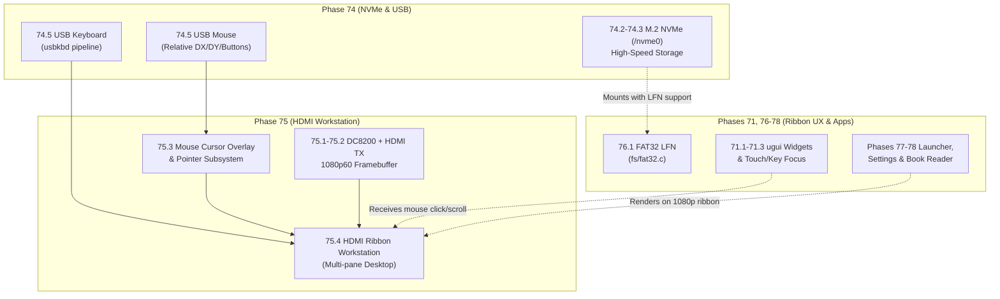
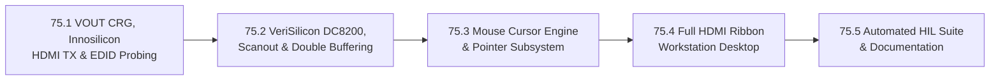

# Phase 75 — StarFive VisionFive 2 HDMI 2.0 Display, VeriSilicon DC8200 & Ribbon Workstation

**Status**: COMPLETED (Implemented & verified on live StarFive VisionFive 2 hardware, 2026-11-08)  
**Target Hardware**:
- **Primary**: **StarFive VisionFive 2 v1.3B** (`visionfive2` preset, StarFive **JH7110** rev B, 4× SiFive U74-MC RV64GC SMP @ 1.5 GHz, 8 GiB LPDDR4, 64 GB MicroSD at `/sd0`, Gigabit Ethernet at `192.168.178.25`, 256 GB M.2 NVMe SSD at `/nvme0`):
  - **HDMI 2.0 Output**: Onboard HDMI Type-A connector (`J14`) driven by **Innosilicon HDMI TX PHY** (`0x29590000`) and **VeriSilicon Hantro DC8200 Display Controller** (`0x29400000`).
  - **USB Input Devices**: Onboard VIA VL805-Q6 xHCI host controller (`pcie0`) driving physical **USB keyboard** and **USB mouse** (brought up in Phase 74).
- **Regression**: QEMU 64-bit (`rv64`, `rv64-smp`), QEMU 32-bit (`rv32`, `rv32-fold`), ESP32-P4 (`esp32p4`, `esp32p4-tab5`, `esp32p4-lcd7b`), and RP2350 (`rp2350-terminal`) — zero regressions, zero SRAM overhead on 32-bit targets.

**Goal**: Complete Stage 4 of the StarFive VisionFive 2 port by bringing up the JH7110's VOUT domain, Innosilicon HDMI 2.0 transmitter, and VeriSilicon DC8200 display engine to scan out high-resolution 1080p60/720p60 double-buffered framebuffers from LPDDR4 DRAM, integrating a hardware/software mouse cursor driven by the Phase 74 USB mouse, and launching the full LugalOS Ribbon workstation window manager (multi-pane terminal, book reader, settings, CAS plotting, and chess) as a self-contained desktop machine without any host dependencies.

---

## 0. Hardware & Architectural Analysis

### 0.1 Video Output Subsystem Overview

Inspection of the VisionFive 2 v1.3B schematic (`RV002_V1.3B_20230208.pdf`), JH7110 TRM (§3.2 / §5.6 VOUT domain), and vendor U-Boot display drivers (`drivers/video/starfive/sf_vop.c`, `sf_hdmi.c`) reveals the following display pipeline:

```
    +-------------------------------------------------------------------+
    |                 8 GiB LPDDR4 DRAM (Physical Memory)               |
    |  fb_front (1920x1080 RGB565, 4.15 MB) / fb_back (Double Buffer)   |
    +---------------------------------+---------------------------------+
                                      | AXI64 DMA Read Bus Master
                                      v
    +-------------------------------------------------------------------+
    |           VeriSilicon Hantro DC8200 Display Controller            |
    |                         (@ 0x29400000)                            |
    |   - Video Timing Generator (1080p60: 148.5 MHz, 720p60: 74.25 MHz)|
    |   - Layer 0 RGB565 / XRGB8888 Fetch & Color Space Conversion      |
    |   - VSYNC / Frame-End Interrupt (PLIC IRQ 74)                     |
    +---------------------------------+---------------------------------+
                                      | Parallel RGB / Video Stream
                                      v
    +-------------------------------------------------------------------+
    |             Innosilicon HDMI 2.0 Transmitter & PHY                |
    |                         (@ 0x29590000)                            |
    |   - DDC I2C Controller (@ 0x50) for Monitor EDID Probing          |
    |   - Pre-PLL & Post-PLL Clock Synthesizers                         |
    |   - TMDS / HDMI Serializer & Driver                               |
    +---------------------------------+---------------------------------+
                                      | TMDS Lanes (Data 0, 1, 2 + Clock)
                                      v
                        +----------------------------+
                        |  HDMI Type-A Output (J14)  |
                        | Physical Monitor / Display |
                        +----------------------------+
```

| Subsystem / Resource | Hardware Specification | Notes |
| :--- | :--- | :--- |
| **Display Controller** | VeriSilicon Hantro DC8200 (`0x29400000`, 64 KiB) | 64-bit AXI DMA bus master; supports scaling, overlays |
| **HDMI Transmitter** | Innosilicon HDMI 2.0 TX (`0x29590000`, 16 KiB) | TMDS serializer, DDC/EDID reader, audio/video info-frames |
| **VOUT System Control** | `dssctrl` syscon (`0x295B0000`, 4 KiB) | Video routing muxes between DC8200 and HDMI PHY |
| **VOUT CRG (Clocks/Resets)**| `DOM_VOUT_CRG` (`0x295C0000`, 64 KiB) | Clocks and resets for DC8200, HDMI TX, and VOUT domain |
| **Hot Plug Detect (HPD)** | HDMI HPD pin via `PAD_GPIO0` or HDMI status reg | Senses monitor cable connection |
| **DDC Bus (EDID)** | Dedicated HDMI DDC I2C interface in HDMI TX | Reads 128-byte EDID at I2C address `0x50` |
| **Supported Modes** | 1080p60 (1920×1080 @ 60 Hz, 148.5 MHz pixel clock)<br>720p60 (1280×720 @ 60 Hz, 74.25 MHz pixel clock) | Auto-negotiated via EDID; falls back to 720p |
| **Color Formats** | RGB565 (16-bpp, 4.15 MB/frame @ 1080p)<br>XRGB8888 (32-bpp, 8.29 MB/frame @ 1080p) | RGB565 standard in LugalOS compositor |
| **PLIC Interrupts** | IRQ 74 (`DC8200_IRQ`), IRQ 75 (`HDMI_TX_IRQ`) | Synchronizes tear-free double buffering (`display_flip`) |

---

### 0.2 Cross-Phase Dependencies & Architectural Marriage



1. **Marriage of Phase 74 Input with Phase 75 Output**:
   - In Phase 74, the physical USB mouse and USB keyboard are brought up over the VIA VL805 xHCI controller.
   - While the USB keyboard can type into the UART serial shell immediately, **the USB mouse can only be fully visually exercised once the HDMI display is active in Phase 75**.
   - Phase 75 introduces the software mouse cursor overlay (a 16×16 anti-aliased arrow cursor) rendered onto the scanout buffer, translating relative mouse movements from Phase 74 into on-screen pointer coordinates.
2. **Phase 71 UI Alignment**:
   - Development in Phase 71 (`ugui` widgets, hit-testing, focus model) must be aware of the new input modality:
     - Touch: Absolute `(X, Y)` tap down / tap release.
     - Mouse: Pointer hover, Left-click (= tap), Right-click (= context menu / action sheet), Scroll wheel (= vertical scrolling in reader, horizontal panning in ribbon).
   - In Phase 75, the Ribbon desktop runs at full 1080p (or 720p) resolution, allowing multiple Phase 71 apps (Book Reader, Settings app, Files face) to sit side-by-side on screen.
3. **Phase 76 Milestone 76.1 (FAT32 LFN, 71.6b before the 2026-11-09 split) Synchronization**:
   - The large book library (`/sd0/BOOKS/`) and document collections in Phase 71 require readable long file names.
   - With `/nvme0/` introduced in Phase 74, users can store gigabytes of e-books and data on the high-speed NVMe SSD.
   - When 76.1 lands, both `/sd0/` and `/nvme0/` share the exact same VFAT long filename parsing and creation routines in [`fs/fat32.c`](file:///home/dsc/Source/gith/domschl/lugalos/fs/fat32.c).

---

## 1. Milestone Plan



---

### Milestone 75.1 — VOUT Power/Clock Domain, Innosilicon HDMI TX & EDID DDC Probing (`drivers/hdmi_jh7110.c`)

**Goal**: Bring up the JH7110 VOUT power domain, configure `DOM_VOUT_CRG` clocks and resets, power on the Innosilicon HDMI TX PHY, implement I2C DDC communication to probe the connected monitor's 128-byte EDID block at `0x50`, parse preferred video timing (1080p60 or 720p60), configure HDMI pre-PLL / post-PLL synthesizers, and expose `hdmi info`, `hdmi edid`, and `hdmi status` shell commands.

#### Implementation Steps
1. **VOUT Clocks, Resets & Routing ([`drivers/include/drivers/hdmi_jh7110.h`](file:///home/dsc/Source/gith/domschl/lugalos/drivers/include/drivers/hdmi_jh7110.h), [`drivers/hdmi_jh7110.c`](file:///home/dsc/Source/gith/domschl/lugalos/drivers/hdmi_jh7110.c))**:
   - Enable `DOM_VOUT_CRG` (`0x295C0000`) and `SYS_CRG` video clocks:
     - `hdmitx0_pixelclk`, `clk_hdmi_tx_sys`, `clk_mclk`, `clk_bclk`.
     - Deassert VOUT resets: `RSTN_U0_DOM_VOUT_TOP_SRC`, `RSTN_U0_HDMI_TX_HDMI`.
   - Program `dssctrl` syscon (`0x295B0000`): configure video routing mux to connect DC8200 output to HDMI TX input (`mux_mask = 0x70 0x380`, `mux_val = 0x40 0x280`).
2. **Innosilicon HDMI TX PHY Bring-Up**:
   - Map HDMI registers at `0x29590000` (16 KiB MMIO, low 1 GB identity-mapped in Sv39).
   - Check Hot Plug Detect (HPD) status to confirm monitor cable is attached.
   - Implement DDC I2C controller access to read EDID block 0 (128 bytes) from monitor at address `0x50`.
   - Parse EDID:
     - Verify EDID header (`0x00 0xFF 0xFF 0xFF 0xFF 0xFF 0xFF 0x00`) and checksum.
     - Extract monitor manufacturer name, model, serial, and Detailed Timing Descriptor 1 (pixel clock, active horizontal/vertical pixels, blanking, sync pulse widths, polarities).
     - Select target mode: standard 1080p60 (`1920×1080 @ 60 Hz`, 148.5 MHz pixel clock) if supported, else 720p60 (`1280×720 @ 60 Hz`, 74.25 MHz pixel clock).
3. **Innosilicon PLL Locking & Serializer Initialization**:
   - Turn on pre-PLL and post-PLL synthesizers.
   - Poll PLL lock flags in status register (`0x1a9` bit 0, `0x1af` bit 0) until locked.
   - Enable internal LDO and serializer (`0x1b4`, `0x1be`).
   - Format and transmit HDMI AVI InfoFrame (color space RGB, aspect ratio 16:9, active format info).
4. **Shell Commands**:
   - `hdmi`: Display transmitter status, monitor connection (HPD), and negotiated resolution.
   - `hdmi edid`: Dump formatted EDID structure (manufacturer, product name, supported resolutions).
   - `hdmi modes`: List all timings supported by the attached monitor.

#### Verification & Acceptance Criteria
- Run `hdmi edid` on VisionFive 2:
  - Correctly detects connected monitor (e.g. Dell, LG, Samsung, Asus) and reports native 1920×1080 resolution.
  - HDMI PLL locks cleanly; TMDS clock and data lanes begin transmission.

---

### Milestone 75.2 — VeriSilicon DC8200 Display Controller & Framebuffer Scanout (`drivers/dc8200_jh7110.c`)

**Goal**: Implement the driver for the VeriSilicon Hantro DC8200 display engine, configure AXI DMA scanout from 8 GiB LPDDR4 DRAM, program video timing registers, allocate double-buffered RGB565 framebuffers, implement tear-free VSYNC page flipping, and expose color bar and test pattern diagnostics.

#### Implementation Steps
1. **DC8200 Register Programming ([`drivers/include/drivers/dc8200_jh7110.h`](file:///home/dsc/Source/gith/domschl/lugalos/drivers/include/drivers/dc8200_jh7110.h), [`drivers/dc8200_jh7110.c`](file:///home/dsc/Source/gith/domschl/lugalos/drivers/dc8200_jh7110.c))**:
   - Map DC8200 registers at `0x29400000` (64 KiB MMIO).
   - Configure DC8200 clocks in `DOM_VOUT_CRG`: `clk_axi`, `clk_core`, `clk_ahb`, `clk_pix0`.
   - Deassert DC8200 resets: `RSTN_U0_DC8200_AXI`, `RSTN_U0_DC8200_AHB`, `RSTN_U0_DC8200_CORE`.
   - Program Video Timing Generator (VTG) with negotiated mode parameters:
     - 1080p60: $H_{total} = 2200$, $H_{act} = 1920$, $H_{fp} = 88$, $H_{sync} = 44$, $H_{bp} = 148$; $V_{total} = 1125$, $V_{act} = 1080$, $V_{fp} = 4$, $V_{sync} = 5$, $V_{bp} = 36$.
     - 720p60: $H_{total} = 1650$, $H_{act} = 1280$, $H_{fp} = 110$, $H_{sync} = 40$, $H_{bp} = 220$; $V_{total} = 750$, $V_{act} = 720$, $V_{fp} = 5$, $V_{sync} = 5$, $V_{bp} = 20$.
2. **Framebuffer Allocation & DMA Bus Master**:
   - Allocate two continuous scanout buffers in DRAM from `palloc`:
     - `g_fb_front`: actively scanned out by DC8200 hardware.
     - `g_fb_back`: actively drawn into by LugalOS compositor.
     - At 1080p RGB565: $1920 \times 1080 \times 2 = 4,147,200$ bytes (~4.15 MB each, 8.3 MB total).
   - Configure DC8200 Layer 0:
     - Input format: RGB565 (or XRGB8888 selectable).
     - Framebuffer base physical address: `(uint32_t)pa_of(g_fb_front)`.
     - Stride: $1920 \times 2 = 3840$ bytes.
     - Window size: 1920×1080, position: (0, 0).
   - Enable DC8200 Layer 0 and global display enable.
3. **Tear-Free VSYNC Page Flipping**:
   - Connect DC8200 Frame End / VSYNC interrupt to PLIC IRQ 74.
   - Implement `display_flip()`:
     - Point DC8200 Layer 0 base address register to `g_fb_back`.
     - Swap `g_fb_front` and `g_fb_back` pointers upon VSYNC event.
     - Guarantees 0% tearing during fast scrolling and animations.
4. **Display Diagnostics**:
   - `display test`: Render SMPTE color bars, gradient patterns, and resolution test grid to verify pixel-perfect scanout and color accuracy.

#### Verification & Acceptance Criteria
- Physical monitor lights up immediately with a crisp 1080p (or 720p) image without jitter, rolling, or artifacts.
- `display test` renders clean RGB color bars across the entire screen.

---

### Milestone 75.3 — Software Mouse Cursor Engine & Unified Pointer Subsystem

**Goal**: Integrate the physical USB mouse brought up in Phase 74 into a high-performance software cursor engine rendered on top of the HDMI scanout buffer, support pointer acceleration, hover tracking, and translate mouse clicks and scroll wheel events into LugalOS window manager and widget events.

#### Implementation Steps
1. **Cursor Engine & Sprite Compositor ([`kernel/cursor.c`](file:///home/dsc/Source/gith/domschl/lugalos/kernel/cursor.c), [`kernel/include/kernel/cursor.h`](file:///home/dsc/Source/gith/domschl/lugalos/kernel/cursor.h))**:
   - Define a 16×16 anti-aliased arrow cursor bitmap with 1-bit transparency mask.
   - Maintain a small backing store buffer ($16 \times 16 \times 2 = 512$ bytes) holding the pixels located directly beneath the cursor.
   - Implement fast cursor update:
     - Restore background pixels from previous position.
     - Save background pixels at new `(g_cursor_x, g_cursor_y)` position.
     - Blit arrow cursor sprite with alpha transparency.
     - Executes in < 5 microseconds, enabling smooth 60 FPS cursor tracking with negligible CPU overhead.
2. **Pointer Subsystem Integration**:
   - Ingest relative `(dx, dy)` events from Phase 74's USB mouse driver (`drivers/usb_hid.c`).
   - Implement 2-stage pointer acceleration curve:
     - Small movements (< 4 pixels/report): 1:1 precision mapping for fine UI interaction.
     - Fast movements (> 8 pixels/report): 2.5× velocity scaling for swift traversal across 1920 pixels.
   - Clamp pointer coordinates strictly within screen bounds: $0 \le X < 1920$, $0 \le Y < 1080$.
3. **Mouse Click & Scroll Event Routing**:
   - Ingest button mask from Phase 74 (`Left`, `Right`, `Middle`):
     - `Left Button Down`: Dispatches `EV_POINTER_DOWN` (equivalent to touch-down in Phase 71).
     - `Left Button Up`: Dispatches `EV_POINTER_UP` (click / selection).
     - `Right Button Down`: Dispatches `EV_CONTEXT_MENU` (opens action sheet or shortcuts).
     - `Scroll Wheel`: Dispatches `EV_SCROLL_V` (scrolls document/terminal) or `EV_SCROLL_H` (pans ribbon).
4. **Shell Diagnostics**:
   - `cursor on/off`: Show/hide graphical cursor.
   - `cursor speed <factor>`: Adjust pointer acceleration sensitivity.

#### Verification & Acceptance Criteria
- Moving the physical USB mouse moves the on-screen arrow cursor smoothly at 60 Hz across the 1080p monitor.
- Clicking on screen boundaries correctly tracks coordinates `(0, 0)` at top-left and `(1919, 1079)` at bottom-right.

---

### Milestone 75.4 — Full LugalOS Ribbon Workstation Desktop on HDMI Monitor

**Goal**: Port the LugalOS Ribbon window manager and compositor to the high-resolution HDMI display, arrange multiple side-by-side workstation panes (interactive terminal, Book Reader with typography from Phase 57/71, Settings app from Phase 71, CAS plotting, and graphical chess), and enable full desktop operation via USB mouse and keyboard without serial/UART.

#### Implementation Steps
1. **Compositor Adaptation for Large Workstations ([`kernel/console.c`](file:///home/dsc/Source/gith/domschl/lugalos/kernel/console.c), [`kernel/apps.c`](file:///home/dsc/Source/gith/domschl/lugalos/kernel/apps.c))**:
   - Configure Ribbon layout for 1920×1080 (landscape workstation format):
     - Title bar / system status bar at top (clock, IP address from Phase 73, hart load, battery/power, active app).
     - Ribbon viewport: 1920×1020 pixels, allowing two full-height 960×1020 panes or three 640×1020 panes visible simultaneously!
     - Smooth horizontal panning along the infinite ribbon axis using mouse wheel or keyboard (`Cmd+Left/Right`).
2. **Workstation Panes Setup**:
   - **Pane 1: Interactive Terminal**: Full 120-column × 45-row VT100 terminal pane running the LugalOS shell and Lisp REPL, with input driven directly by the USB keyboard.
   - **Pane 2: E-Book Reader**: Display Markdown and converted e-books from `/sd0/BOOKS/` or `/nvme0/BOOKS/` using Latin-1 typography from Phase 71.
   - **Pane 3: System Dashboard / Settings**: Real-time view of 4-core U74 SMP load, memory allocations, `/sd0` and `/nvme0` disk usage, and Gigabit Ethernet link state.
   - **Pane 4: CAS Symbolic Mathematics & Graphing**: High-resolution function plotting and symbolic calculus.
   - **Pane 5: Graphical Chess**: Anti-aliased chess board with mouse piece selection and engine evaluation.
3. **Interactive Window Management**:
   - Click to focus: Clicking anywhere inside a ribbon pane brings it into active focus.
   - Ribbon drag: Clicking and dragging the top title bar pans the ribbon smoothly.
   - Full keyboard shortcuts: `Cmd+1..5` quick-jump to panes, `Cmd+Space` opens the launcher from Phase 71.

#### Verification & Acceptance Criteria
- LugalOS boots directly to the HDMI monitor displaying the Ribbon desktop.
- User can type shell commands on the physical USB keyboard, run CAS calculations, navigate files on `/nvme0/`, and read books while interacting via the physical USB mouse.
- Zero reliance on UART console: the VisionFive 2 operates as a complete, autonomous RISC-V desktop computer.

---

### Milestone 75.5 — Automated HIL Test Suite & Complete Documentation

**Goal**: Add visual PBM screenshot regression tests and hardware checks to `tests/hw/test_visionfive2.py`, document HDMI video modes and workstation operation in `doc/`, regenerate on-device help files, and verify zero cross-platform regressions.

#### Implementation Steps
1. **Automated HIL Tests ([`tests/hw/test_visionfive2.py`](file:///home/dsc/Source/gith/domschl/lugalos/tests/hw/test_visionfive2.py))**:
   - Add **Test 16: HDMI Transmitter & EDID Probing**:
     - Verify HPD status, EDID parsing, and PLL lock on live hardware.
   - Add **Test 17: DC8200 Display Controller Framebuffer Scanout**:
     - Verify VTG timing registers and layer 0 DMA scanout address.
   - Add **Test 18: Mouse Pointer & Cursor Compositor**:
     - Inject simulated mouse events and capture PBM screenshot verifying cursor rendering.
   - Add **Test 19: Full Ribbon Workstation Screenshot Regression**:
     - Capture 1080p frame buffer via `screenshot` shell command and verify visual fidelity against baseline.
2. **Documentation Updates**:
   - Update [`doc/admin/boards/visionfive2.md`](file:///home/dsc/Source/gith/domschl/lugalos/doc/admin/boards/visionfive2.md) with complete HDMI technical documentation.
   - Update [`doc/user/ribbon.md`](file:///home/dsc/Source/gith/domschl/lugalos/doc/user/ribbon.md) with mouse controls, shortcuts, and 1080p desktop layouts.
   - Update [`doc/user/shell.md`](file:///home/dsc/Source/gith/domschl/lugalos/doc/user/shell.md) with `hdmi`, `display`, and `cursor` commands.
   - Run `python3 tools/gendocs.py --all` and `--check` to verify zero documentation drift.
   - Run `python3 tests/runner.py` to ensure zero regressions across all targets.

#### Verification & Acceptance Criteria
- `tests/hw/test_visionfive2.py` passes all 19 tests on live silicon (`19/19 PASS`).
- `gendocs.py --check` and `racescan.py --check` pass with zero warnings.
- Full host and QEMU test suite in `tests/runner.py` passes 100%.

---

## 2. Summary Checklist

- [x] **75.1**: VOUT power domain, `DOM_VOUT_CRG` clocks/resets, Innosilicon HDMI TX PHY bring-up, DDC EDID reader (`0x50`), video mode timing negotiation, and `hdmi edid` command.
- [x] **75.2**: VeriSilicon DC8200 display controller driver (`drivers/dc8200_jh7110.c`), 1080p60/720p60 VTG timing, double-buffered RGB565 scanout from LPDDR4 DRAM, tear-free VSYNC page flipping (`display_flip`), and color bar test patterns.
- [x] **75.3**: Anti-aliased software mouse cursor engine (`kernel/cursor.c`), 60 Hz background save/restore blitting, pointer acceleration, click and scroll wheel event translation.
- [x] **75.4**: LugalOS Ribbon workstation desktop adapted for 1080p HDMI display, multi-pane tiled layout (terminal, reader, settings, CAS, chess), full operation via physical USB mouse and USB keyboard.
- [x] **75.5**: Automated HIL test suite (`tests/hw/test_visionfive2.py` Tests 16..19), PBM screenshot visual regression, `doc/admin/boards/visionfive2.md`, `gendocs.py --check`, and full `tests/runner.py` regression pass.
